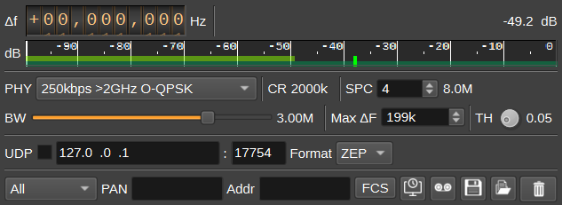
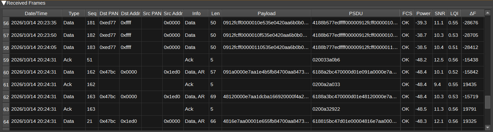

<h1>IEEE 802.15.4 demodulator plugin</h1>

<h2>Introduction</h2>

This plugin can be used to demodulate IEEE 802.15.4 frames. The 802.15.4 PHY & MAC layers are used by networking protocols such as ZigBee, Thread, 6LoWPAN, WirelessHART and others.

The demodulator supports the same PHYs as the [802.15.4 modulator](../../channeltx/mod802.15.4/readme.md): the BPSK PHYs (clause 13 of IEEE 802.15.4-2015) and the O-QPSK PHYs (clause 12), including the 2.4GHz O-QPSK PHY used by ZigBee and Thread.

Received frames are displayed in a table, with the MAC header decoded. Frames can be forwarded via UDP, either as raw MAC frames or encapsulated in ZEP (ZigBee Encapsulation Protocol), which Wireshark can decode, or logged to a .csv or .pcap file.

<h2>Receiver</h2>

All supported PHYs use DSSS (Direct Sequence Spread Spectrum), where each symbol (4 bits for O-QPSK, 1 bit for BPSK) is transmitted as a sequence of 32, 16 or 15 chips.

The frequency tolerance of 802.15.4 devices is +/-40ppm, so two devices can be up to 80ppm apart: around +/-200kHz at 2.4GHz and +/-70kHz at 868/915MHz. The demodulator handles this, as well as clock offsets of 80ppm.

When tested with the 802.15.4 modulator over a simulated AWGN channel with a frequency offset of 40ppm and clock offset of 20ppm, the packet error rate for a 20 octet PSDU (as used for the receiver sensitivity definition in 10.1.7 of the specification) was 1% at approximately the following Eb/N0:

PHY                         | Both lanes | Coherent lane only | Non-coherent lane only
----------------------------|------------|--------------------|-----------------------
20kbps BPSK                 | 9dB        | 9.5dB              | 9.5dB
40kbps BPSK                 | 9.5dB      | 9.5dB              | 10dB
100kbps <1GHz O-QPSK        | 6.5dB      | 7dB                | 8dB
250kbps <1GHz O-QPSK (Sine) | 7dB        | 7dB                | 8dB
250kbps <1GHz O-QPSK (RC)   | 6dB        | 6.5dB              | 7.5dB
250kbps >2GHz O-QPSK        | 7dB        | 7dB                | 7dB

These were measured with 200 frames per 1dB step of Eb/N0, so are approximate.

<h2>Interface</h2>

The top and bottom bars of the channel window are described [here](../../../sdrgui/channel/readme.md)

<h3>1: Frequency shift from center frequency of reception</h3>

Use the wheels to adjust the frequency shift in Hz from the center frequency of reception. Left click on a digit sets the cursor position at this digit. Right click on a digit sets all digits on the right to zero. This effectively floors value at the digit position. Wheels are moved with the mousewheel while pointing at the wheel or by selecting the wheel with the left mouse click and using the keyboard arrows. Pressing shift simultaneously moves digit by 5 and pressing control moves it by 2.

<h3>2: Channel power</h3>

Average total power in dB relative to a +/- 1.0 amplitude signal received in the pass band.

<h3>3: Level meter in dB</h3>

  - top bar (green): average value
  - bottom bar (blue green): instantaneous peak value
  - tip vertical bar (bright green): peak hold value

<h3>4: PHY</h3>

Specifies the PHY (physical layer), which determines the bit rate, modulation and spreading. Each PHY is applicable only to specific frequency bands, as detailed below:

Channel Page | Channels | Frequencies (MHz)  | PHY                         | Bit rate (kbps) | Chip rate (kcps) | Modulation | Shaping
-------------|----------|--------------------|-----------------------------|-----------------|------------------|------------|---------
0            | 0        | 868.3              | 20kbps BPSK                 | 20              | 300              | BPSK       | RC r=1
0            | 1-10     | 906, 908... 924    | 40kbps BPSK                 | 40              | 600              | BPSK       | RC r=1
0            | 11-26    | 2405, 2410... 2480 | 250kbps >2GHz O-QPSK        | 250             | 2000             | O-QPSK     | Sine
2            | 0        | 868.3              | 100kbps <1GHz O-QPSK        | 100             | 400              | O-QPSK     | Sine
2            | 1-10     | 906, 908... 924    | 250kbps <1GHz O-QPSK (Sine) | 250             | 1000             | O-QPSK     | Sine
5            | 0-3      | 780, 782... 786    | 250kbps <1GHz O-QPSK (RC)   | 250             | 1000             | O-QPSK     | RC r=0.8
11           | 0-13     | 2363... 2397       | 250kbps >2GHz O-QPSK        | 250             | 2000             | O-QPSK     | Sine

Changing the PHY sets the RF bandwidth (7) and maximum frequency offset (8) to default values for the PHY.

<h3>5: CR - Chip rate</h3>

Displays the chip rate for the selected PHY.

<h3>6: SPC - Samples per chip</h3>

The number of samples per chip the demodulator works at. The channel sample rate, which is displayed to the right, is the chip rate multiplied by this value.
4 is a good choice. 2 gives a small loss of sensitivity, but halves the CPU usage. Larger values use more CPU without any real benefit.

The device's sample rate needs to be at least the RF bandwidth, but doesn't need to be a multiple of the chip rate, as the signal is resampled.
So for the 2.4GHz PHY, a device sample rate of 4MSa/s or more is suitable. When the device sample rate is lower than the RF bandwidth, the RF bandwidth value will be displayed with a red background.

<h3>7: BW - RF Bandwidth</h3>

Specifies the bandwidth of the channel filter applied to the received signal.

<h3>8: Max ΔF - Maximum frequency offset</h3>

The maximum carrier frequency offset in kHz to search for when acquiring a frame. The default is 80ppm of the highest frequency the PHY is used at.
If the frequency offset of the transmitter is known to be smaller (E.g. after adjusting the channel frequency (1) by the ΔF displayed in the table), reducing this slightly reduces the CPU used per preamble detection.

<h3>9: TH - Detection threshold</h3>

Sets the threshold for detecting a preamble. Lower values allow weaker signals to be detected, but increase the number of false detections, each of which uses some CPU while the preamble is verified.
The default is 0.05.

<h3>10: UDP</h3>

When checked, received frames are forwarded to the specified UDP address (11) and port (12).

<h3>11: UDP address</h3>

IP address of the host to forward received frames to via UDP.

<h3>12: UDP port</h3>

UDP port number to forward received frames to.

<h3>13: UDP format</h3>

The format frames are forwarded in via UDP:

* ZEP - Frames are encapsulated using ZigBee Encapsulation Protocol v2, which includes the channel number, LQI and a timestamp. Wireshark decodes ZEP on UDP port 17754.
* Raw - The MAC frame (PSDU), including the FCS.

To view frames in Wireshark, set the UDP format to ZEP and the port to 17754, and capture on the loopback interface (which on Windows requires Npcap's loopback adapter). For ZigBee networks, you may need to enter the network key in Wireshark's ZigBee protocol preferences, to decrypt the NWK layer.

<h3>14: Frame type filter</h3>

Display only frames of the selected type in the table (Beacon, Data, Ack, Command or Other).

<h3>15: PAN - PAN ID filter</h3>

Entering a regular expression displays only frames where the source or destination PAN ID matches. PAN IDs are displayed as 0x followed by 4 hex digits. E.g. 0x1a62.

<h3>16: Addr - Address filter</h3>

Entering a regular expression displays only frames where the source or destination address matches. Short addresses are displayed as 0x followed by 4 hex digits.
Extended addresses are displayed as 8 colon separated bytes, most significant byte first. E.g. 00:12:4b:00:01:02:03:04.

<h3>17: FCS - Show frames with invalid FCS</h3>

When checked, frames with an invalid FCS (Frame Check Sequence - a CRC) are displayed in the table in red, logged and forwarded via UDP. When unchecked, only frames with a valid FCS are.

<h3>18: Use Date and Time from File</h3>

When checked, if the source device is a File Input device, the date and time used for frame reception time is taken from the file playback time. Otherwise, the current system clock time is used.

<h3>19: Start/stop Logging Frames to File</h3>

When checked, writes all received frames to a file. If the filename has a .pcap extension, frames are written in PCAP format (with link type 195, IEEE 802.15.4 with FCS), which can be opened in Wireshark. Otherwise, a .csv file is written.

<h3>20: Log Filename</h3>

Click to specify the name of the file which received frames are logged to.

<h3>21: Read Data from .csv File</h3>

Click to specify a previously written .csv log file, which is read and used to update the table.

<h3>22: Clear Frames from table</h3>

Pressing this button clears all frames from the table.

<h3>Received Frames Table</h3>

The received frames table displays information about each frame received.

* Date/Time - The date and time the frame was received.
* Type - MAC frame type: Beacon, Data, Ack, Command, Multipurpose, Fragment or Extended.
* Seq - Sequence number.
* Dst PAN - Destination PAN ID.
* Dst Addr - Destination address.
* Src PAN - Source PAN ID.
* Src Addr - Source address.
* Info - Command name, security level, acknowledgement request (AR), frame pending (FP), frame version and information elements.
* Len - Length of the PSDU (MAC frame) in bytes, including the FCS.
* Payload - MAC payload as hex. This is encrypted if security is enabled.
* PSDU - The complete MAC frame as hex, including the FCS.
* FCS - Whether the FCS is valid.
* Power - Received power during the frame in dB.
* SNR - Estimated symbol signal to noise ratio (Es/N0) in dB, after despreading. Eb/N0 is 6dB less for the O-QPSK PHYs.
* LQI - Link quality indicator. The mean normalised correlation of the received symbols, from 0 to 1.
* ΔF - Estimated carrier frequency offset in Hz.

Right clicking on the table header allows you to select which columns to show. The columns can be reordered by left clicking and dragging the column header. Right clicking on an item in the table allows you to copy the value to the clipboard.

<h3>Waveforms</h3>

The waveforms display shows signals within the demodulator, which may be useful for debugging. The available signals are:

* IQ - The received signal, at the channel sample rate.
* MagSq - Magnitude squared of the received signal.
* Detect - Preamble detection metric, compared against the threshold (9).
* Correlation - Normalised correlation of the most recently decoded symbol.
* Chip - Phase corrected soft value of the last chip of the most recently decoded symbol.
* Phase - Tracked carrier phase / pi.
* State - 0 for searching, 1 for acquiring and 2 for receiving a frame.
* FCS - 1 after a frame with a valid FCS is received, -1 after a frame with an invalid FCS.

<h2>API</h2>

Full details of the API can be found in the Swagger documentation. Below are a few examples:

To set the PHY to 20kbps BPSK:

    curl -X PATCH "http://127.0.0.1:8091/sdrangel/deviceset/0/channel/0/settings" -d '{"channelType": "IEEE_802_15_4_Demod", "direction": 0, "IEEE_802_15_4_DemodSettings": { "phy": "20kbps BPSK" }}'

To forward frames to Wireshark via ZEP:

    curl -X PATCH "http://127.0.0.1:8091/sdrangel/deviceset/0/channel/0/settings" -d '{"channelType": "IEEE_802_15_4_Demod", "direction": 0, "IEEE_802_15_4_DemodSettings": { "udpEnabled": 1, "udpAddress": "127.0.0.1", "udpPort": 17754, "udpFormat": 0 }}'

To get the number of frames received:

    curl -X GET "http://127.0.0.1:8091/sdrangel/deviceset/0/channel/0/report"
