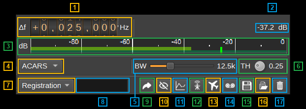
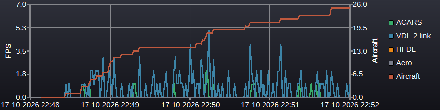
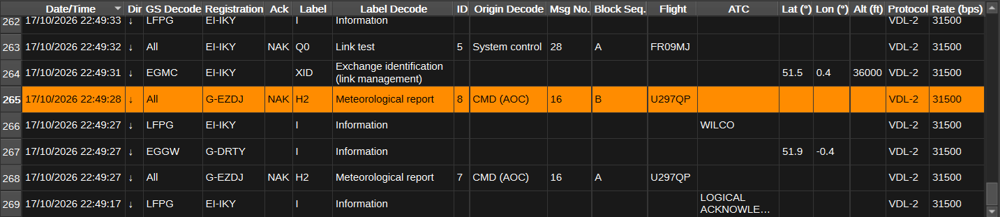
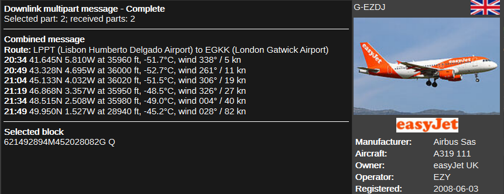

<h1>ACARS demodulator plugin</h1>

<h2>Introduction</h2>

This plugin can be used to demodulate ACARS, VDL-2, HFDL, Aero and Iridium data packets, broadcast to and from aircraft.
These packets can contain flight plans and other operational data as well as status information about the aircraft.

ACARS uses MSK modulation at 2,400 baud, which is then AM modulated on to the VHF carrier.
In Europe, the main ACARS frequencies are:

  - 131.525 MHz (SITA - Europe secondary) 
  - 131.725 MHz (SITA - Europe primary)
  - 131.825 MHz (ARINC/Collins)
 
VDL Mode 2 uses D8PSK modulation at 10,500 baud (bit rate 31,500 bps). It can contain ACARS or ATN packets.
VDL Mode 2 frequencies in Europe are:

  - 136.675 MHz (ARINC)
  - 136.725 MHz (ARINC)
  - 136.775 MHz (SITA)
  - 136.800 MHz
  - 136.825 MHz (ARINC)
  - 136.875 MHz (SITA)
  - 136.900 MHz
  - 136.975 MHz (SITA & ARINC, the common signalling channel)

HFDL uses M-PSK at 1,800 baud and frequencies are between 2 and 21 MHz. The active frequencies vary with propagation, and the 
frequencies in use are reported in squitters transmitted by the ground stations. These are combined by the demodulator and
displayed in the Ground Station Table dialog. You can find an initial frequency to try on: https://hfdl.observer/

Inmarsat Classic Aero (aviation SATCOM) uses MSK at 600 and 1,200 bps and OQPSK at 10,500 bps. The ground station to aircraft
(P channel) uplink is in L band around:

| Region              | Id    | Satellite				  | Longitude | G->A Frequency   |
|---------------------|-------|---------------------------|-----------|------------------|
| Atlantic Ocean West | AOR-W | Inmarsat 4-F3             | 98W       |                  |
| Atlantic Ocean East | AOR-E | Inmarsat 3-F5             | 54W       | ~1,545 MHz       |
| Pacific Ocean       | POR   | Inmarsat 4-F1             | 178E      |                  |
| Indian Ocean        | IOR   | Inmarsat 4A-F4 / Alphasat | 25E       |                  |

Unlike the other modes, which are continuous narrowband channels, Iridium is burst TDMA from
satellites in low earth orbit: DQPSK at 25 kBd in bursts of about 8.3 ms within a 90 ms frame.
Channels are spaced 41.67 kHz apart.

| Channel                  | Frequency        | Carries                                                |
|--------------------------|------------------|--------------------------------------------------------|
| Ring alert               | 1,626.270833 MHz | Satellite position and paging - always transmitting    |
| Duplex traffic           | 1,616 - 1,626 MHz| Short burst data, which is what carries ACARS          |

Iridium does not tune a single channel like the other modes. A duplex channel is assigned when a call is set up, out of
about 240 spaced 41.67 kHz, so watching one channel sees only a few percent of the traffic. Instead the
whole tuned width is split by a polyphase channelizer and a burst receiver run on every output. The width is chosen with
the combo box next to the Mode selector:

| Scan width | Channels | Sample rate | Covers                                    |
|------------|----------|-------------|-------------------------------------------|
| 1 MHz      | 32       | 1 MS/s      | part of the band                          |
| 2 MHz      | 64       | 2 MS/s      | part of the band                          |
| 4 MHz      | 128      | 4 MS/s      | about half the band                       |
| 8 MHz      | 256      | 8 MS/s      | all of it, tuned to 1623 MHz              |

<h2>Interface</h2>

<h3>1: Frequency shift from center frequency of reception</h3>

Use the wheels to adjust the frequency shift in Hz from the center frequency of reception. Left click on a digit sets the cursor position at this digit. Right click on a digit sets all digits on the right to zero. This effectively floors value at the digit position. Wheels are moved with the mousewheel while pointing at the wheel or by selecting the wheel with the left mouse click and using the keyboard arrows. Pressing shift simultaneously moves digit by 5 and pressing control moves it by 2.

<h3>2: Channel power</h3>

Average total power in dB relative to a +/- 1.0 amplitude signal received in the pass band.

<h3>3: Level meter in dB</h3>

  - top bar (green): average value
  - bottom bar (blue green): instantaneous peak value
  - tip vertical bar (bright green): peak hold value

<h3>4: Mode and Aero rate</h3>

Selects the demodulator: ACARS, VDL-2, HFDL, Aero or Iridium - and, in Aero mode
only, the rate and channel selector appears beside it. 

Changing either resets the demodulator and sets a default RF bandwidth.
Each demodulator runs at its own fixed channel sample rate, which the channelizer is
set to when the mode is selected.

| Mode             | Sample rate | Symbol rate |Samples per symbol|
|------------------|-------------|-------------|------------------|
| ACARS            | 48 kS/s     | 2,400 Bd    | 20               |
| VDL-2            | 105 kS/s    | 10,500 Bd   | 10               |
| HFDL             | 7.2 kS/s    | 1,800 Bd    | 4                |
| Aero, 600 bps    | 19.2 kS/s   | 600 Bd      | 32               |
| Aero, 1,200 bps  | 19.2 kS/s   | 1,200 Bd    | 16               |
| Aero, 10,500 bps | 105 kS/s    | 5,250 Bd    | 20               |
| Iridium          | 1-8 MS/s    | 25,000 Bd   | 5                |

<h3>5: RF Bandwidth</h3>

This specifies the bandwidth of a LPF that is applied to the input signal to limit the RF bandwidth. 
A default value is automatically set when selecting the Mode, and in Aero mode the rate
and channel, from the combo boxes (4):

| Mode  | Rate                 | Default RF bandwidth |
|-------|----------------------|----------------------|
| ACARS | 2,400 bps            | 12.5 kHz             |
| VDL-2 | 31,500 bps           | 25.0 kHz             |
| HFDL  | 300 - 1,800 bps      | 3.0 kHz              |
| Aero  | 600 bps, P, R or T   | 1.2 kHz              |
| Aero  | 1,200 bps, P, R or T | 2.4 kHz              |
| Aero  | 10,500 bps P         | 13.1 kHz             |
| Iridium | 25,000 Bd          | not used (see above) |

<h3>6: Threshold</h3>

ARACS pre-key (preamble) detection threshold, as a fraction from 0 to 1. The statistic it is compared against
is the depth of 2,400 Hz modulation on the envelope. A real pre-key
reads about 0.85 and noise reads near zero, so the default of 0.25 sits between them and is
a false alarm setting rather than something to tune per station. Lower it only if
transmissions are being missed entirely.

<h3>7: Filter field</h3>

Selects which column of the messages table the filter applies to: Registration, Flight, Label or Message.

<h3>8: Filter pattern</h3>

Entering a regular expression displays only messages where the selected column matches it. Clear the field to show all messages.

<h3>9: UDP</h3>

When checked, received packets are forwarded over UDP. Right click the button for the
destination address and port; the button's tooltip shows where they are being sent.

<h3>10: Hide frames with no information</h3>

Some frames carry nothing a listener can use - no aircraft is named and no message is
carried - and on a busy channel they are the majority of what is received. This button
hides them, and is checked by default. Uncheck it to see everything that has been
received.

In **Aero**, these are the satellite housekeeping the ground earth station broadcasts
continuously, whether or not any aircraft is logged on: the system tables that describe
the satellite, its beams and its channels.

In **VDL-2**, these are the supervisory and link management responses - `RR`, `RNR`,
`REJ`, `SREJ`, `DM`, `DISC`, `UA`, `FRMR` and `U`.

<h3>11: Display Chart</h3>

When checked, displays a chart plotting the number of frames received per second for each mode. See below.

<h3>12: Display Ground Station Table</h3>

When checked, displays a table of the ground stations heard in squitters and the frequencies each announced as in use.
Right clicking a row offers finding that station on the Map, or retuning the device so this channel receives that frequency.

<h3>13: Download Aircraft Database</h3>

Click to download an aircraft database (45MB - same database as used by ADS-B demodulator).

This contains information such as the aircraft type, that will be displayed under the aircraft's image.
It also allows matching 24-bit ICAO addresses to registrations, for VDL-2, HFDL and Aero.

<h3>14: Start/stop Logging ACARS packets to .csv File</h3>

When checked, writes all received ACARS packets to a .csv file.

<h3>15: .csv Log Filename</h3>

Click to specify the name of the .csv file which received ACARS packets are logged to.

<h3>16: Read Data from .csv File</h3>

Click to specify a previously written ACARS .csv log file, which is read and used to update the ACARS messages table.

<h3>17: Clear Messages from table</h3>

Pressing this button clears all messages from the table.

<h3>Frames per Second Chart</h3>

  - **ACARS** - ACARS messages, from whichever mode is selected (4). A message carried over
    VDL-2, HFDL, Aero or Iridium counts here, not under its mode.
  - **VDL-2 link** - AVLC link frames that are not ACARS: XID and GSIF link management, and
    supervisory acknowledgements whether or not they are displayed in the table.
  - **HFDL** - squitters and logons.
  - **Aero** - log-ons, log-offs, channel assignments and acknowledgements.

Clicking a legend entry shows or hides that series; right clicking the chart button clears the data.
The mouse wheel zooms the time axis, or the rate axis with shift held, centred on the
cursor; dragging with the left button pans. The time axis follows the newest data whenever
its right edge is at the latest point. Data more than 10 minutes old is averaged over one
minute intervals, so long sessions do not accumulate an excessive number of points.

<h3>Received Messages Table</h3>

The received messages table displays the contents of the ACARS packets that have been received.

<h3>Message Decode</h3>

The decode field displays a decode of the ACARS message selected in the received messages table.
For multipart messages it shows the assembly status, the combined message - decoded once all
parts have arrived - and the selected block.

* Date/Time - The receiver's local date and time when the ACARS message was received, or the recorded date and time when reading a CSV log. Right click the table to choose between showing the date and time or the time alone; the column sorts by the full date and time either way.
* Dir - The transmission direction. An up arrow is an uplink from a ground station to an aircraft; a down arrow is a downlink from an aircraft to a ground station.
* GS - Ground Station Id. ACARS: ARINC 618 Mode character. VDL-2: Ground Station (GS). HFDL: Ground Station (GS). Aero: Ground Earth Station (GES).
* GS Decode - Ground Station name. Right clicking either ground station column offers *Find on map*, which draws that station on the Map as a fixed antenna and centres on it. Only HFDL and VDL-2 stations have a known position - HFDL's comes from the system table and VDL-2's from the community ground station list - so the action is absent for an ACARS Mode character, which names no station, and for an Aero GES id, which resolves only to a satellite and an ocean region.
* Registration - The aircraft address or registration from the seven-character ACARS header field, with leading padding periods removed.
* Ack - The technical acknowledgement field. It is displayed as `ACK`, `NAK`, or the block ID to which the acknowledgement applies.
* Label - The two-character message label identifying the message type. When present, a sublabel is appended after a slash, for example `H1/CF`.
* Label Decode - A human-readable description of the message label or sublabel.
* ID - The block identifier used for message sequencing and acknowledgement. Downlinks normally use `0`-`9`, while uplinks normally use `A`-`Z`.
* Origin - For downlinks, the one-character originator code identifying the aircraft system or terminal that generated the message.
* Origin Decode - The decoded name of the downlink originator, such as FMC, CMU, TCAS, or a cabin terminal.
* Msg No. - For downlinks, the two-digit message number in the message text header.
* Block Seq. - For multipart downlinks, the block sequence character used to order the blocks.
* Flight - For downlinks, the six-character flight identifier carried in the message text header.
* Message - The ACARS message payload after the standard downlink header fields and any recognized sublabel have been removed.
* Message Decode - A structured, human-readable decode of the message payload. 
  Selecting the row displays the full multi-line
  decode below the table.
* ATC - Air Traffic Control communication extracted from supported ARINC 622/CPDLC messages.
* Lat (°) - Aircraft latitude extracted from an ADS-C or CPDLC position report or any decoded message carrying a position (position report labels, OOOI events, FST01 flight status, H1 FMS reports), in decimal degrees; north is positive and south is negative.
* Lon (°) - Aircraft longitude extracted from the same sources, in decimal degrees; east is positive and west is negative.
* Alt (ft) - Aircraft altitude extracted from an ADS-C or CPDLC position report, in feet.
* Hex - The complete received ACARS frame rendered as hexadecimal bytes, including its framing, header, payload, check sequence, and terminating byte.
* Protocol - Which link the frame arrived on: `ACARS`, `VDL-2`, `HFDL`, or `Aero` followed by the channel it came on - `Aero P`, `Aero R` or `Aero T`.
* Rate (bps) - The bit rate the frame was sent at: 2400 for ACARS, 31500 for VDL-2, 300 to 1800 for HFDL and 600, 1200 or 10500 for Aero.

<h3>VDL-2 Link Frames</h3>

In VDL-2 mode, ACARS messages carried over AVLC fill the table exactly as described above.
AVLC frames that do not carry an ACARS message (ATN data, XID/GSIF link management, and supervisory acknowledgements)
have no ACARS header, so only the following columns are used:

* Date/Time - The receiver's local date and time when the frame was received.
* Dir - The transmission direction. An up arrow is an uplink to an aircraft; a down arrow is a downlink from an aircraft.
* GS - Ground Station Id. 
* GS Decode - Ground Station name.
* Registration - The aircraft side of the link. VDL-2 link frames identify aircraft by their 24-bit ICAO address (the same address the aircraft transmits in Mode S / ADS-B) rather than by registration, so the registration is looked up from the OpenSky database (14); when the address is not in the database, the address itself is shown in hexadecimal. Frames between ground stations show `GS` followed by the ground station's address, and broadcasts show `All`.
* Label - The AVLC frame type: `I` (information), `UI`, `XID` (link management, including GSIF ground station broadcasts), `TEST`, or the supervisory types `RR`, `RNR`, `REJ`, `SREJ`, `DM`, `DISC`, `UA`, `FRMR`.
* Label Decode - What the frame type means, for example `Information`, `Exchange identification (link management)`, `Receive ready` or `Selective reject - retransmit this frame`.
* Message - The source and destination addresses of the frame, followed for information frames by the decoded protocol stack, layer by layer, for example `X.25 DATA > CLNP > COTP DT > CPDLC`, and for XID frames by the message type, for example `XID: Handoff Initiation` or `XID: Ground Station Information Frame`. X.25 call setup, clear and supervisory packets, ES-IS and IDRP routing traffic are identified by name.
* Message Decode - For information frames carrying an ICAO ATN application, the full decode of the CM (context management logon), CPDLC or ADS-C version 2 message. For XID frames, the decoded public and VDL-specific link parameters: connection management, XID sequencing, frequency support, ground station location, destination airport, ATN router NETs and so on. Multi-line decodes are flattened with semicolons; hover over the cell (or select the row) for the original multi-line form.
* ATC - For frames carrying a CPDLC controller-pilot message, the expanded message elements and their arguments, for example `WILCO` or `REQUEST [level], Flight level: 370` - the ATN equivalent of the DO-219 expansion shown for ACARS ATC messages.
* Lat (°) / Lon (°) - The position from an XID aircraft or ground station location parameter, or from an ADS-C version 2 report, in decimal degrees. The XID encoding is coarse (0.1 degrees, roughly 10 km); ADS-C positions are precise.
* Alt (ft) - The altitude from an XID aircraft location parameter (1000 ft resolution) or an ADS-C version 2 report, in feet.
* Hex - The complete AVLC frame rendered as hexadecimal bytes: address fields, link control, information field and frame check sequence.

<h3>HFDL Frames</h3>

HFDL frames that are not carrying an ACARS message use the same columns as the VDL-2 link frames. 

<h3>Aero Signal Units</h3>

In Aero mode, ACARS messages carried over the satellite link are as described above. Signal
units that are not carrying an ACARS message use only the following columns:

* Date/Time - The receiver's local date and time when the signal unit was received.
* Dir - The transmission direction. An up arrow is a transmission from the ground earth
  station on a P channel; a down arrow is a transmission from an aircraft on an R or T
  channel.
* GS - Ground Earth Station (GES) Id. 
* GS Decode - Satellite name, for example 'AOR-E'. See frequency table above.
* Registration - The aircraft, when the signal unit names one. The AES ID is the
  aircraft's 24-bit ICAO address - the same address it transmits in Mode S / ADS-B.
* Label - The signal unit type as its hexadecimal octet.
* Label Decode - What that type is, for example `Log-on request`, `C channel assignment,
  flight safety` or `System table, satellite identification`.
* Message - The two ends of the exchange, as `GES 2A` and the aircraft, in the direction
  of transmission. Signal units carrying neither an AES ID nor a GES ID show
  `Broadcast` instead: the system and EIRP tables describe the satellite and its beams
  rather than addressing any one aircraft, so there is no conversation to show.
* Message Decode - The decoded contents, where the unit has any: the pair of L band
  frequencies and beam type in a voice channel assignment, the log-on parameters, and so on.
* Hex - The complete signal unit as hexadecimal bytes, with the type in the first octet.

<h2>Attribution</h2>

Aircraft images are from [PlaneSpotters](https://www.planespotters.net/)

The GUI uses [libacars](https://github.com/szpajder/libacars) by Tomasz Lemiech.

The VDL Mode 2 physical layer constants were cross-checked against, and the ICAO ATN
ASN.1 decoder in the `atn` directory (used for CM, CPDLC and ADS-C version 2 carried over
X.25/CLNP/COTP) is vendored from [dumpvdl2](https://github.com/szpajder/dumpvdl2) by
Tomasz Lemiech (GPL-3.0).

The HFDL constants and conventions were cross-checked against
[dumphfdl](https://github.com/szpajder/dumphfdl) by Tomasz Lemiech (GPL-3.0).

The Inmarsat Classic Aero protocol parameters - the convolutional code and its polynomials,
the interleaver row permutation, the scrambler polynomial and seed, the unique words, the
frame and signal unit layouts, and the ISU/SSU reassembly rules - were all established by
reading [JAERO](https://github.com/jontio/JAERO) by Jonti Olds (MIT).

The community VDL Mode 2 ground station list is vendored from [acars-vdl2 @ Groups.io](https://acars-vdl2.groups.io/).

The frame formats, BCH polynomials and interleaving are from iridium-toolkit, and the physical layer constants from
gr-iridium: https://github.com/muccc/iridium-toolkit and https://github.com/muccc/gr-iridium

Forward icon by Pandu Bramantyo from Noun Project, licensed under [CC BY 3.0](https://creativecommons.org/licenses/by/3.0/).

Some code was written using AI.
