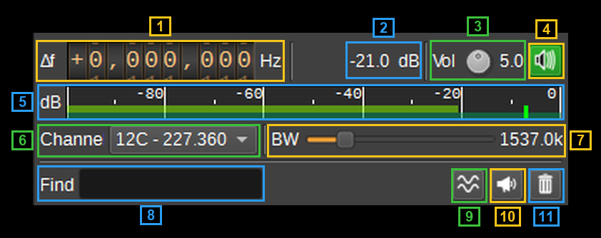
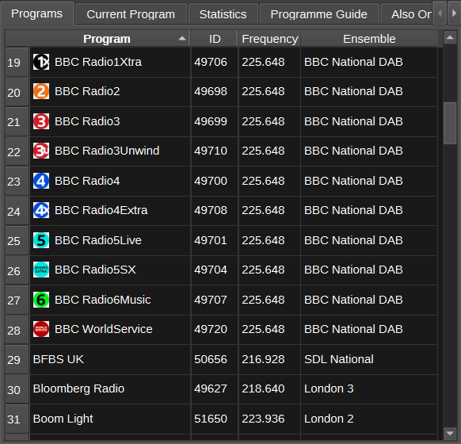
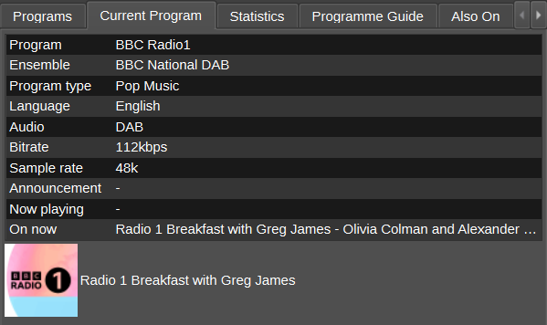
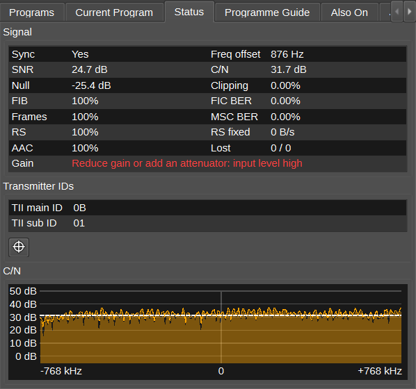
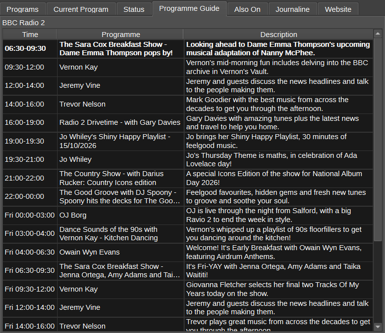

<h1>DAB demodulator plugin</h1>

<h2>Introduction</h2>

This plugin can be used to demodulate DAB and DAB+ radio.

The DAB demodulator uses a sample rate of 2.048MHz.

For more information about DAB receivers technical requirements see [ETSI TS 103 461 V1.2.2 (2020-10)](https://www.etsi.org/deliver/etsi_ts/103400_103499/103461/01.02.02_60/ts_103461v010202p.pdf)

<h2>Interface</h2>

The top and bottom bars of the channel window are described [here](../../../sdrgui/channel/readme.md)

<h3>1: Frequency shift from center frequency of reception</h3>

Use the wheels to adjust the frequency shift in Hz from the center frequency of reception. Left click on a digit sets the cursor position at this digit. Right click on a digit sets all digits on the right to zero. This effectively floors value at the digit position. Wheels are moved with the mousewheel while pointing at the wheel or by selecting the wheel with the left mouse click and using the keyboard arrows. Pressing shift simultaneously moves digit by 5 and pressing control moves it by 2.

<h3>2: Channel power</h3>

Average total power in dB relative to a +/- 1.0 amplitude signal received in the pass band.

<h3>3: Audio volume</h3>

This is the volume of the audio signal from 0.0 (mute) to 10.0 (maximum). It can be varied continuously in 0.1 steps using the dial button. A value of 5.0 corresponds to a gain of 0dB.

<h3>4: Audio mute</h3>

Left click on this button to toggle audio mute for this channel.

If you right click on it, it will open a dialog to select the audio output device. See [audio management documentation](../../../sdrgui/audio.md) for details.

<h3>5: RF level meter in dB</h3>

  - top bar (green): average value
  - bottom bar (blue green): instantaneous peak value
  - tip vertical bar (bright green): peak hold value

<h3>6: Channel</h3>

Displays a list of DAB Band III channels and frequencies. Selecting an item will set the Device center frequency accordingly.
If the center frequency is set manually, this box will be updated to reflect the corresponding channel, or left blank if there is not a channel that corresponds to the current centre frequency.

<h3>7: RF Bandwidth</h3>

This specifies the bandwidth of a filter that is applied to the input signal before decimation or interpolation to limit the received signal's bandwidth. This should typically be 1.537 MHz.

<h3>8: Find</h3>

Enter a regular expression used to filter the program table.

<h3>9: Coherent</h3>

The button with two waves in phase selects how the receiver demodulates the carriers:

* Off: three-symbol differential detection.
* On: coherent detection. The whole multiplex is decoded, re-encoded, and the carriers demodulated again with the decoded data as pilots. This is about 1 dB more sensitive (it decodes in AWGN from about 4.4 dB C/N rather than 5.1 dB), but uses about twice the CPU and adds about 0.4 s of delay.

<h3>10: Announce</h3>

The megaphone button switches the audio to announcements when broadcast: road traffic, transport, warning, news, weather, event, special event, programme information, sport and financial reports.
Only those the current program supports (signalled in FIG 0/18) are followed, and the audio returns to the program when the announcement ends. An announcement in progress is not interrupted by another.

Left click to follow all types; right click to choose the types. Alarm announcements are always followed, whatever this setting, as receivers are required by ETSI TS 103 176 to do.

<h3>11: Clear programs</h3>

Clear all programs in the table.

The sections that follow, from the program table to Website, are tabs of one Ensemble section.

<h3>Program Table</h3>

The program table shows programs that have been detected within a tuned ensemble. Double clicking on a program will cause
the demodulator to set the corresponding center frequency and then to play audio for the program.

<h3>Current Program</h3>

The current program area display information about the currently playing program, including:

* Program name.
* Ensemble name.
* Program type (E.g. News / Pop).
* Language.
* Audio (DAB or DAB+).
* Bitrate in kbps.
* Audio sample rate (in kSa/s). If this does not match the sample rate of the selected audio device, it will be resampled to match.
* Announcement: an announcement in progress for the program (E.g. Road traffic), and the service it comes from when the audio has switched to it.
* Now playing: the artist and title, from the DL Plus tags of the dynamic label. The tooltip lists all the tags.
* On now: the programme on now, from the programme guide (SPI). The tooltip gives its description.
* The station logo, from the programme guide.
* Data broadcast with the program (E.g. song name).

<h3>Status</h3>

<h4>Statistics Table</h4>

The statistics table displays statistics generated by the demodulator that may give an indication of the quality of the received signal.

These also help with setting the gain:

* **SNR:** the signal to noise ratio of the demodulated symbols (their MER), in dB. It is measured from how far each carrier's symbol is from its ideal constellation point, so it includes every impairment: noise, interference, multipath, receiver overload and phase noise.
* **C/N:** the carrier to noise ratio of the median carrier, from the null symbol (the 1 ms gap at the start of each frame). It sees noise and interference, but not overload of the receiver by the ensemble itself, nor multipath. SNR well below C/N points to those.
* **Null:** the power in the null symbol relative to the rest of the frame, from the frames without TII. With noise only, it is close to minus the C/N.
* **MSC BER and FIC BER:** the bit error rates of the selected service and of the FIC before error correction. These show the margin while audio is still perfect: about 6% is a clean signal, and audio errors start at about 10%.
* **RS fixed:** for DAB+, bytes per second corrected by Reed Solomon. This rises before audio errors start.
* **Frames, RS and AAC:** over the last status interval, the percentage of good audio frames (for DAB+, superframes whose Fire code checks; for DAB, frames whose CRC checks), and for DAB+ only, of Reed Solomon codewords corrected and of AAC access units whose CRC checks.
* **Lost:** frames lost, and times synchronization was acquired again, since tuning.
* **Clipping:** the percentage of input samples at or near full scale.
* **Gain:** advice on the receiver gain:
  * *Reduce gain* (red): samples clip, or the input level is above -15 dBFS, where an RTL-SDR's tuner compresses. If the gain is already at its lowest, the signal is too strong for the receiver: add an attenuator.
  * *Increase gain* (amber): the input level is below -45 dBFS, or below -30 dBFS with a poor C/N.
  * *Check* (amber): SNR is 8 dB or more below a good C/N. Try less gain, in case the receiver is overloaded; otherwise this is multipath or interference.
  * *Gain OK*.

To set the gain, step it while watching MSC BER, and keep the setting where it is lowest. With an RTL-SDR on a typical antenna this is usually with the channel power (2) around -25 dB.

<h4>Transmitter</h4>

The TII (Transmitter Identification Information) main and sub IDs of the strongest transmitter, in hexadecimal. 
TII is optional: "None" shows when the ensemble has been received for a few seconds without any. 

Pressing the "Find Transmitter on Map" button will attempt to locate the transmitter with the same IDs and Ensemble name on the [Map](../../feature/map/readme.md) feature.

<h4>Carrier C/N</h4>

The carrier to noise ratio of each of the 1536 carriers, across the ensemble's 1.536 MHz. The dashed line is the median, as shown in C/N.

* Multipath shows as regular ripple or notches across the band.
* Interference shows as a dip over the carriers it covers.
* Adjacent channel energy lowers the carriers at one edge.

<h3>Programme Guide</h3>

The Service and Programme Information (SPI, formerly EPG, ETSI TS 102 818 and TS 102 371) of the ensemble, for the current program: its description and its schedule, with the programme on now in bold. Times are local. Station logos from the SPI also show in the program table and in the current program area.

The SPI is a data service of the ensemble, decoded whatever program is selected. It is sent as a carousel of files, mostly logos, at a low bit rate: the station information and schedules can take several minutes to arrive after tuning. Not every ensemble sends one.

The files received are kept for each ensemble (in `dabdemod_spi`, in SDRangel's application data directory), so that logos, station information and schedules show as soon as the ensemble is tuned to again. Files the ensemble has not sent for 14 days are removed.

<h3>Also On</h3>

Where the current program can also be received (service following):

* The same service in other ensembles (FIG 0/24), with their frequencies (FIG 0/21).
* Services linked to it (FIG 0/6): the same programme (a hard link) or a related one (soft), on DAB, on FM (by RDS PI code) or on DRM, with their frequencies where the ensemble gives them.

Double click a DAB entry to tune to its ensemble.

<h3>Journaline</h3>

Journaline (ETSI TS 102 979) news of the current program, carried in its X-PAD or a data component: a menu of pages to browse.
Follow a menu entry to open it; Home returns to the main menu and Back to the previous page. Entries show in grey until the page they open has arrived.

<h3>Website</h3>

The MOT Broadcast Website (ETSI TS 101 498) of the current program, carried in a data component: its pages are shown as the files arrive, which can take several minutes for a large website. The label shows how many of the files listed in the website's directory have arrived.
The tab opens the website's start page; follow links to open other pages, and use Back and Home to return.

