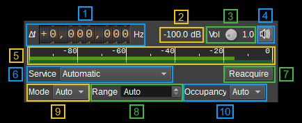
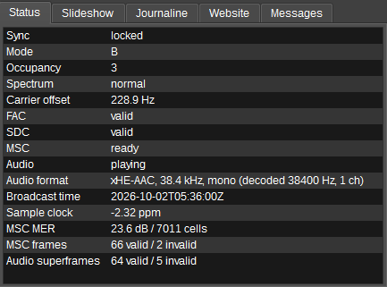
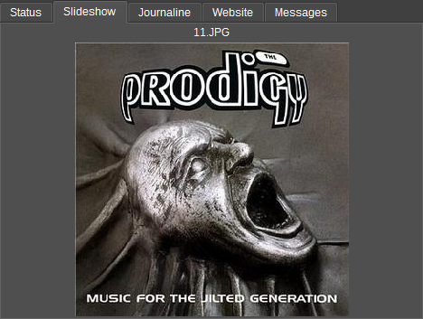
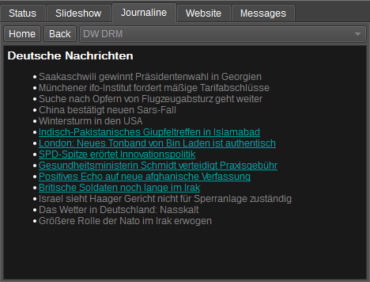
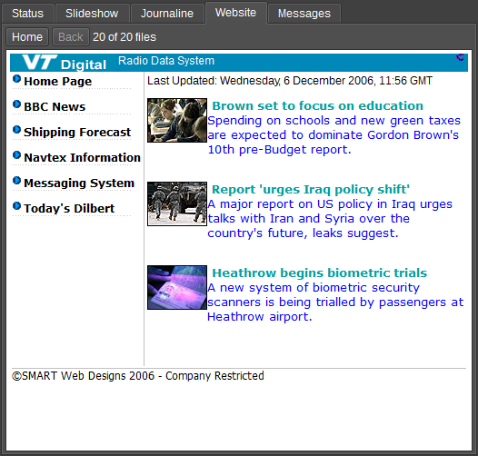
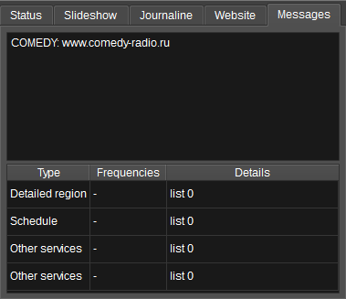

<h1>DRM demodulator plugin</h1>

<h2>Introduction</h2>

This plugin demodulates Digital Radio Mondiale (DRM) broadcasts, as specified in [ETSI ES 201 980 V4.3.1](https://www.etsi.org/deliver/etsi_es/201900_201999/201980/04.03.01_60/es_201980v040301p.pdf).

It supports:

  - Robustness modes A, B, C and D (all valid 4.5 to 20 kHz occupancies) and mode E (DRM+, 100 kHz).
  - 16/64-QAM (A-D) and 4/16-QAM (E) MSC with equal or unequal error protection, short or long interleaving.
  - AAC (with SBR and parametric stereo) and xHE-AAC audio in mono or stereo.
  - Service labels, language and country, text messages, broadcast time and alternative-frequency information (displayed only: the receiver does not retune).
  - MOT slideshow images of the selected service.
  - MOT Broadcast Websites of the selected service.
  - Data services without audio: their slideshow or website.
  - Journaline news (menus and pages of text) from any service in the multiplex.

Not supported: other data services (such as EPG), conditional access, multichannel audio (MPEG Surround is decoded as its stereo core) and automatic alternative-frequency switching.

The channel accepts any device sample rate. It is resampled to 192 kHz, or to 48 kHz when the channel is narrower than 192 kHz, in which case only modes A-D can be received. Set the device sample rate to at least 192 kHz for mode E.

The robustness mode, occupancy, frequency error and the spectrum's orientation are found from the signal: a receiver or frequency converter that delivers I and Q swapped is deetected automatically.

<h2>Interface</h2>

The top and bottom bars of the channel window are described [here](../../../sdrgui/channel/readme.md).

<h3>1: Frequency shift from center frequency of reception</h3>

Use the wheels to adjust the frequency shift in Hz from the center frequency of reception to the DRM reference frequency (the nominal channel frequency). Left click on a digit sets the cursor position at this digit. Right click on a digit sets all digits on the right to zero. Wheels are moved with the mousewheel while pointing at the wheel or by selecting the wheel with the left mouse click and using the keyboard arrows. Pressing shift simultaneously moves digit by 5 and pressing control moves it by 2.

The channel marker on the spectrum shows the occupied carriers, which for some occupancies lie mostly above the reference frequency (below it for a mirrored spectrum).

<h3>2: Channel power</h3>

Average power in dB, relative to a +/- 1.0 amplitude signal, of the DRM band after the input filter: while searching, the band every candidate mode and occupancy could occupy; once locked, the signal's own occupied band. Adjacent stations elsewhere in the channel do not count.

<h3>3: Audio volume</h3>

This is the volume of the audio signal from 0.0 (mute) to 10.0 (maximum). It can be varied continuously in 0.1 steps using the dial button.

<h3>4: Audio mute</h3>

Left click on this button to toggle audio mute for this channel. The button is green while decoded audio is playing.

If you right click on it, it will open a dialog to select the audio output device. See [audio management documentation](../../../sdrgui/audio.md) for details.

<h3>5: RF level meter in dB</h3>

  - top bar (green): average value
  - bottom bar (blue green): instantaneous peak value
  - tip vertical bar (bright green): peak hold value

<h3>6: Service</h3>

Selects the service to decode. Services are listed by label and 24-bit service ID as they are announced. 
Automatic decodes the first audio service the receiver can play, or, when the multiplex has no audio service, the first data service with a slideshow or a website. 
A data service plays no audio: its slideshow or website is shown in its tab. 
The selection is saved by service ID, so it survives label changes; a saved service that is not on air is listed as unavailable. 
Changing service keeps synchronization.

<h3>7: Reacquire</h3>

Discards synchronization and decoded signalling and searches the channel again.

<h3>8: Acquisition range</h3>

How far either side of the set frequency the receiver searches for the DRM carriers. Auto uses 2 kHz for modes A-D and 5 kHz for mode E; otherwise 100 to 5000 Hz. 
Use a wider range for a receiver with a large frequency error.

<h3>9: Mode</h3>

Auto tries every mode the channel bandwidth can carry. Forcing a mode reduces the search work.

<h3>10: Occupancy</h3>

The DRM spectrum occupancy code to search for (0 to 5). Auto tries every occupancy valid for the mode; an occupancy the forced mode does not define is searched as Auto.

<h3>Receiver status</h3>

<h4>11: Status</h4>

  - **Sync**: `searching` for a signal, `acquiring` (a candidate is being confirmed), `locked`, or `reacquiring` after losing lock. Locking requires three consecutive valid FAC blocks; five consecutive failures lose lock.
  - **Mode** and **Occupancy**: as detected from the signal.
  - **Spectrum**: `normal`, or `mirrored` when the input's I and Q are swapped; - until locked.
  - **Carrier offset**: frequency error of the signal from the set frequency; - until locked.
  - **FAC**, **SDC**: whether the latest Fast Access Channel and Service Description Channel blocks passed their CRC. The tooltips give the valid/invalid counts.
  - **MSC**: `ready` once the main service channel configuration is known and its interleaver is filled.
  - **Audio**: `playing` while decoded audio has been produced in the last 2.5 seconds; concealed (error-masked) audio does not count. The tooltip gives the decoded audio age and, when there is no audio, the reason.
  - **Audio format**: the selected service's coding, sample rate and channels as signalled, and the decoder output.
  - **Broadcast time**: UTC date and time sent by the station, when present.
  - **Sample clock**: estimated sample-rate error of the receiver in parts per million; - until enough frames have been received.
  - **MSC MER**: modulation error ratio of the main service channel cells, a measure of reception quality.
  - **MSC frames**, **Audio superframes**: valid and invalid counts. The audio tooltip also counts decoded and concealed audio frames and dropped samples.

 
  
<h4>12: Slideshow</h4>

When the selected service has a MOT slideshow, the latest image it has sent is shown here with its name; otherwise the tab says `No slideshow`, or `Waiting for a slide` until the first image arrives. 
A station repeats each image at a few kilobytes per second, so the first can take a minute or so. 
The image is kept while the receiver regains a lost signal; changing service or retuning clears it.

<h4>13: Journaline</h4>

Journaline is a news service of menus and pages, which a station repeats in a carousel. 
The tab opens the service's main menu; click an entry to open it, and use **Back** and **Home** to return. 
Entries that have not arrived yet are grey and become links when they do: the whole service can take a few minutes. 
When several Journaline services are on air, choose one in the list (it starts on the selected service's own, if it has one). 
The pages are kept while the receiver regains a lost signal, and cleared on retuning.

<h4>14: Website</h4>

When the selected service has a MOT Broadcast Website, its pages are shown here as the files arrive: the station repeats the website's files in a carousel, which can take several minutes for a large website. 
The label shows how many of the files listed in the website's directory have arrived. 
The tab opens the website's start page; follow links to open other pages, and use **Back** and **Home** to return. 
The files are kept while the receiver regains a lost signal; changing service or retuning clears them.

<h4>15: Messages</h4>

The text box shows the station's text message, or the reason audio is unavailable. 
The table lists the alternative-frequency information the station sends: frequencies of other DRM transmissions of this multiplex (with restrictions by service, region or schedule) and related schedule, region, other-service and linking entries. 

<h2>API</h2>

Full details of the API can be found in the Swagger documentation. Here is a quick example of how to set the service to decode:

    curl -X PATCH "http://127.0.0.1:8091/sdrangel/deviceset/0/channel/0/settings" -d '{"channelType": "DRMDemod", "direction": 0, "DRMDemodSettings": {"selectedServiceIdentifier": 14709345}}'

and to reacquire:

    curl -X POST "http://127.0.0.1:8091/sdrangel/deviceset/0/channel/0/actions" -d '{"channelType": "DRMDemod", "direction": 0, "DRMDemodActions": {"reacquire": 1}}'

The channel report (`GET .../channel/0/report`) gives the synchronization state, the detected mode, occupancy and spectrum orientation (`spectrumInverted`), the DRM band's power (`channelPowerDB`), services with their labels and audio descriptors, signalling and audio counters, text message, broadcast time, alternative frequencies, the slideshow's status (`slideshowPresent`, `slideshowImages`, `slideshowName`, `slideshowMimeType`), the Broadcast Website's (`websitePresent`, `websiteFiles` of `websiteObjects` received, `websiteStartPage`), whether the selected service is a data service (`dataService`) and the Journaline news received (`journalineServices` and `journalineObjects` count the services and their menus and pages; `journaline` holds them, an entry per service with its objects: object 0 is the main menu, whose items link to other objects by `linkId`). To save the latest slideshow image to a file on the SDRangel host:

    curl -X POST "http://127.0.0.1:8091/sdrangel/deviceset/0/channel/0/actions" -d '{"channelType": "DRMDemod", "direction": 0, "DRMDemodActions": {"saveSlideshowImage": "/tmp/slide.jpg"}}'

To save the Broadcast Website's files received so far into a directory (keeping their paths within it):

    curl -X POST "http://127.0.0.1:8091/sdrangel/deviceset/0/channel/0/actions" -d '{"channelType": "DRMDemod", "direction": 0, "DRMDemodActions": {"saveWebsite": "/tmp/website"}}'
