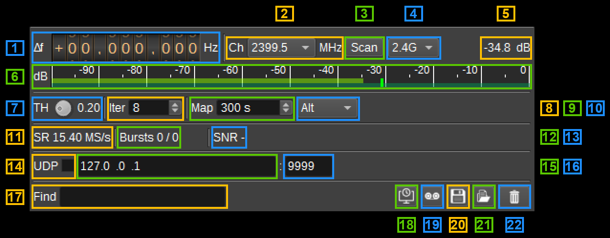

<h1>DJI DroneID Demodulator Plugin</h1>

<h2>Introduction</h2>

This plugin can be used to demodulate DJI DroneID broadcasts. DroneID is transmitted by DJI drones that use the OcuSync / O2 / O3 video links (such as the Mini 2, Mini 3, Mini 3 Pro, Air 2S, Mavic Air 2 and Mavic 3).
It contains the drone's serial number, model, position, altitude, velocity and yaw, as well as the position of the pilot and the drone's home point.
Drones with O4 video links (E.g. Mini 4 Pro, Mini 5) encrypt DroneID, so can not be decoded.

The drone transmits a DroneID burst approximately every 640ms while the motors are running, on one of a number of channels in the 2.4GHz and 5.8GHz bands. Known channel center frequencies are:

- 2.4GHz: 2399.5, 2414.5, 2429.5, 2444.5, 2459.5 and 2474.5 MHz
- 5.8GHz: 5721.5, 5731.5, 5741.5, 5756.5, 5761.5, 5771.5, 5776.5, 5786.5, 5796.5, 5801.5, 5816.5 and 5831.5 MHz

The drone remains on a channel for many bursts, but can change channel and band from time to time. How the channel is chosen is not documented (it may be related to the video link, which adapts to interference).
The Scan option (3) can be used to search the channels for DroneID bursts, pausing on a channel while bursts are being received.

DroneID is an OFDM signal, similar to LTE: 9 symbols with a 1024 point FFT at 15.36 MS/s (15kHz subcarrier spacing) and 600 occupied subcarriers, giving an occupied bandwidth of 9MHz.
Symbols 4 and 6 contain Zadoff-Chu sequences, that are used for synchronisation and channel estimation, while the remaining symbols are QPSK modulated.
Data is protected with a CRC24 and an LTE turbo code, and is scrambled with a Gold sequence.
Older drones (E.g. Mavic 2) do not transmit the first symbol, and these are also supported.

The demodulator requires a baseband sample rate of at least 15.36 MS/s, so an SDR such as a HackRF, USRP, BladeRF or PlutoSDR is required. An RTL SDR can not be used.
It is best to set the device sample rate to exactly 15.36 MS/s or 30.72 MS/s, to avoid the need for fractional resampling.
As DroneID has no DC subcarrier, the device can be tuned directly to the DroneID channel frequency.
The drone's video link uses the same bands. Its transmissions may trigger the burst detector, which uses CPU, but they are rejected by the decoder, as they do not contain the DroneID synchronisation sequences.
To see which channels a drone uses, enable Scan (3) for both bands and check the Freq column in the table.

Decoded drone, pilot and home positions are sent to the [Map feature](../../feature/map/readme.md).
On the 3D map, the drone is displayed with a 3D model, oriented according to its yaw, with its propellers spinning while its motors are on.
The drone can be positioned using either its altitude or its height above its take-off point (10), while the pilot and home point are displayed on the ground.
Note that the 3D map draws tracks at the absolute heights sent, so a drone's track can be hidden by the terrain when it is flying low.
Decoded messages are also made available to other plugins (E.g. MCP Server) and can be forwarded via UDP and logged to a .csv file.

<h2>Interface</h2>

The top and bottom bars of the channel window are described [here](../../../sdrgui/channel/readme.md)

<h3>1: Frequency shift from center frequency of reception</h3>

Use the wheels to adjust the frequency shift in Hz from the center frequency of reception. Left click on a digit sets the cursor position at this digit. 
Right click on a digit sets all digits on the right to zero. This effectively floors value at the digit position. 
Wheels are moved with the mousewheel while pointing at the wheel or by selecting the wheel with the left mouse click and using the keyboard arrows. 
Pressing shift simultaneously moves digit by 5 and pressing control moves it by 2.

<h3>2: Ch - Channel</h3>

Select one of the known DroneID channels. The device center frequency is set so that the channel, at its current frequency shift (1), is on the selected frequency. 
If the channel's frequency is not a known DroneID channel, Custom is displayed.

<h3>3: Scan</h3>

When checked, the device center frequency is stepped through the DroneID channels in the band selected by (4), so that this channel is tuned to each of them in turn.
When a burst with DroneID synchronisation sequences is detected, the scan pauses on that channel, and the button displays Lock. Scanning resumes once no bursts have been detected for the hold time.

As drones often reuse channels, each pass through the channels starts with those that bursts have previously been detected on (most recent first), followed by the remaining channels in frequency order.
When bursts stop on a channel, a new pass is started immediately, so other previously used channels are checked next.

Right click to set:

- Dwell - Time in seconds to wait on each channel for a burst. As bursts are transmitted every 640ms, this should be at least 1 second. Default is 1.5 seconds.
- Hold - Time in seconds to remain on a channel after the last burst was detected. Default is 3 seconds.

Selecting a channel in (2) stops scanning. As the device center frequency is changed, only one channel in a device set should have scanning enabled.

<h3>4: Scan Band</h3>

Select which channels to scan: 2.4GHz, 5.8GHz or both bands.

<h3>5: Channel power</h3>

Average total power in dB relative to a +/- 1.0 amplitude signal received in the pass band.

<h3>6: Level meter in dB</h3>

  - top bar (green): average value
  - bottom bar (blue green): instantaneous peak value
  - tip vertical bar (bright green): peak hold value

<h3>7: TH - Detection Threshold</h3>

Bursts are detected by correlating each OFDM symbol's cyclic prefix with the end of the symbol, summed over all symbols in a burst.
This sets the normalised correlation threshold (0.05 to 0.95) required to detect a burst. Lower values can detect weaker bursts, but will result in more false detections, which increases CPU usage.
The default value is 0.20.

<h3>8: Iter - Turbo decoder iterations</h3>

Maximum number of turbo decoder iterations. Decoding stops as soon as the CRC is valid, so more iterations only cost CPU for weak bursts.

<h3>9: Map - Map timeout</h3>

Time in seconds after which a drone, its pilot and home point are removed from the Map, if no further messages are received. Set to 0 to never remove.

<h3>10: Map Altitude</h3>

Selects which value is used for the drone's altitude on the 3D Map:

- Alt - The drone's altitude, which is GPS height above the WGS84 ellipsoid. This is correct over any terrain, but GPS error can put the drone slightly below ground (and so hidden) on take-off and landing.
- Height - The drone's height above its take-off point, displayed relative to the ground at the drone's position.

<h3>11: SR - Channel sample rate</h3>

Displays the channel sample rate. This is displayed in red if it is less than the required 15.36 MS/s.

<h3>12: Bursts</h3>

Displays the number of bursts detected and the number successfully decoded (I.e. with a valid CRC24).

<h3>13: SNR</h3>

Displays the SNR and carrier frequency offset of the last detected burst.

<h3>14: UDP</h3>

When checked, received messages are forwarded to the specified UDP address (15) and port (16).

<h3>15: UDP address</h3>

IP address of the host to forward received messages to via UDP.

<h3>16: UDP port</h3>

UDP port number to forward received messages to.

<h3>17: Find</h3>

Entering a regular expression in the Find field displays only messages where the drone serial number matches the given regular expression.

<h3>18: Use Date and Time from File</h3>

When checked, if the source device is a File Input device, the date and time used for messages are taken from the file playback time. Otherwise, the current system clock time is used.

<h3>19: Start/stop Logging Messages to .csv File</h3>

When checked, writes all received messages to a .csv file.

<h3>20: .csv Log Filename</h3>

Click to specify the name of the .csv file which received messages are logged to.

<h3>21: Read Data from .csv File</h3>

Click to specify a previously written .csv log file, which is read and used to update the table.

<h3>22: Clear Messages from table</h3>

Pressing this button clears all messages from the table.

<h3>Received Messages Table</h3>

The received messages table displays information about each DroneID message received.

* Date/Time - The date and time the message was received.
* Serial - The drone's serial number.
* Model - The drone's model, determined from the product type.
* Type - Message type. Flight (flight information) or Purpose (flight purpose, which contains only the serial number).
* Seq - Message sequence number.
* Lat - Drone latitude in degrees. Double click to centre the map on the drone.
* Lon - Drone longitude in degrees. Double click to centre the map on the drone.
* Alt - Drone altitude in metres above the WGS84 ellipsoid. This is GPS height, which differs from height above mean sea level (as typically displayed by phones and maps) by the local geoid height.
* Height - Drone height above take-off point in metres.
* Speed - Horizontal ground speed in metres per second.
* V/S - Vertical speed in metres per second.
* Course - Ground track in degrees, calculated from the velocity.
* Yaw - Drone yaw in degrees.
* Pilot Lat - Pilot's latitude in degrees, from the GPS in the pilot's phone. Double click to centre the map on the pilot.
* Pilot Lon - Pilot's longitude in degrees, from the GPS in the pilot's phone. Double click to centre the map on the pilot.
* Home Lat - Home point latitude in degrees. Double click to centre the map on the home point.
* Home Lon - Home point longitude in degrees. Double click to centre the map on the home point.
* UUID - UUID, if set.
* State - Drone state flags.
* GPS Time - Date and time from the pilot's phone GPS.
* SNR - Signal to noise ratio of the burst in dB.
* CFO - Carrier frequency offset of the burst in Hz.
* Freq - Channel frequency the burst was received on in MHz. Useful when scanning, to see which channel the drone is using.
* CRC - Whether the message's CRC16 is valid.

Right clicking on the table header allows you to select which columns to show. The columns can be reordered by left clicking and dragging the column header.
Right clicking on a row allows the drone, pilot or home point to be found on the map.

The meanings of the State flags are provisional, as they are taken from the Wi-Fi beacon variant of DroneID.

<h2>API</h2>

Full details of the API can be found in the Swagger documentation. Here is a quick example of how to set the frequency offset of the demodulator:

    curl -X PATCH "http://127.0.0.1:8091/sdrangel/deviceset/0/channel/0/settings" -d '{"channelType": "DroneIDDemod",  "direction": 0, "DroneIDDemodSettings": { "inputFrequencyOffset": 0 }}'

And to scan the 2.4GHz and 5.8GHz channels (scanBand: 0 - 2.4GHz, 1 - 5.8GHz, 2 - both):

    curl -X PATCH "http://127.0.0.1:8091/sdrangel/deviceset/0/channel/0/settings" -d '{"channelType": "DroneIDDemod",  "direction": 0, "DroneIDDemodSettings": { "scan": 1, "scanBand": 2 }}'

The channel report contains the number of bursts detected, decoded and dropped, the number of drones being tracked, and scanLocked, which is 1 when scanning is paused on a channel where DroneID bursts are being received:

    curl "http://127.0.0.1:8091/sdrangel/deviceset/0/channel/0/report"

<h2>Attribution</h2>

This plugin was developed using the information published in "Drone Security and the Mysterious Case of DJI's DroneID" (N. Schiller et al., NDSS 2023), and David Protzman's [dji_droneid](https://github.com/proto17/dji_droneid) project.
