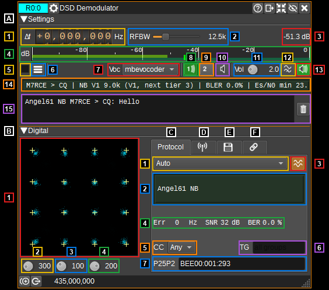
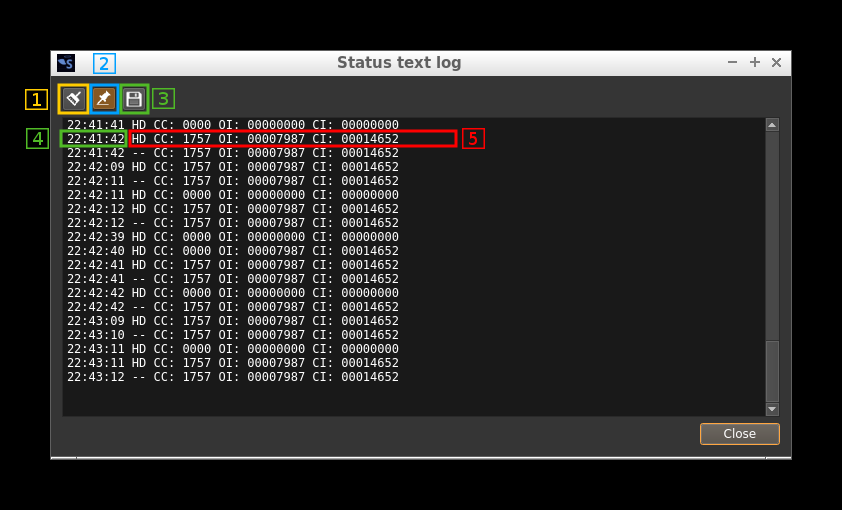
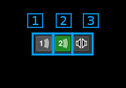
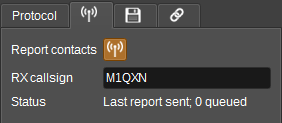
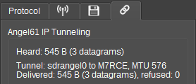

<h1>DSD (Digital Speech Decoder) demodulator plugin</h1>

<h2>Introduction</h2>

This plugin demodulates and decodes digital voice modes. It is the receive counterpart of the [DSE Modulator](../../../plugins/channeltx/moddse/readme.md). The following protocols are supported:

  - D-STAR: GMSK, 4800 bit/s, AMBE 3600x2400. Developed and promoted by Icom for Amateur Radio customers.
  - DMR: 4FSK, 4800 symbols/s, AMBE+2 3600x2450. ETSI two slot TDMA standard (base station, mobile station and direct mode). MOTOTRBO is a popular implementation of this standard.
  - Yaesu System Fusion (YSF): C4FM, 4800 symbols/s. Developed and promoted by Yaesu for Amateur Radio customers. Voice/data type 2 (the usual narrow mode) is decoded to audio; the other data types are identified only.
  - NXDN: A joint Icom (IDAS) and Kenwood (Nexedge) standard, both the 4800 bit/s (2400 Baud, 6.25 kHz, "NXDN48") and the 9600 bit/s (4800 Baud, 12.5 kHz, "NXDN96") versions. The full rate vocoder (EFR) of NXDN96 is decoded by the AMBE feature only.
  - dPMR (ETSI TS 102 490): 4FSK, 2400 symbols/s, AMBE+2 3600x2450.  
  - P25 Phase 1: C4FM, 4800 symbols/s, IMBE 7200x4400. the APCO Project 25 FDMA standard used by public safety networks in North America, clear (unencrypted) voice.
  - P25 Phase 2: 4FSK at 6000 symbols/s, AMBE+2 3600x2450. The two slot TDMA version of Project 25 used by trunked systems for their voice channels. The voice is scrambled with a sequence derived from the system's identity (WACN, system ID and NAC), which must be entered (C.7); the values are broadcast on the system's control channel and listed by the usual radio reference sites.
  - [M17](https://spec.m17project.org): 4FSK at 4800 symbols/s in 12.5 kHz, 40 ms frames, Codec2 3200 voice with the callsigns in a link setup frame and packet transmissions carrying SMS text or APRS. This is SDRangel's second M17 receiver: the [M17 Demodulator](../demodm17/readme.md) has its own modem, this one decodes M17 in the same chain as the other protocols here, so a scanner or a recording can switch between them, and the two can be compared on the same measurements.
  - Angel61: SDRangel's own amateur digital voice protocol in four profiles:
    - on VHF/UHF Angel61 NB, 6.25 kHz (4800 symbols/s QPSK or 16-QAM), and Angel61 WB, 12.5 kHz (9600 symbols/s QPSK or 16-QAM), 
    - on HF Angel61 HF-NB, 2.7 kHz (50-carrier OFDM), and HF-WB, 6 kHz (110-carrier OFDM) 
    - with 24 kHz V1 speech (vocoscodec) at four tiers (from 1.5kpbs to 12kbps) and WB's top tier using Opus audio at 18.4 kbit/s, LDPC coding, callsign routing, text messages, positions, file transfers and IP tunneling.

The protocol is detected automatically from the synchronisation patterns found in the signal, at all three symbol rates, or the search can be limited to one protocol (C.1). The receiver measures the frequency deviation, the carrier frequency error and the symbol clock error of the signal it locks to and corrects them itself, so there is nothing to adjust for a given radio or channel plan beyond the channel bandwidth.

&#9888; A minimum of 48 kS/s I/Q sample rate in the baseband is required for the demodulator/decoder to work correctly.

<h3>Sensitivity</h3>

The following table shows strong a signal each protocol needs for the voice to sound clean, measured over the air from the DSE Modulator to this demodulator, and in a test harness with white noise. Every protocol is on one scale, C/N0 in dB-Hz (the signal power over the noise in one hertz), so protocols of different bandwidths can be compared; lower is better. For the FM protocols clean is 1% raw bit error rate, where the vocoder's codes still correct what arrives; for Angel61 it is 1% of frames lost, every frame checked by its CRC.

| Protocol | Modulation | Voice | Clean, on air (dB-Hz) | Clean, harness (dB-Hz) | On air, native |
|---|---|---|---:|---:|---|
| Angel61 HF-NB, tier 0 | OFDM, 2.5 kHz | V1 1.5 kbit/s | 37.6 | 38.5 | SNR3k 2.8 dB |
| Angel61 HF-WB, tier 0 | OFDM, 5.5 kHz | V1 2.25 kbit/s | 38.7 | 38.8 | SNR3k 3.9 dB |
| Angel61 NB, tier 0 | QPSK 4800 sym/s | V1 2.25 kbit/s | 39.1 | 39.7 | Es/N0 2.3 dB |
| Angel61 WB, tier 0 | QPSK 9600 sym/s | V1 4.5 kbit/s | 41.0 | 41.7 | Es/N0 1.2 dB |
| dPMR | 4FSK 2400 sym/s | AMBE+2 2.45 kbit/s | 42.8 | 44.6 | C/N 2.4 dB |
| NXDN48 | 4FSK 2400 sym/s | AMBE+2 2.45 kbit/s | 44.3 | 44.6 | C/N 3.9 dB |
| D-STAR | GMSK 4800 bit/s | AMBE 2.4 kbit/s | 44.6 | 45.1 | C/N 4.3 dB |
| M17 | 4FSK 4800 sym/s | Codec2 3.2 kbit/s | 44.8 | 45.7 | C/N 4.5 dB |
| NXDN96 | 4FSK 4800 sym/s | AMBE+2 2.45 kbit/s | 46.0 | 46.1 | C/N 5.6 dB |
| DMR | 4FSK 4800 sym/s, TDMA | AMBE+2 2.45 kbit/s | 46.4 | 46.6 | C/N 6.1 dB |
| YSF (V/D type 2) | 4FSK 4800 sym/s | AMBE+2 2.45 kbit/s | 46.5 | 46.5 | C/N 6.2 dB |
| P25 Phase 1 | C4FM 4800 sym/s | IMBE 4.4 kbit/s | 47.0 | 46.5 | C/N 6.7 dB |
| Angel61 NB, tier 3 | 16-QAM 4800 sym/s | V1 9.0 kbit/s | 47.5 | 47.6 | Es/N0 10.7 dB |
| P25 Phase 2 | 6000 sym/s, TDMA | AMBE+2 2.45 kbit/s | 47.7 | 47.7 | C/N 7.3 dB |
| Angel61 WB, tier 3 | 16-QAM 9600 sym/s | Opus 18.4 kbit/s | 48.7 | 48.8 | Es/N0 8.9 dB |

The native figure is each mode's own measure: C/N for the FM protocols, in the 10.8 kHz noise bandwidth of the 12.5 kHz reference filter (C/N0 = C/N + 40.4 dB); Es/N0 for Angel61 NB and WB (C/N0 = Es/N0 + 36.8 dB and + 39.8 dB); SNR3k for Angel61 HF (C/N0 = SNR3k + 34.8 dB). An FM protocol's frames already arrive 1 to 5 dB below its clean figure (fewer than 10% lost), but carry more errors than its codes correct, so the voice is degraded there.

<h2>AMBE Voice decoding</h2>

For protocols using the AMBE vocoder (which is all apart from M17 and Angel61), there are two ways of turning the received voice frames into audio:

<h3>Software: mbevocoder</h3>

[mbevocoder](https://github.com/srcejon/mbevocoder) decodes AMBE and IMBE frames in software with soft decisions: the demodulator passes the confidence of every received bit to the codec's own error correction, which is what gives the best audio at low signal levels. All protocols and vocoder rates (AMBE 3600x2400 for D-Star, AMBE+2 3600x2450 for DMR, NXDN and dPMR, AMBE+2 2450 for YSF, IMBE 7200x4400 for P25) are covered.

<h3>DV serial device (AMBE feature)</h3>

You can use a serial device connected to your system that implements and exposes the packet interface of the AMBE3000 chip. This can be for example a ThumbDV USB dongle. You may also connect to an AMBE server instance over the network. This is supported via the [AMBE feature](../../feature/ambe/readme.md).

When an AMBE feature is selected as the vocoder (A.7) the received frames go to the feature as hard bits and its device decodes them. IMBE (P25) decoding depends on the device firmware. If the selected feature is not there, or mbevocoder is selected, decoding takes place in software with mbevocoder.

The decoded audio (mono, at the audio device rate, after the volume and the slot selection) is also available to features that take a channel's demodulated signal, such as the Demod Analyzer and the Morse Decoder. Audio decoded by the AMBE feature goes straight to the audio device and is not on that path.

<h2>Interface</h2>

The top and bottom bars of the channel window are described [here](../../../sdrgui/channel/readme.md)

<h3>A section: settings</h3>

<h4>A.1: Frequency shift from center frequency of reception</h4>

Use the wheels to adjust the frequency shift in Hz from the center frequency of reception. Left click on a digit sets the cursor position at this digit. Right click on a digit sets all digits on the right to zero. This effectively floors value at the digit position. Wheels are moved with the mousewheel while pointing at the wheel or by selecting the wheel with the left mouse click and using the keyboard arrows. Pressing shift simultaneously moves digit by 5 and pressing control moves it by 2.

<h4>A.2: Channel bandwidth before discriminator</h4>

This is the bandwidth of the pre-discriminator filter while the demodulator searches for a signal. It should match the channel plan: 12.5 kHz for DMR, YSF, P25 and NXDN, 6.25 kHz is enough for dPMR and D-Star. Once locked, the filter narrows itself to the occupied bandwidth of the signal found (measured from its deviation and symbol rate), so a wide setting only costs sensitivity while searching (the synchronisation patterns must still be found through the wide filter): a 25 kHz channel works for a scanner. The automatic frequency correction of the demodulator is bounded to a quarter of this bandwidth.
Angel61 does not depend on it: while an Angel61 receiver is listening (Angel61 NB, Angel61 WB or Auto) the input is never filtered narrower than it needs (8 kHz for NB, 10 kHz for WB before its own matched filter).
The receiver's DC (the DC spike of an SDR tuned to the channel) is removed before anything else.

<h4>A.3: Channel power</h4>

Total power in dB relative to a +/- 1.0 amplitude signal generated in the pass band.

<h4>A.4: Level meter in dB</h4>

  - top bar (green): average value
  - bottom bar (blue green): instantaneous peak value
  - tip vertical bar (bright green): peak hold value

<h4>A.5: Activate status text log</h4>

Check to send the status text lines (A.14) and DMR events to the log. Uncheck to dismiss sending.
DMR events are emitted when a call starts or ends, when link-control details become available or change, and when a complete standard Talker Alias, in-band GPS position or text message is decoded.
Repeated voice bursts and unchanged metadata do not produce repeated rows; changing GPS positions are limited to one row per second per slot.

<h4>A.6 View status text log</h4>

Click to open the non-modal status text and event log. It can remain open while the demodulator controls are used; clicking the button again brings the existing window to the front:

<h5>A.6.1 Clear log</h5>

Push this button to clear the log

<h5>A.6.2 Pin to last line</h5>

Use this toggle to pin or unpin the log to the last line

<h5>A.6.3 Save log to file</h5>

Click to select a file to which the log will be saved

<h5>A.6.4 Timestamp</h5>

Each line in the log starts with the timestamp when the status line was fetched from the decoder

<h5>A.6.5 Status text and DMR events</h5>

One line per status text or DMR call event after the timestamp. A DMR event has the form:

`DMR S1 CC:1 EVT:START SRC:1234567 DST:91 TYPE:GROUP EMG:N PRIV:N PRI:0`

`EVT` is `START`, `UPDATE` or `END`; an `END` row also carries the approximate call duration. `SRC` and `DST` are the source radio and destination radio or talkgroup IDs; `TYPE` distinguishes group from unit-to-unit calls; `EMG`, `PRIV` and `PRI` are the emergency flag, privacy flag and priority from the DMR service-options field. `--` means that valid link control has not yet been received.

Standard Talker Alias, in-band GPS link control and text messages produce rows such as:

`DMR S1 CC:1 EVT:ALIAS SRC:1234567 FORMAT:UTF-8 TEXT:"M7RCE"`

`DMR S1 CC:1 EVT:GPS SRC:1234567 LAT:51.123456 LON:-1.234567 ERR:<20m`

`DMR S1 CC:1 EVT:TEXT SRC:1234567 DST:91 TYPE:GROUP FORMAT:UTF-16BE TEXT:"Meet at gate 2"`

`DMR S1 CC:1 EVT:TEXT SRC:1234567 DST:7654321 TYPE:UNIT FORMAT:UTF-16BE/IP TEXT:"On my way"`

An Angel61 transmission logs its start and end, its text messages (from the data slots or the message field of data frames), the positions it sends and, at its end, the rate request record kept for its source (see A14.8):

`ANGEL61 EVT:START`

`ANGEL61 EVT:TEXT SRC:M7RCE DST:CQ VIA:SLOTS TEXT:"Hello from Angel61"`

`ANGEL61 EVT:POSITION SRC:M7RCE LAT:51.36900 LON:-0.12190 ALT:35 SPD:-- CRS:--`

`ANGEL61 EVT:RATE SRC:M7RCE DST:CQ REQ:0 SEND:2 PROFILE:NB BLER:0.0 SNR:40.0`

`ANGEL61 EVT:END SRC:M7RCE DST:CQ FRAMES:141 LOST:0 SNR:40.0 CONCEALED:0 FALLBACK:0`

Talker Alias supports the ETSI 7-bit, ISO-8859-1, UTF-8 and UTF-16BE formats. GPS latitude and longitude are in decimal degrees and `ERR` is the accuracy category sent by the radio. Decoded DMR GPS positions, D-Star D-PRS/NMEA positions and Angel61 positions are also sent to a running Map feature, where the source radio ID or callsign labels the marker. Text decoding supports ETSI Unified Data Transport in packed 7-bit, ISO-8859-1 and UTF-16BE formats, plus UTF-16BE text carried by UDP on port 5016 with either the full IPv4 header or the DMR compressed UDP/IPv4 header. Headers, confirmed-data block sequence numbers and CRCs, complete packet CRCs and IP headers are checked before a message is logged; incomplete or damaged messages are discarded. Packet text is currently reassembled from rate 1/2 data blocks. Vendor-specific text and location services, such as Motorola TMS/LRRP and Hytera text/location protocols, are not decoded.

<h4>A.7: Vocoder</h4>

Selects what decodes the received AMBE and IMBE frames: `mbevocoder` in software, or a hardware device through an AMBE feature (`AMBE F:0` and so on). The list is updated when features are added or removed. It shows `none` in place of `mbevocoder` when that is not built in, and `(absent)` after a selected feature that is not there now: decoding is then in software and goes back to the feature when it returns. M17 and Angel61 do not use this setting.

<h4>A.8 to A.10: Two slot TDMA handling</h4>

<h5>A.8 (1): Slot #1 voice select</h5>

Toggle button to select slot #1 voice output. When on (lit) the voice frames from slot #1 are sent to the audio output. This applies to DMR and P25 Phase 2 (channel 0). For all other protocols the (single) voice stream is controlled by this button. The button turns green while voice frames are being received on the slot.

<h5>A.9 (2): Slot #2 voice select</h5>

Toggle button to select slot #2 voice output. When on (lit) the voice frames from slot #2 are sent to the audio output. This applies to DMR and P25 Phase 2 (channel 1). The button turns green while voice frames are being received on the slot.

<h5>A.10 (3): TDMA stereo mode toggle</h5>

  - When off the slot(s) selected sends their voice as mono on both audio channels
  - When on the slot #1 voice goes to the left audio channel and slot #2 to the right audio channel

<h4>A.11: Audio volume</h4>

This is the volume of the audio signal from 0.0 (mute) to 10.0 (maximum). It can be varied continuously in 0.1 steps using the dial button. With the software vocoder this is a linear gain applied to the decoded audio; with the AMBE feature it drives the device's output gain. The default of 2.0 is about right for speech.

<h4>A.12: High-pass filter for audio</h4>

Use this switch to toggle high-pass filter on the audio. This is useful to remove the low frequency content of the decoded speech. Applies to the software vocoder and to the AMBE feature.

<h4>A.13: Audio mute, lock indicator and select audio output device</h4>

Left click on this button to toggle audio mute for this channel. The button lights up in green while the demodulator is locked to a transmission it has confirmed (a sync matched by chance in noise does not light it).

If you right click on it a dialog will open to select the audio output device. See [audio management documentation](../../../sdrgui/audio.md) for details.

<h3>A.14: Format specific status display</h3>

When the decoder is locked on a transmission this area shows the signalling it decodes, in a format that depends on the protocol. The status line is also what the log (A.5, A.6) and the `statusText` field of the Web API report carry.

<h4>A14.1: D-Star status display</h4>

`MY/SFX>UR|RPT1>RPT2|text|locator:bearing/distance`

  - `MY/SFX`: the origin callsign and its 4 character suffix from the radio header, `UR` the destination callsign
  - `RPT1`, `RPT2`: the departure and destination repeater callsigns
  - `text`: the 20 character informative text sent in the slow data, once the four blocks have been received
  - `locator`: the Maidenhead locator of the position sent in the slow data as D-PRS (`$$CRC...`) or NMEA (`$GPGGA`, `$GPRMC`) sentences; when the position of the station is known (see the [Preferences](../../../sdrgui/readme.md) dialog) the bearing in degrees and the distance in kilometres follow

`no header` shows while the transmission has been joined at a voice sync and no radio header has been decoded yet, neither from the start of the transmission nor from its repetition in the slow data.

A D-PRS sentence whose CRC checks is an APRS packet, whatever it carries (a position, a message, an object, telemetry). It is logged as an `APRS` event and forwarded to the [APRS](../../feature/aprs/readme.md) feature, and to any other feature listening for packets, as the AX.25 frame of its `CALL>APxxxx,DSTAR*:...` text - so positions, messages and status from D-STAR radios appear in the APRS feature beside those received through a Packet Demodulator. The sentence is repeated every few seconds while the transmission lasts: the same text again inside 30 seconds is treated as a duplicate and not forwarded, as an APRS-IS gateway would.

<h4>A14.2: DMR status display</h4>

`Sta: BS CC: 1 S1: VOX G 1234567>8 S2: ---`

  - `Sta`: the station role: `BS` base station (both slots transmitted), `MS` mobile station (one slot, the other silent), `DM` direct mode
  - `CC`: the colour code, from the slot type of data bursts or the embedded signalling of voice bursts
  - `S1`, `S2`: for each TDMA slot the type of the last burst and its addressing:
    - `VOX` voice, `PI` privacy indicator header, `VLC` voice LC header, `TLC` terminator with LC, `CSBK`, `MBH` multi block control header, `MBC` multi block control continuation, `DAH` data header, `R12` rate 1/2 data, `R34` rate 3/4 data, `IDL` idle, `R1` rate 1 data, `UNK` unknown, `---` nothing received yet
    - then `G` group call or `U` unit to unit call, the source ID and the destination ID from the voice LC header, the terminator or the embedded LC

<h4>A14.3: dPMR status display</h4>

`CC 4 VOICE 1234567 > 2345678 (all call)`

  - `CC`: the colour code
  - the type of the last frame: `HEADER`, `VOICE` (payload frame) or `END`
  - the own ID and the called ID from the header, `(all call)` when the call is an all call

<h4>A14.4: Yaesu System Fusion (YSF) status display</h4>

`V/D 2 src: F4EXB dest: CQCQCQ down: F5ZOO up: F5ZOO`

  - the data type from the FICH: `V/D 1`, `data FR`, `V/D 2` or `voice FR`; `no FICH` while none has been decoded
  - the source and destination callsigns from the header or the data channel of the communication frames, then the downlink and uplink repeater callsigns

<h4>A14.5: NXDN status display</h4>

`RAN 1 VCALL group 1234 > 5678`

  - `RAN`: the radio access number from the SACCH; `EFR` follows the message type when the call uses the full rate vocoder
  - the last message type decoded from the SACCH or FACCH1: `VCALL` (voice call), `TX_REL` (transmission release) or `MSG xx` for the others
  - for a voice call: `group` or `unit` call, the source ID and the destination ID

<h4>A14.6: P25 status display</h4>

`NAC 293 LDU1 TG 100 from 1234567`

  - `NAC`: the network access code from the NID, in hexadecimal
  - the last data unit type: `HDU`, `LDU1`, `LDU2`, `TDU`, `TDULC`, `TSDU`, `PDU`
  - `TG` talkgroup (group call) or `unit` (unit to unit call) destination and the source ID from the header or the link control; `encrypted` is appended when the algorithm ID says the voice is encrypted (only clear voice is decoded)

On a trunking control channel (a stream of TSDUs) the display becomes:

`NAC 1A0 system BEE00:1AE:1A0 TSDU GRP_V_CH_GRANT_UPDT TG 20400 500.7000 MHz`

  - `system`: the WACN, system ID and NAC from the network status broadcast, in the form the P25 Phase 2 setting (C.7) takes
  - the last trunking signalling block decoded: its opcode name (TIA-102.AABC) and, for the channel grants, the talkgroup (or unit) and the frequency (from the identifier update broadcasts; the raw channel field until they have been seen, and the slot for a TDMA channel), for the status broadcasts the system, RFSS and site. A channel grant stays on display for a few seconds; the vendor specific blocks show as `MFID xx op yy`.

<h4>A14.7: P25 Phase 2 status display</h4>

`S1: 4V PTT TG 4321 from 1234567 S2: SACCH IDLE`

For each of the two channels (slots): the last burst type (`4V`, `2V` voice, `SACCH`, `FACCH`, `LCCH`), the last MAC message decoded from a SACCH or FACCH (`PTT`, `END`, `IDLE`, `ACTIVE`, `HANGTIME`), and from the last PTT the talkgroup and the source ID, followed by the encryption algorithm name when the voice is encrypted (only clear voice is decoded). `TS ?` at the start means the timeslot is not yet known (the first bursts after a lock, until an information ISCH is read); `no system` means the WACN, system ID and NAC (C.7) are not set, in which case only the unscrambled signalling is decoded.

<h4>A14.8: Angel61 status display</h4>

`M7RCE > CQ | NB V1 4.5k (V1, next tier 2) | BLER 0.0% | Es/N0 min 11.0 dB | req 2 send 3 | IO91XJ:123/4.5km`

* The source and destination callsigns of the transmission (`CQ` for everyone; a callsign longer than 9 characters, such as `EA8/G4ABC/QRP-7`,
arrives in a slot of its own every 2 s: until it has, it shows as its base callsign and `...`, `G4ABC...`, or as `#` and a hash for a special event callsign), 
* the frame type (`NB V1 2.25k` to `NB V1 9.0k`, `NB voice + data`, `NB data`, `NB data 16-QAM` or `NB idle`, and the same for WB,
whose top tier is `WB Opus 18.4k`, and for HF, whose data goes in groups, `HF-NB data tier 0` and so on) with what the station slot announces (the codec family of the voice the station uses next and its tier),
* the block error rate (BLER) since the lock, 
* the least Es/N0 of the transmission (the mean SNR in 3 kHz on HF),
* the rate request tiers (`req` the tier the source asks of its destination, `send` the tier this station would ask of the source from what it has received.
On VHF the judgement steps one tier at a time: up when a transmission of a second or more came in with under 1% of blocks lost and a least Es/N0 3 dB above the next tier's threshold, down after over 3% or two consecutive lost blocks,
otherwise the previous judgement, forgotten after a minute or when the station is heard on another profile; HF's reads the mean SNR3k, with holds) and,
* when a position was received, its Maidenhead locator with the bearing and distance from this station when its own position is known.

What an Angel61 transmission carries is also published as APRS: the position becomes a compressed APRS position report (keeping the slot's resolution,
with its course, speed and altitude), text to a callsign an APRS message, text to `CQ` a status, and an information field sent verbatim (content type 2, for objects, weather, telemetry or a message acknowledgement) is passed on as it was received.
The packets are `SOURCE>APZA61[,repeater*]:...`, they go to the [APRS](../../feature/aprs/readme.md) feature, with a 30 second duplicate window,
and the symbol is the one the station sent in its slot.

A call to a talkgroup shows as `G4ABC > TG 9`. The **TG** field beside the Files setting is a group list, as a DMR radio's RX group list: talkgroups separated by commas (`9, 23`).
A call to a talkgroup not in it is shown and logged but not played; calls to `CQ` and to callsigns are always played, and with the field empty every call is. Its Web API setting is `angel61Groups`.

<h4>A.15: Text messages / DTMF</h4>

Shows received text messages and DTMF sequences. Text messages are formatted as: `protocol source > destination: text`: 

* DMR text messages (UDT and IP: the ETSI service on UDP port 5016 and Motorola's TMS on port 4007, see A.6.5)
* D-STAR 20 character slow data text
* YSF text messages (data full rate transmissions)
* NXDN short and long data calls (SDCALL/DCALL: plain text is shown, other user data as hexadecimal)
* dPMR slow data messages sent during a call (plain text is shown, other data as hexadecimal)
* P25 packet data (a TMS or UTF-16 message inside an IPv4/UDP datagram, confirmed or unconfirmed blocks)
* M17 SMS messages (packet transmissions, shown once the whole packet has passed its CRC)
* Angel61 text messages

DTMF sequences are formatted as `DTMF 123#`, once a sequence has had no new key for 2 s:

* Angel61's DTMF slots, whose tones are also played in the audio, 
* keys of AMBE tone frames (DMR, D-STAR, YSF, NXDN, dPMR, P25 Phase 2), 
* keys found in the decoded voice (P25 Phase 1, M17, or tones a transmitter coded as voice) by a detector with ITU-T Q.24's limits.

A key of an Angel61 sequence whose slots were all lost shows as `?`. The last DTMF sequence is also the `dtmf` field of the channel report in the Web API. The last 32 are kept; the button on the right clears the field. They are also logged with the events in the status text log (A.6).

<h3>Symbol constellation</h3>

<h3>B.1: Symbol constellation</h3>

While searching, this plots every 48 kHz discriminator sample against the preceding sample, using the DMR nominal outer level of 1944 Hz as its scale.
This keeps the display active without a lock and normally shows discriminator noise or the transition paths of a signal.

Once locked, it changes to the matched filter output at the symbol instants: the horizontal axis is the current symbol and the vertical axis the previous one, both in units of the nominal outer level of the detected protocol.
The grid crosses mark the four nominal levels +3, +1, -1 and -3 of the 4FSK protocols; D-Star uses only the outer two. A well received 4FSK signal is 16 tight clusters on the grid crossings, and a D-Star signal is four clusters on the outer corners.

A point the decoder got wrong, or one next to such a point, is then shown out of place, so scattered points between the corners are errors or noise rather than the interference of the pulse shape. Nothing is shown for a D-Star symbol received without a carrier.

While an Angel61 transmission has the channel, the display is its equalised constellation: the payload symbols (HF: the OFDM data cells) of the frames it confirms, I against Q at unit mean power: four clusters for QPSK, sixteen for 16-QAM.

The controls B.2 to B.4 set the persistence of the display.

<h4>B.2: Trace length</h4>

This controls the length of the trace displayed on B.1. Units are milliseconds. Practical values are between 300 and 500 ms.

<h4>B.3: Trace stroke</h4>

This controls the stroke of the points displayer on B.1. The trace has limited persistence based on alpha blending. This is the 8 bit unsigned integer value of the trace alpha blending (from 0 to 255). This controls the intensity of the points.

<h4>B.4: Trace decay</h4>

This controls the persistence decay of the points displayed on B.1. The trace has limited persistence based on alpha blending. This controls the alpha value of the black screen printed at the end of each trace and thus the decay of the points intensity. The value is 255 minus he displayed value using 8 bit unsigned integers.

  - A value of 0 yields no persistence
  - A value of 255 yields infinite persistence

<h3>C: Protocol tab</h3>

<h4>C.1: Protocol</h4>

Selects the protocols searched for: `Auto` searches for all of them and locks to the first synchronisation found; a single protocol (DMR, D-STAR, YSF, NXDN48, NXDN96, dPMR, P25, P25P2, M17, Angel61 NB, Angel61 WB) limits the search to that protocol only, which is useful on a busy channel or when the automatic detection is misled by a signal of another kind.

`Angel61 HF-NB` and `Angel61 HF-WB` are not searched for in `Auto`, and must be selected manually. Use a fixed gain on the receiving device for these, as a hardware AGC can adjust its gain inside the OFDM symbols.

<h4>C.2: Protocol and synchronisation pattern</h4>

Shows the protocol locked to and the last synchronisation pattern accepted, with a green background while locked:

  - `No Sync`: searching
  - `DMR BS data`, `DMR BS voice`: DMR base station data or voice sync, `DMR MS data`, `DMR MS voice` mobile station, `DMR TS1 ...`, `DMR TS2 ...` direct mode time slot 1 or 2
  - `D-STAR header`, `D-STAR voice`
  - `YSF`
  - `NXDN FSW`, `NXDN preamble FSW`
  - `dPMR FS1` (header), `dPMR FS2` (superframe)
  - `P25`
  - `P25 Phase 2` (the ISCH sync word)
  - `Angel61 NB`, `Angel61 WB`, `Angel61 HF-NB`, `Angel61 HF-WB`: the profile of the Angel61 signal

<h4>C.3: Coherent detection</h4>

When on (the default) every burst of the 4FSK protocols is detected a second time from the IQ samples by a coherent sequence detector (a Viterbi search over the phase trajectory of the continuous phase 4FSK signal) once the discriminator path has found its timing and levels, which is worth about 2 dB of sensitivity and equalises echoes of up to two symbols (see DESIGN.md 4.10 for the figures). D-Star is not concerned. It works on the channel filtered IQ with the filter in its channel model, so it sees the same channel as the discriminator path. It only runs on bursts the discriminator path may have got wrong (judged from its own residual noise), so it costs nothing on a strong signal; on a signal at the edge of coverage it costs about a quarter of a fast processor core per DMR channel, several times the rest of the demodulator. Uncheck it on a small machine such as a Raspberry Pi that cannot afford that, or to compare.

<h4>C.4: Measurements</h4>

`Err` `-12` `Hz` &nbsp; `SNR` `21` `dB` &nbsp; `BER` `0.0` `%`

Measured on the signal locked to:

  - `err`: the carrier frequency error in Hz, corrected automatically within a quarter of the channel bandwidth
  - `snr`: the symbol signal to noise ratio at the slicer in dB
  - `ber`: the raw bit error rate on the channel in percent, from the corrections the voice frames' own codes make, whichever vocoder plays them (the AMBE feature and Codec2 included): the Golay and Hamming codes of the AMBE and IMBE frames (DMR, D-STAR, YSF full rate, NXDN, dPMR, P25), counted by decoding each frame on its hard bits, re-encoding it and comparing; M17's convolutional code; YSF V/D type 2's triple repetition; Angel61's LDPC code. Checked against the harness's known channel errors for every protocol: within about 15% up to 5%, reading low above about 10% where the codes run out of correction (the voice is gone by then). Frames that do not decode are not in it; for Angel61 those are what the status line's `BLER` counts (A14.8). D-STAR and P25 Phase 1 need mbevocoder compiled in for the count; the AMBE+2 protocols do not

<h4>C.5: CC - Color code</h4>

The **CC** selector beside the stereo button filters audio by colour code: DMR (`0` to `15`), dPMR (`0` to `63`) and, by its RAN, NXDN (`0` to `63`). Select `Any` to hear every call, or select a value to hear audio only when the decoded code matches. A value above `15` silences DMR. This does not affect synchronization, decoding, the constellation or the status display.

<h4>C.6: TG - Talk Group</h4>

Angel61 talkgroups to play, comma separated (9, 23). A call to another talkgroup is shown but not played. Calls to CQ and to callsigns are always played. Empty: every call is played.

<h4>C.7: P25 Phase 2 system</h4>

The WACN, system ID and NAC of the P25 system, in hexadecimal separated by colons (`BEE00:001:293`), from which the Phase 2 scrambling sequence is derived. Without the right values the voice and the scrambled signalling of a Phase 2 channel cannot be decoded (the lock, the timeslots and the unscrambled signalling are still reported). Trunked systems broadcast their WACN and system ID on the control channel, and their NAC is that of the site; radio reference sites list all three.

<h3>D: Contacts Reporting Tab</h3>

<h4>D.1: Report contacts</h4>

When checked, Angel61 contacts are reported to [angel61.sdrangel.org](http://angel61.sdrangel.org/contacts), where they can be viewed on a map. Please ensure your position (Under Preferences > My Position) is correct before enabling this option. Audio and text messages are not sent to the server, only the callsigns, the time and the position of the contact.

<h4>D.2: RX callsign</h4>

Callsign to include in contact reports as the receiver.

<h3>E: File Transfer Tab</h3>

<h4>E.1: Save to</h4>

The directory to save received files to.

<h4>E.2: Confirm</h4>

Check to confirm every file transfer before saving it. It will be held in memory until accepted or refused.

<h4>E.3: Max size</h4>

Largest file to accept, in kilobytes. A larger offer is refused before a block is stored. 0: no limit.

<h4>E.4: Accept</h4>

Accept the file awaiting confirmation.

<h4>E.5 Refuse</h4>

Refuse the file awaiting confirmation.

<h3>F: IP Tunnel</h3>

Angel61 can carry IP between two stations. The DSD Demodulator has no settings for it: the tunnel belongs to a [DSE Modulator](../../channeltx/moddse/readme.md) in the same instance, which creates the host interface and holds its peer, address, routes and filter. Everything the demodulator receivers goes to that modulator. With no modulator, or with its Tunnel off, datagrams are counted but none will reache the host. If there is more than one DSD Demodulator, the modulator's Rx selector picks which one it listens to.

<h4>F.1: Heard</h4>

The IP datagrams heard, valid and fully reassembled: their total size in bytes and their number. This counts them from any station and whether or not a DSE Module processes them, so a rising figure does not mean they are reaching the host. It restarts from zero each time the channel starts.

<h4>F.2: Tunnel state</h4>

  - The state of its tunnel, as its own IP tunnel tab shows it (`Tunnel: off`, `Tunnel: sdrangel0 to G4ABC, MTU 576`, or an error).
  - `Delivered`: the datagrams it passed to the host, as bytes and a count, from every demodulator it listens to. This is the figure to look at to see that the tunnel is working.
  - `refused`: the datagrams it did not pass on, because they were not from its Peer, were not valid for the tunnel's MTU, or the host would not take them. Datagrams that arrive with the tunnel closed are not counted here.

Delivered and refused reset when the modulator's Tunnel is turned on.
