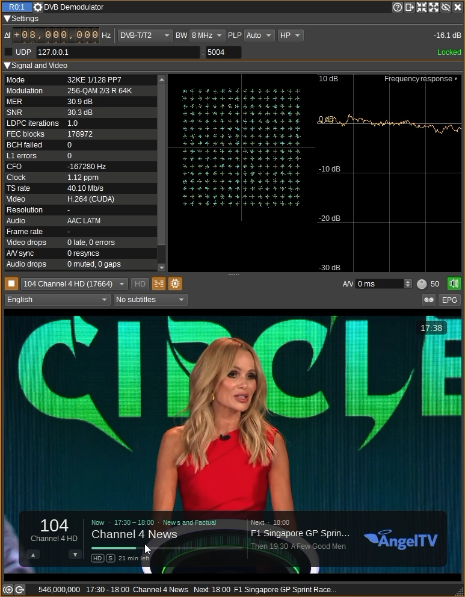
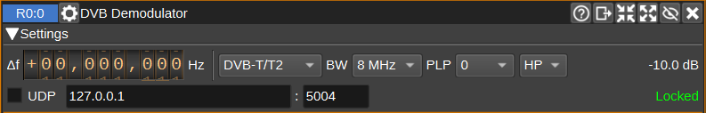
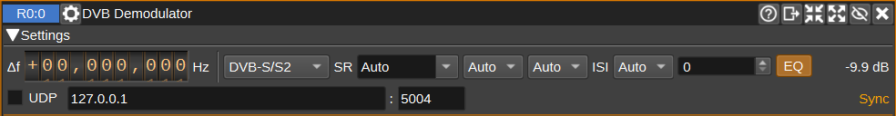
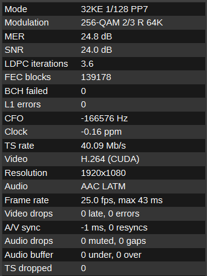
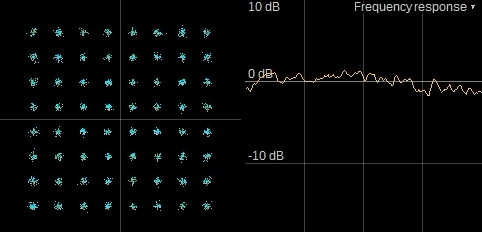
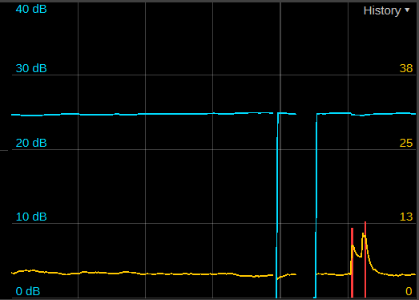
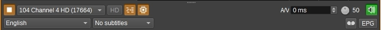
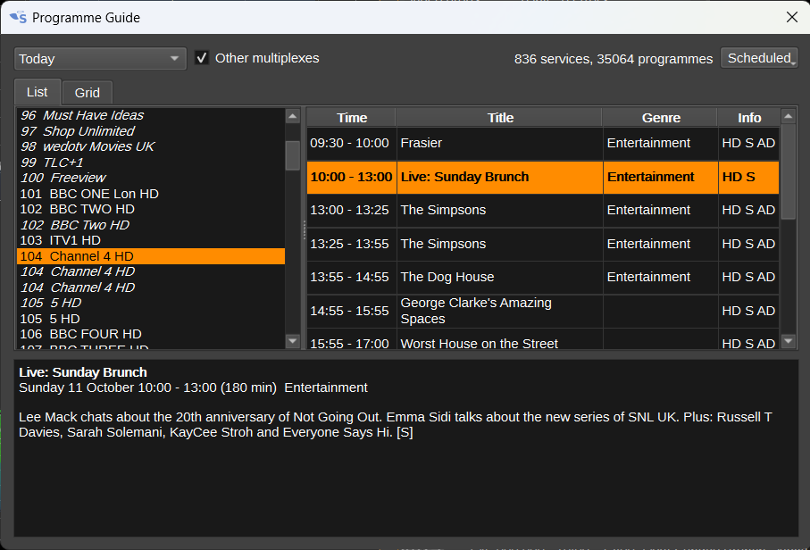
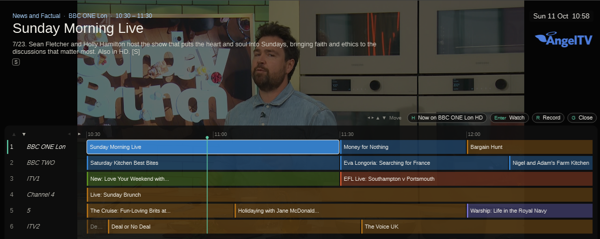
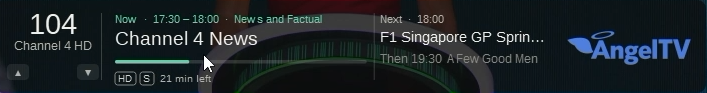

<h1>DVB Demodulator Plugin</h1>

<h2>Introduction</h2>

This plugin demodulates DVB-T and DVB-T2 digital terrestrial television, as specified in ETSI EN 300 744 and EN 302 755, and DVB-S, DVB-S2
and DVB-S2X satellite television, as specified in EN 300 421, EN 302 307 and EN 302 307-2, and plays one of the services (TV channels or radio) in the multiplex.
The transport stream can also be sent over UDP, to be played or recorded by another application, such as VLC or ffplay.

[Tutorial Video](https://www.youtube.com/watch?v=r6gPONrETqI)

DVB-T:

* 2K and 8K modes.
* QPSK, 16-QAM and 64-QAM, non-hierarchical or hierarchical (α = 1, 2 or 4), decoding either the high or low priority stream.
* Code rates 1/2, 2/3, 3/4, 5/6 and 7/8.
* All guard intervals.
* 8, 7 and 6 MHz channels.

The mode, guard interval, constellation and code rate are found automatically, from the guard interval correlation and the Transmission Parameter Signalling (TPS).

DVB-T2 (the T2-base and T2-Lite profiles):

* 1K to 32K FFT sizes, normal and extended carrier modes.
* All guard intervals, including 1/128, 19/256 and 19/128, and pilot patterns PP1 to PP8.
* QPSK to 256-QAM, with rotated constellations, and 16K and 64K LDPC codes at all rates, including T2-Lite's 1/3 and 2/5.
* Time interleaving with one or more TI-blocks per T2-frame, or over several T2-frames, and PLPs that aren't in every T2-frame.
* Future Extension Frames, which are skipped, so a T2-Lite signal carried in the FEFs of a T2-base one (or the other way round) can be received.
* Common and type 1 and 2 data PLPs, of which one is decoded, carrying a transport stream in normal or high efficiency mode, with or without null packet deletion.
* Tone reservation (signalled reserved carriers).
* 8, 7 and 6 MHz channels.

The FFT size comes from the P1 symbol, the guard interval from the correlation of the following symbols, and the rest from the L1 signalling.
The FFT window is placed from the channel's measured impulse response, so echoes up to the length of the guard interval can be received, from the first
frame after acquisition (the response is measured from the first P2 symbol). With long echoes, the channel is estimated from the pilots of several symbols.
MISO is supported (both groups of transmitters, or either alone). Time-frequency slicing and recombining data PLPs with their common PLP aren't supported. 
In the UK, the HD multiplexes (e.g. PSB3) use 32K extended carriers, GI 1/128, PP7 and one PLP of rotated 256-QAM 2/3 with 64K LDPC,
which is supported.

DVB-S:

* QPSK, with the convolutional code at rates 1/2, 2/3, 3/4, 5/6 and 7/8, and Reed-Solomon (204,188).
* Symbol rates from 10 kS/s to 50 MS/s, with roll-off 0.35.

The code rate and the phase of its puncturing are found automatically (or the rate can be set, which locks sooner), as is a spectrum inverted by the receiving chain.
Reception is quasi error free from Eb/N0 about 0.5 dB below the figures in EN 300 421 (e.g. 5.0 dB for 3/4, whose figure is 5.5 dB).

DVB-S2:

* All 28 MODCODs: QPSK 1/4 to 9/10, 8PSK 3/5 to 9/10, 16APSK 2/3 to 9/10 and 32APSK 3/4 to 9/10, with normal (64800 bit) and short (16200 bit) FECFRAMEs, with or without pilots.
* CCM, VCM and ACM (the MODCOD and frame size can change frame by frame), and dummy frames.
* Single and multiple input streams (MIS), of which one is decoded, carrying transport streams, in normal or high efficiency mode, with or without null packet deletion.
* Time slicing (EN 302 307-1 Annex M, used on wideband transponders): frames with a two slot header carrying a time slice number (TSN), one slice of which
  is decoded, as an input stream is. Near the threshold, it takes a few frames longer to lock than other DVB-S2, as the search looks for either kind
  of header in turn.
* Roll-offs 0.35, 0.25 and 0.20, DVB-S2X's 0.15, 0.10 and 0.05, and any physical layer scrambling code.
* Symbol rates from 10 kS/s to 50 MS/s.
* DVB-S2X (EN 302 307-2): its 55 broadcast MODCODs, as well as DVB-S2's, mixed frame by frame in VCM and ACM: QPSK 13/45 to 11/20 (and 11/45 to 32/45 in short frames),
  8PSK and 8APSK (2+4+2), 16APSK (4+12 and 8+8), 32APSK (4+12+16rb and 4+8+4+16), 64APSK (16+16+16+16, 8+16+20+20 and 4+12+20+28), 128APSK and 256APSK,
  each in its own frame size, with or without pilots. The frames of the reserved PLS codes whose length is given are skipped, so lock is kept through them.
  Not received: super-frames and channel bonding.
* DVB-S2X VL-SNR frames (EN 302 307-2 5.5.2, for very low SNRs, as for mobile terminals): all nine MODCODs, QPSK 2/9, pi/2 BPSK 1/5, 11/45 and 1/3
  (in 32400 bit medium FECFRAMEs), pi/2 BPSK 1/5, 4/15 and 1/3 in short frames, and BPSK-S 1/5 and 11/45 (each bit spread over two symbols),
  and VL-SNR dummy frames, in a carrier of VL-SNR frames alone or mixed with other frames in VCM and ACM.

The MODCOD, frame size and pilots come from each frame's header, and the roll-off from the BBHEADER. A spectrum inverted by the receiving chain is found from the frame headers.
In a Gaussian channel, frames decode within 0.5 to 1 dB of the Es/N0 in EN 302 307 table 13 (and EN 302 307-2 tables 20a and 20b for DVB-S2X), with pilots.
Without pilots, the carrier is followed from the data's decisions, and frames decode within 1 dB of the threshold too (QPSK 1/4 within 0.5 dB),
with a frequency drifting as much as 1 kHz a second at 1 MS/s. The loop's bandwidth follows the phase noise, measured from the frame headers:
with an LNB's phase noise at a low symbol rate, pilots are still much the better, as without them, frames may be lost several dB above the threshold.

VL-SNR frames are found by their 900 symbol VL-SNR header as well as the frame header, so below DVB-S2's lowest thresholds too, and decode within
1 dB of the Es/N0 in EN 302 307-2 tables 20a to 20c, down to BPSK-S 1/5 at about -9 dB. Locking to them below about -3 dB takes a few frames longer:
the search for their headers starts after two of their frames' time without a lock, and the symbol clock's error is measured from the frames'
timing, so a few of the first frames may be lost while it's taken out.

Video and audio are decoded with FFmpeg, so the plugin can play any codec FFmpeg supports, such as MPEG-2 and H.264 video and MPEG-1 Layer 2, AAC and AC-3 audio.

<h2>Sample rate</h2>

DVB-T is defined in terms of an elementary period of 7/64 us for 8 MHz channels, so the receiver works at 64/7 MS/s (9,142,857 S/s).
For 7 and 6 MHz channels it is 8 MS/s and 48/7 MS/s respectively. 
It's best to set the device sample rate to this, or to it multiplied by a power of 2, with decimation enabled.

Other channel sample rates from 0.875 to 2.2 times this (8.0 to 20.1 MS/s for 8 MHz channels) are resampled, which takes more CPU. 
The lowest still holds the 7.61 MHz occupied by an 8 MHz channel (7.77 MHz for DVB-T2 in extended carrier mode).
The receiver also measures the sample clock offset between the device and the transmitter, and resamples to correct it when it is more than 3 ppm (1 ppm for DVB-T2, whose 32K symbols are longer).
Smaller offsets are followed by moving the FFT window. A DVB-T2 32K signal may not be decoded until the offset has been corrected, a frame or two after the receiver finds it, if it's more than a few ppm.

Devices that can run at 9,142,857 S/s include the USRP B210, SDRplay RSPduo, LimeSDR, BladeRF and PlutoSDR.
An RTL-SDR can't run fast enough.

For DVB-S and DVB-S2, the device's sample rate should be at least 1.2 times the symbol rate: the signal
is 1 + roll-off times it wide, and losing a little of its edges (at roll-off 0.25 and 0.35) costs under 0.3 dB. 
Higher is better if the device can keep up, leaving room for the signal being off centre and for the device's own filter. 
For example, 33 MS/s or more for 27.5 MS/s (which needs a USRP B210 or similar), 27.6 MS/s or more for 23 MS/s, 
and 1 MS/s or more for the 333 kS/s and 500 kS/s amateur signals on QO-100. 

<h2>Satellite reception</h2>

A satellite dish's LNB (low noise block downconverter) converts the Ku band (10.7 to 12.75 GHz) to an intermediate frequency of 950 to 2150 MHz,
which an SDR covering L band can receive. The LNB is powered over the coax, and chooses the polarisation from the voltage (13 V vertical, 18 V horizontal),
and the band from a 22 kHz tone (none for the low band, 9.75 GHz local oscillator; with it for the high band, 10.6 GHz). SDRs don't supply this,
so a power inserter (bias tee) giving 13 or 18 V, and a 22 kHz tone generator for the high band, are needed between the LNB and the SDR,
with a DC block, or an SDR input that tolerates DC, on the SDR's side.

A Sky Q (two-cable wideband) LNB has a single 10.41 GHz local oscillator, and puts all of each polarisation (290 to 2340 MHz) on its own cable,
selected by the cable rather than the voltage, and without a 22 kHz tone. Either cable needs powering (at 13 or 18 V). Its level is high,
so an attenuator (about 10 dB) may be needed before the SDR, to keep it out of compression.

To tune by downlink frequency, turn on the device's transverter mode, with its delta frequency set to the LNB's local oscillator frequency (e.g. 10,410,000,000 for a Sky Q LNB,
9,750,000,000 or 10,600,000,000 for a universal LNB's bands), so the device's centre frequency reads as the downlink frequency (e.g. 11,426,500 kHz),
and the programme guide's frequencies can be tuned to.

<h2>Interface</h2>

The top and bottom bars of the channel window are described [here](../../../sdrgui/channel/readme.md)

<h3>1: Δf - Channel frequency offset</h3>

Offset in Hz of the channel centre from the device centre frequency. For DVB-T and T2, the receiver corrects frequency errors of up to an eighth of the channel bandwidth;
for DVB-S and S2, up to about a third of the symbol rate.

<h3>2: Standard</h3>

* DVB-T/T2: Searches for both DVB-T and DVB-T2 at the current frequency, and receives whichever is found. It searches for both again if the signal is lost for 5 seconds.
* DVB-T: Searches for DVB-T only.
* DVT-T2: Searches for DVB-T2 only.
* DVB-S/S2: Searches for both DVB-S and DVB-S2.
* DVB-S: Searches for DVB-S only.
* DVB-S2: Searches for DVB-S2 only.

<h3>3: BW - Channel bandwidth</h3>

DVB-T and T2 channel bandwidth: 10, 8, 7, 6, 5 or 1.7 MHz. Most of Europe use 8 MHz for UHF channels, and 7 MHz for VHF.
10 MHz (for professional links) and 1.7 MHz (used for T2-Lite, for mobile and digital radio) are DVB-T2 only: the Auto
standard then looks for DVB-T2 only. 1.7 MHz runs at 131/71 MS/s (1.845 MS/s), so devices of 2 MS/s or so can receive it;
the others at 8/7 times the bandwidth (5.71 MS/s for 5 MHz, 11.43 MS/s for 10 MHz).

<h3>4: SR - Symbol rate</h3>

DVB-S and S2 symbol rate, in symbols a second. Type it, or choose a common one: 22,000,000, 23,000,000, 27,500,000 and 29,500,000 for broadcasting
(Astra 2's HD multiplexes are 23 MS/s DVB-S2 8PSK, and its SD ones 22 or 27.5 MS/s DVB-S), and 25,000 to 2,000,000 for amateur DATV (QO-100's wideband transponder).
The channel's sample rate is from 2 to 4 times this, but the device sample rate needs to be only 1.2 times this (see Sample rate above).

Auto (the default) measures the symbol rate of the strongest signal in the channel. 

<h3>5: RO - Roll-off</h3>

DVB-S2 roll-off of the root raised cosine pulse: 0.35, 0.25, 0.20, DVB-S2X's 0.15, 0.10, 0.05, or Auto, which follows the BBHEADER (starting at 0.35). DVB-S's is always 0.35.
A matched filter with the wrong roll-off costs a few tenths of a dB. 

<h3>6: Rate - Code rate</h3>

DVB-S code rate: 1/2, 2/3, 3/4, 5/6, 7/8 or Auto, which tries each (and each phase of its puncturing) until one decodes. DVB-S2's comes from the frame headers.

<h3>7: PLP or ISI</h3>

The DVB-T2 Physical Layer Pipe to decode. Auto decodes the first data PLP. The list is filled with the PLPs in the L1 signalling, once received.
Most multiplexes have one PLP.

For DVB-S2 multiple input streams, the input stream (ISI) to decode. Auto decodes the first one received, unless it carries only null packets
(as one of padding does): after 1000 of them, the next one seen. A service chosen in the programme guide is received in the input stream it was
found in. The list is filled with the input streams
seen in the BBHEADERs. Most signals have a single input stream. With time slicing, it's the time slice (TSN) to decode, the list those seen in the frames' headers.

<h3>8: HP/LP</h3>

For DVB-T hierarchical modes, which carry two transport streams, whether to decode the high priority (HP) or low priority (LP) one.
The HP stream is the more robust, as it is carried by the quadrant of each point, and the LP stream has more capacity.
Non-hierarchical modes are decoded whichever is selected. Playing a service on another multiplex from the programme guide selects the stream given in the network information.

<h3>9: PLS - Physical layer scrambling code</h3>

DVB-S2 physical layer scrambling code (the Gold code index n, 0 to 262141). Broadcasting uses 0. Some feeds use another, which has to be known,
as the frames can't be descrambled without it.

<h3>10: EQ - Equaliser</h3>

Check to use an equaliser to undo the channel's frequency response.

<h3>11: Channel power</h3>

Average power of the signal in the channel, in dB.

<h3>12: UDP</h3>

When checked, the transport stream is sent as UDP datagrams to the given address (an IP address, or a host name) and port. 
It can be played with, for example:

    vlc udp://@:5004
    ffplay udp://127.0.0.1:5004

<h3>13: State</h3>

* Searching - looking for a signal.
* Sync - synchronising frequency and pilots.
* TPS - waiting for the Transmission Parameter Signalling (DVB-T).
* L1 - waiting for the L1 signalling to be decoded (DVB-T2).
* Carrier - recovering the carrier (DVB-S).
* FEC - searching for the code rate and the phase of its puncturing (DVB-S).
* No TS - demodulating, but the transport stream isn't synchronised.
* Generic - DVB-S2 or T2 decoding a generic stream (as GSE, carrying IP), not a transport stream: it isn't decoded or played. The Stream row of the
  measurements table says which kind.
* Locked - receiving the transport stream.
* SR search - measuring the symbol rate (DVB-S and S2, with SR Auto).
* Unsupported - a DVB-T mode that can't be decoded (DVB-H's in-depth interleaver in 2K mode).
* Needs x MS/s+ - the channel sample rate is too low or high for the bandwidth or symbol rate (see Sample rate above).

If samples are lost, as when the SDR or the computer can't keep up, the signal's timing jumps.
For DVB-T, the receiver finds the timing again within a few symbols, keeping the frequency and frame, so only the signal lost is,
rather than acquiring again, which takes a few tenths of a second.

<h3>Signal and Video</h3>

The signal area is above the video area. Drag the bar between them to share the height out differently: 
dragging it to the top or bottom hides one area.
The sizes are saved with the settings.

<h3>Signal</h3>

<h4>Measurements Table</h4>

The table to the left of the plots has the receiver's measurements, and the codecs of the service playing. Hover over a row for further information.

<h5>DVB-S/S2</h5>

For DVB-S and S2, the rows are:

* Symbol rate: the symbol rate set, and the one measured from the spectrum's width, in kS/s (when the sample rate leaves room around the signal to
  see the noise floor, from about 1.7 times the symbol rate). If nothing locks at the rate set for 5 s, the signal's is measured (as Auto does),
  and if it's another, it's shown as "(signal ...)" in orange, and the state is Wrong SR: as after retuning to a transponder at another rate.
* Modulation (DVB-S): QPSK and the code rate found. MODCOD (DVB-S2): the modulation and code rate of the frames, the FECFRAME size (64K normal or 16K short),
  P if they have pilots, VCM when the MODCOD changes, and the input stream decoded in a multiple input stream (or TSN, the time slice, with time slicing).
  The tooltip has the roll-off.
  DVB-S2X's MODCODs have their canonical names, as 16APSK 2/3-L (L for the variant for linear channels).
  VL-SNR frames show VL-SNR and their MODCOD's canonical name, with 32K for a medium FECFRAME, as VL-SNR BPSK 1/5 32K; BPSK-S is spread over two
  symbols, and the constellation of pi/2 BPSK is shown with its quarter turns taken off, on the real axis.
* MER: the modulation error ratio of the data symbols.
* Es/N0 (DVB-S2): the signal to noise ratio from the known symbols (frame headers and pilots), which isn't overestimated near the threshold as the MER is.
  QPSK 3/4 needs about 4 dB, 8PSK 2/3 6.6 dB, 16APSK 3/4 10.2 dB, and QPSK 1/4 -2.4 dB.
* EQ (after the SNR): the equaliser's correction. The receive chain's frequency response (the device's filter, near the edge of its band at
  1.25 to 1.5 times the symbol rate, and the satellite transponder's) cuts a wide signal's edges, which costs SNR. Once locked at an Es/N0 of
  3 dB or more, the receiver measures the response from the spectrum (against the raised cosine's) every 4 s, and undoes it in the matched
  filter, so it costs no CPU. The figure is the gain applied half the symbol rate from the centre: on Astra 2 at 27.5 MS/s, sampled at
  1.25 times, 4 to 7 dB, and the SNR 1.2 to 2.3 dB higher with it. Signals of more than 8 samples a symbol aren't equalised.
  The EQ button (beside the PLS code) turns it off, to compare.
* BER before and after Viterbi, RS corrected and failed (DVB-S): as for DVB-T.
* LDPC iterations, frames (and dummy frames among them), BCH failed and header misses (DVB-S2): the LDPC decoder's average iterations,
  the physical layer frames received, the frames BCH couldn't correct, and the frame headers that weren't found where expected.
* CFO and Clock: the carrier's offset from the channel's centre, in Hz, and the symbol rate's offset from that set, in ppm.

<h5>DVB-T/T2</h5>

* Mode: FFT size (2K or 8K for DVB-T; 1K to 32K for DVB-T2, with E for extended carrier mode), guard interval and, for DVB-T2, pilot pattern, followed by Lite for the T2-Lite profile and MISO for MISO.
The tooltip shows the cell id and, for DVB-T2, the network and T2 system ids.
* Modulation: Constellation and code rate, from the TPS for DVB-T, or the L1 signalling of the PLP for DVB-T2, where R shows a rotated constellation, followed by the LDPC block length.
For DVB-T hierarchical modes, the code rate of the stream being decoded is shown first, then the other's, and the constellation ratio a (α).
* MER: Modulation Error Ratio in dB: the ratio of the power of the equalised data cells to the power of their distance from the nearest constellation point.
In a Gaussian channel, 64-QAM 2/3 needs a C/N of about 16.8 dB for quasi error free reception, 64-QAM 3/4 about 18.3 dB, 16-QAM 1/2 9.4 dB and QPSK 1/2 3.7 dB,
which is within 0.15 dB of the ideal figures in EN 300 744 annex A. Echoes need about 0.5 to 3 dB more.
When there are decision errors (at low MER), the MER overestimates the C/N.
* SNR: Signal to noise ratio in dB, from the pilots, whose values are known, so unlike the MER it isn't overestimated when noise takes cells past the nearest constellation point.
For DVB-T, it's from the error of the continual pilots after equalisation, so it includes the channel estimate's error, as the data cells do.
For DVB-T2, it's from the change of the pilots between the symbols they're in. For DVB-S2, it's the Es/N0 from the known symbols (headers and pilots),
and for DVB-S, which has none, the Es/N0 from the symbols' second and fourth moments (an estimate that needs no decisions: within 0.1 dB in a
Gaussian channel from 3 to 20 dB, where the MER reads 2.4 dB high at 3 dB).
This is the figure to compare with the C/N a mode needs: with 256-QAM, the MER can read several dB higher, so a MER of 23 dB can come with an SNR too low for 256-QAM 2/3.
* BER before and after Viterbi, LDPC iterations: DVB-T: bit error rates before and after Viterbi decoding. The first is estimated by re-encoding the decoded bits, so includes
the carriers given little weight because of interference, the second from the bits Reed-Solomon decoding corrects. Reception is quasi error free (less than one uncorrected error an hour)
when the BER after Viterbi is below 2e-4. DVB-T2, in place of the BER: the average number of LDPC decoder iterations (of the slowest of each group of blocks decoded together). A strong signal needs one or two.
It rises towards the limit of 50 as the signal approaches the threshold, where BCH decoding corrects the few errors left in blocks that would need more.
In a Gaussian channel, rotated 256-QAM 2/3 with 64K LDPC decodes from a C/N of about 18.45 dB, 0.65 dB from the reference in TS 102 831 table 44.
Cells much further from the constellation than the noise would put them, as from narrowband interference or impulsive noise, are given less weight.
* CFO: Frequency offset of the signal, in Hz, which is the sum of the transmitter offset and the device frequency error.
Narrowband interferers strong enough to spoil reception (a carrier at about -23 dBc or more, relative to the whole signal) are notched out before
demodulation, and their frequencies (in kHz from the channel's centre) are shown here too.
* Clock: Sample clock offset, in ppm, between the device and the transmitter.
* TS rate: Transport stream bit rate. For example, 24.13 Mb/s for 8K 64-QAM 2/3 GI 1/32.
* RS corrected and failed, FEC blocks (DVB-T): number of transport stream packets with errors that Reed-Solomon decoding corrected, and the number it couldn't, which are passed on with the transport_error_indicator set.
* BCH failed, L1 errors (DVB-T2): number of FEC blocks decoded, the number with errors BCH decoding couldn't correct, whose packets have the transport_error_indicator set
(or are dropped, if the block's header is lost too), and the number of times the L1 signalling failed its CRC.

<h5>A/V</h5>

* Video: The codecs of the service playing, with the GPU decoder (e.g. CUDA or D3D11VA) when the video is decoded by the GPU
* Resolution: The size in pixels of the decoded picture.
* Audio: Audio codec.
* Frame rate: video frames shown a second, and the longest interval between them in the last 5 to 10 s. Over 100 ms is a stall.
* Video drops: frames not shown as they were too late (the decoder or display falling behind), and errors: frames that failed to decode, and damaged
  packets dropped. With the GPU decoding, a GOP with damage is decoded by FFmpeg in software instead (from its keyframe, until the next intact one),
  which conceals the damage as decoding in software does, as GPU decoders can crash on damaged data: the tooltip counts these.
* A/V sync: how far the video is shown after the audio heard with it (negative: before), allowing for the A/V offset set, and resyncs, the times the
  video lost sync with the audio (or its timestamps jumped) and was shown as decoded until it was resynchronised. Over 60 ms either way is orange.
  It's measured in the player, so it doesn't include the display's or the audio device's own delays beyond what's reported.
* Audio drops: audio frames muted as they had errors, and gaps where frames were missing (lost packets), filled with silence.
* Audio buffer: times the audio buffer ran dry while playing (audio came too late, and the device played silence), and times it was too full and its
  oldest audio was dropped (as when a service starts, and the audio read while finding its streams comes all at once).
* TS dropped: transport stream the player didn't take, as it fell behind the receiver, which is seen and heard as errors.

<h4>Measurements Charts</h4>

The left plot shows the constellation of the equalised data cells. Its spread around the constellation points corresponds to the MER.

For DVB-S and S2, the right plot shows the spectrum of the channel, or its waterfall, chosen by right-clicking it.

For DVB-T and T2, the right plot shows one of the following, chosen by right-clicking it (its name is shown at its top right):

* Frequency response: the magnitude of the channel's frequency response across the carriers, in dB relative to its average.
  It is flat for a single path. Echoes give a ripple, with more cycles across the channel the longer the echo's delay, and deeper notches the closer the echo is to the strength of the main path.
  A slope or a drop at the edges is usually from the device's filters, or the antenna and cable.
* Response waterfall: the frequency response over the last minute or so, the newest at the top, from -30 dB (black) through blue, cyan and yellow (the average) to red (+10 dB).
  Fixed stripes are a steady echo; notches that sweep across the channel are a changing one, as reflections from aircraft give, which the receiver follows less well,
  especially in DVB-T2's 32K modes.
* Impulse response: the paths the signal arrives by, in dB relative to the strongest, against their delay in microseconds from the start of the FFT window
  (1 microsecond is 300 m further). The guard interval is shaded: paths within it don't interfere with the next symbol, so echoes beyond it degrade reception.
* History: the last minute of the MER (blue, dB on the left), for DVB-T2 the LDPC decoder's iterations (yellow, on the right), and red bars for the packets (DVB-T)
  or FEC blocks (DVB-T2) that couldn't be corrected. This shows whether a problem is steady or comes in bursts.

<h3>Video</h3>

<h4>1: Play</h4>

Decode and display the selected service. Click to play; click again to stop.

<h4>2: Service</h4>

Service to play. The list comes from the Service Description Table in the transport stream, which is repeated every few seconds,
so services are shown with their numbers until it has been received. Automatic plays the first service with video.
Data services, such as the Red Button, have no video or audio to play. Scrambled (encrypted, pay TV) services, such as most of Sky's,
can't be played: the video shows "Scrambled". 

<h4>3: HD</h4>

When the programme playing is also available in HD, click the button to switch to it.

<h4>4: Deinterlace</h4>

Deinterlace the video, with FFmpeg's bwdif filter, which interpolates motion. SD services in the UK are interlaced, so without it, moving objects have combing artifacts.
Needs FFmpeg's libavfilter, without which the button is disabled. 

<h4>5: Hardware decoding</h4>

Decode the video with the GPU, where FFmpeg supports it for the codec: CUDA (NVIDIA), D3D11VA or DXVA2 on Windows, CUDA or VAAPI on Linux and VideoToolbox on macOS.
If the GPU can't decode a service, it's decoded by the CPU. The decoder in use is shown in the video codec's name. On by default.

Decoded frames are displayed without leaving the GPU (for CUDA and D3D11VA; VAAPI and VideoToolbox), which for HD services uses
much less CPU than decoding in software.
Otherwise, for example with DXVA2, or if the display can't share textures with the decoder, each frame is copied back from the GPU,
which on most desktop computers costs more CPU than decoding in software.

<h4>6: A/V</h4>

Lip sync: milliseconds to delay the picture relative to the sound. Increase it if the picture is early, decrease it if it's late.
The delay of the audio device's buffer is allowed for, but not other delays in the operating system or the display.

<h4>7: Audio volume</h4>

The dial sets the audio volume.

<h4>8: Audio mute</h4>

The button mutes the audio, and is green while audio is playing. Right click it to select the audio output device.

<h4>9: Audio service</h4>

The audio list has each language, and audio description where the service supports it. In the UK, audio description is a separate
narration that is mixed with the main audio: the main audio is faded down while the narrator speaks. 
A description that is broadcast already mixed is listed as "(audio description)", and audio for the hard of hearing as "(clean audio)".
The choice is kept for other services: the same kind of track in the same language where they have it, else the language's main audio.

<h4>10: Subtitles</h4>

Lists available subtitles, the hard of hearing ones marked so. Subtitles are drawn over the video, scaled with it, including in full screen.
As for audio, the kind chosen is kept for other services, else the language's other subtitles.

<h4>11: Record</h4>

Records to a .ts (MPEG transport stream) file, which VLC, ffplay, mpv and Kodi play.
The button is red while anything is being recorded, including programmes from the guide.
Right-click to choose what's recorded, the directory and how far either side of programmes from the guide to record:

* Service selected: its video, all its audio tracks (including audio description), subtitles and teletext, and its name, but not interactive (Red Button) data.
  About 1.5 GB an hour for SD services and 2 to 4 GB for HD.
* Whole multiplex: everything received, including every service and the programme guide. About 11 GB an hour for a 24 Mb/s DVB-T multiplex and 18 GB for a 40 Mb/s DVB-T2 one.

Files are named after the service (or frequency) and the start time, and programmes from the guide after the service and title.
Programmes from the guide are recorded by the transport stream's time, from 2 minutes before to 5 minutes after by default, following any change to their time in the guide.
Two more options are in the menu:

* Follow programmes that start late or over-run (on by default): where the broadcaster sends each programme's running status (in its multiplex's
  present and following table, as UK broadcasters do), a programme is recorded from when it starts, if that's early, and for as long as it's
  running or paused, past its end (as a match that goes to extra time), for up to 3 hours more.
* Retune for programmes on other multiplexes, and back afterwards (off by default): if the device is on another multiplex when a programme's due,
  it's retuned to the programme's (as playing the service would), and back to where it was once the recording ends, unless it's been retuned
  meanwhile. Not while anything else is being recorded, searched for or scanned, nor to a satellite multiplex on another polarisation.

Programmes are recorded from the multiplex their service is on: without retuning, one due while the device is on another multiplex isn't recorded
(the log says why). While recording, playing a service on another multiplex (or searching for one) is refused, as retuning would interrupt the
recording, and if the device is retuned elsewhere while recording, the recording stops (and starts again in a new file if it's tuned back before
the programme ends). The text next to the button shows the size and duration of the recording,
with the files in the tooltip, and how many programmes are to be recorded. Recordings continue with Play off.

<h4>12: EPG</h4>

The EPG button opens the programme guide. In the UK, each multiplex carries the guide for every Freeview service, for up to 8 days, so it can be
seen for the whole network while receiving one multiplex. It takes a minute or two to arrive, and is saved, so it's there straight away the next time.
For satellite networks, the guide has the frequency, polarisation, symbol rate and DVB-S or S2 of each multiplex, from the
satellite delivery system descriptors in the NIT. Playing a service on another multiplex retunes the device to the multiplex's downlink frequency
(with the transverter delta set to the LNB's local oscillator, see Satellite reception), and sets the standard, symbol rate, roll-off and code rate.

A multiplex on another polarisation than the one received needs the LNB switching,
or the other cable of a Sky Q LNB. Right click the EPG button to set a command to switch it (as a script driving a power inserter or DiSEqC switch).
It's run before retuning, with %p in it replaced by H, V, L or R (horizontal, vertical, left or right hand circular), or that added as its last argument
if there's no %p, and should exit with 0 once switched; if it fails (or doesn't finish within 20 s), the device isn't retuned, and why is shown.
Without a command, a message box says which polarisation the multiplex needs: Continue to switch the LNB yourself and retune, or Cancel to stay on
the multiplex received. 

The services are listed by channel number. Those in italics are on other multiplexes: playing one retunes the device to its multiplex. 
The guide gives the frequencies of DVB-T multiplexes, but in the UK
not of DVB-T2 ones (PSB3, with the HD services), so the frequency of each multiplex received is remembered. Playing a service on a multiplex whose
frequency isn't known yet searches the UHF channels (21 to 48, then 49 to 69) for it, which takes a few seconds a channel; the progress is shown over
the video, and if it isn't found, the device returns to where it was. Every multiplex found on the way is remembered too.
Those greyed out are on other regions' multiplexes.

The List tab shows the services, and the schedule of the one selected for the day selected. The Grid tab shows every service's programmes by time,
starting now; selecting a day scrolls to it. The arrow keys move between programmes in the grid.
Select a programme for its description, genre, HD, subtitles (S), audio description (AD) and age rating.
Double-click a service, or one of its programmes, to play it (Enter in the grid).
Right-click a programme to play it, to watch it on the service it's also on (as in HD), or to record it or cancel its recording: programmes to be
recorded are shown in red, marked REC, and listed under Scheduled. With the Record menu's retune option, programmes on other multiplexes can be
recorded too. A programme with a series id (a series CRID, which UK broadcasters send for most programmes) can have its series recorded:
every programme of the series on that service is scheduled as it appears in the guide, each once (a repeat, with the same programme id, isn't
recorded again). Series being recorded are listed under Scheduled too, to cancel (the programmes already scheduled stay so).

An on-screen guide is also available by right-clicking on the video.

<h4>Scan</h4>

With a satellite standard, the Scan button scans a range of frequencies for transponders. The range is asked for when the scan starts, as From and To
frequencies in the same terms as the device's centre frequency: with the device's transverter delta set to the LNB's local oscillator (see Satellite
reception), these are downlink frequencies. The last scan's range is offered, or the first time, one that depends on how the device is set up
(the LNB cases when it's tuned within 10.7 to 12.75 GHz):

* Universal LNB, low band (transverter delta 9.75 GHz): 10.7 to 11.7 GHz.
* Universal LNB, high band (transverter delta 10.6 GHz): 11.7 to 12.75 GHz.
* Other LNBs (any other transverter delta over 9 GHz): the part of 10.7 to 12.75 GHz that the LNB's IF covers, which is all of it for a Sky Q LNB (10.41 GHz).
* No transverter, tuned to the IF (0.9 to 2.4 GHz): 950 to 2150 MHz.
* Otherwise: the band the device receives now.

The range can be wider than the device's sample rate: it's scanned in steps.

Transponders with a transport stream are added to the programme guide, with their frequency, symbol rate and standard, and their network's services and other
multiplexes come from their NIT and SDT. 
The signals the sweep found, each one tried and what it was, and the transponders found
are written to the log. The progress, and the transponders found when it's done,
are shown in the status and over the video; afterwards the device returns to where it was. 

While it scans, the button shows Stop, which stops it. 
    
<h4>Video</h4>

Displays the selected service, scaled to square pixels, so 16:9 anamorphic SD services are displayed with the right aspect ratio.
Double-click the video for full screen, and double-click again or press Esc to return.

Right-click to view the programme guide over the video:

- When the channel changes, or on a left-click or pressing I (Info), a ribbon along the bottom shows the channel, the programme on now with its progress, and the next two.
  Up and Down keys browse other channels, Left and Right keys later programmes, and Enter watches the channel browsed. It hides itself after a few seconds.
  Clicking the up and down arrows under the channel number watches the channel above or below, keeping the ribbon up to click again.
  If the programme on now is also on another service, as in HD, the ribbon says so, and pressing H watches it there.
- Right-click or pressing G (Guide) shows the full guide: the selected programme's details over the dimmed picture, and a grid of channels by time below it, coloured by the kind
  of programme, with a line at the time now. The arrow keys and Page Up and Down move the selection, Enter watches its channel (retuning if it's on
  another multiplex, shown in italics), H watches the channel's programme in HD (when there's an In HD button), and R records the programme,
  or cancels its recording (marked with a red dot). G or Esc closes it.
- Otherwise, Up and Down (or Page Up and Down) change channel, typing a channel number goes to it, and H switches to the programme in HD.
  Esc returns from full screen.

<h4>Now and next</h4>

What's on now and next on the service playing, from the programme guide (EPG) broadcast in the transport stream, is shown in the channel's status at the
bottom of the window.

<h2>API</h2>

Full details of the API can be found in the Swagger documentation. Settings are under DVBDemodSettings and the report, which includes the receiver state,
MER, BER, frequency and clock offsets and transport stream statistics, under DVBDemodReport. For example, to set the frequency offset:

    curl -X PATCH "http://127.0.0.1:8091/sdrangel/deviceset/0/channel/0/settings" -d '{"channelType": "DVBDemod", "direction": 0, "DVBDemodSettings": {"inputFrequencyOffset": 0}}'

and to read the report:

    curl -X GET "http://127.0.0.1:8091/sdrangel/deviceset/0/channel/0/report"

To play a service, retuning to its multiplex if it's on another (or searching the UHF channels for it, if its frequency isn't known yet, which can take a minute):

    curl -X POST "http://127.0.0.1:8091/sdrangel/deviceset/0/channel/0/actions" -d '{"channelType": "DVBDemod", "direction": 0, "DVBDemodActions": {"play": 1, "serviceId": 4164}}'

To start or stop recording (the multiplex or the service selected, as recordMode says), to record a programme from the guide, or cancel it
(recordEvent 0), and to record a programme's series, or stop (recordSeries 0). With play in the same action, the service played is recorded: if
its multiplex has to be searched for, once it's found (and not at all if it isn't). The Record menu's options are the recordFollowRunning and
recordRetune settings:

    curl -X POST "http://127.0.0.1:8091/sdrangel/deviceset/0/channel/0/actions" -d '{"channelType": "DVBDemod", "direction": 0, "DVBDemodActions": {"record": 1}}'
    curl -X POST "http://127.0.0.1:8091/sdrangel/deviceset/0/channel/0/actions" -d '{"channelType": "DVBDemod", "direction": 0, "DVBDemodActions": {"recordEvent": 1, "serviceId": 4164, "eventId": 12345}}'
    curl -X POST "http://127.0.0.1:8091/sdrangel/deviceset/0/channel/0/actions" -d '{"channelType": "DVBDemod", "direction": 0, "DVBDemodActions": {"recordSeries": 1, "serviceId": 4164, "eventId": 12345}}'
    curl -X PATCH "http://127.0.0.1:8091/sdrangel/deviceset/0/channel/0/settings" -d '{"channelType": "DVBDemod", "direction": 0, "DVBDemodSettings": {"recordRetune": 1}}'

The report always gives the guide's size and what's on now and next on the service selected. The epgReport setting adds more of the guide: 1 adds
epgServiceList, every service (of this and the network's other multiplexes, in channel number order) with its network and transport stream ids, name,
type, channel number, whether it's on the multiplex being received, its multiplex's frequency, and the id, title, start and duration of what's on now
and next; 2 also adds epgSchedule, a service's schedule from an hour ago, with each programme's description, genre, guidance, HD, subtitles and audio
description flags, and whether a recording of it is scheduled. The service is epgReportServiceId (0 for the service selected), of the network
epgReportNetworkId (-1 for the network being received). The lists can be large (the UK's guide has about 200 services and 8 days of programmes), so
they're left out unless asked for. For example, to get BBC One's schedule:

    curl -X PATCH "http://127.0.0.1:8091/sdrangel/deviceset/0/channel/0/settings" -d '{"channelType": "DVBDemod", "direction": 0, "DVBDemodSettings": {"epgReport": 2, "epgReportServiceId": 4164}}'
    curl -X GET "http://127.0.0.1:8091/sdrangel/deviceset/0/channel/0/report"

The play and recordEvent actions take a networkId too, from epgServiceList, for a service id used on more than one network.

To receive DVB-S2 at 23 MS/s, with the roll-off from the BBHEADER, or with the standard and symbol rate found automatically:

    curl -X PATCH "http://127.0.0.1:8091/sdrangel/deviceset/0/channel/0/settings" -d '{"channelType": "DVBDemod", "direction": 0, "DVBDemodSettings": {"standard": 6, "symbolRate": 23000000, "rollOff": 0}}'
    curl -X PATCH "http://127.0.0.1:8091/sdrangel/deviceset/0/channel/0/settings" -d '{"channelType": "DVBDemod", "direction": 0, "DVBDemodSettings": {"standard": 4, "symbolRate": 0}}'

symbolRate 0 is automatic: the report's symbolRate is then the rate found (0 while searching). freesatRegion selects Freesat's regional channel
numbers (0 for the default region's).

The standard is 0 for automatic (DVB-T or T2), 1 DVB-T, 2 DVB-T2, 3 DVB-T2-Lite, 4 automatic (DVB-S or S2), 5 DVB-S and 6 DVB-S2. The DVB-S and S2
report adds the symbol rate set and measured, the roll-off, and, for DVB-S2, the MODCOD, pilots, frame size, input stream, Es/N0, and frame, dummy frame
and header miss counts.

<h2>Testing with recordings</h2>

Signals can be recorded to a .wav IQ file at 9 142 857 S/s from the device's recording control, then played back with the File Input device.

sdrangelbench can decode a recording to a transport stream file, printing the receiver state:

    sdrangelbench -t dvbtfile -f recording.wav -a out=recording.ts

With analyse=1, it also counts clipped samples and prints the MER across the channel and of the carriers either side of the centre, which shows interference and LO leakage:

    sdrangelbench -t dvbtfile -f recording.wav -a seconds=10,analyse=1

A transport stream can be played without a display, which prints the services and the codecs:

    sdrangelbench -t dvbtplay -f recording.ts -a seconds=10

With subs=1 and ad=1, it prints the audio and subtitle tracks and when subtitles change, and wav= saves the audio played:

    sdrangelbench -t dvbtplay -f recording.ts -a seconds=20,subs=1,ad=1,wav=audio.wav

The programme guide in a transport stream, with the multiplexes the NIT gives, can be printed, and the grid drawn to an image:

    sdrangelbench -t dvbtepg -f recording.ts -a all=1,grid=grid.png

It can also create a recording from a transport stream file, for testing (the stream's bit rate must match the mode, which it prints):

    sdrangelbench -t dvbtmod -a in=stream.ts,out=dvbt_490MHz,centre=490000000

and test the receiver with a simulated signal (by default with an echo of 0.3 at 40 samples: echo=0 for a Gaussian channel):

    sdrangelbench -t dvbt -a snr=20,cfo=10000,ppm=2
    sdrangelbench -t dvbt -a mod=qpsk,rate=1/2,snr=3,echo=0
    sdrangelbench -t dvbt -a snr=22,cw=-10,cwfreq=1234567
    sdrangelbench -t dvbt -a hier=2,mod=64qam,rate=1/2,lprate=3/4,stream=lp

For DVB-T2, the equivalents are dvbt2file (with plp=id to choose the PLP), dvbt2mod and dvbt2. dvbt2mod adds null packets to make up the rate of the
T2 mode, if tsrate gives the rate of the input stream. The mode is given by fft, ext, gi, pp, mod, rate, rot, fec (16k or 64k), ti (TI-blocks, 0 for none),
l1mod, tr and hem, and defaults to the UK HD multiplexes:

    sdrangelbench -t dvbt2file -f recording.wav -a out=recording.ts
    sdrangelbench -t dvbt2mod -a in=stream.ts,out=dvbt2_545MHz,centre=545833000,tsrate=24128342
    sdrangelbench -t dvbt2 -a loop,snr=20,frames=3
    sdrangelbench -t dvbt2

The last runs self tests of the tables and the FEC. With fectest, it tests the FEC alone in a Gaussian channel.

For DVB-S, the equivalents are dvbsfile (sr gives the symbol rate, and rate the code rate, auto by default), dvbsmod and dvbs, and for DVB-S2 dvbs2file,
dvbs2mod and dvbs2. A recording should be at 1.2 to 64 times the symbol rate. dvbs2mod's and dvbs2's mode is given by modcod (a number, 1 to 28, or e.g. 8psk2/3),
short, nopilots, ro (0.35 to 0.05), n (the scrambling code), vcm, mis, generic (a generic stream) and tsn (time slicing, each stream's time slice
number, as tsn=17/33 with mis=1). A VL-SNR MODCOD is vl and its VL-SNR header's index, 0 to 5 or 9 to 11 (as vl4 for BPSK-S 1/5), as the
modcod or in vcm, and vldummy=n sends n VL-SNR dummy frames first. dvbs2 simulates a channel given by snr (Es/N0 in dB, or offset from the
MODCOD's threshold), cfo, ppm, pn (phase noise), drift and conj=1 (the spectrum inverted), and lowsnr (the Es/N0 after the first quarter of the
signal, to test following a signal that fades), and by default first runs self tests of the tables and the FEC. It fails if any packet's lost
after the first frames, unless gaps allows a few runs of them (as a VL-SNR lock's first frames may be). dvbs2file takes isi (an input
stream, or a time slice), rxro (the matched filter's roll-off, else from the BBHEADER) and conj=1:

    sdrangelbench -t dvbs2file -f recording.wav -a sr=23000000,out=recording.ts
    sdrangelbench -t dvbs2mod -a in=stream.ts,out=dvbs2_qo100,sr=333000,modcod=qpsk3/4,centre=10491500000
    sdrangelbench -t dvbs2 -a modcod=8psk2/3,sr=1000000,offset=0.5,cfo=20000,ppm=30
    sdrangelbench -t dvbs2 -a noself=1,modcod=qpsk1/4,tsn=17/33,mis=1,ro=0.05,conj=1
    sdrangelbench -t dvbs2 -a noself=1,modcod=vl4,offset=1,gaps=2
    sdrangelbench -t dvbs2 -a fectest
    sdrangelbench -t dvbs -a rate=7/8,ebn0=6

dvbsref and dvbs2ref check that signals generated by the DATV modulator's DVB-S and DVB-S2 encoders are decoded.

datvcmp compares these receivers with the [DATV demodulator](../demoddatv/readme.md)'s on the same simulated signal: the packets each decodes
against Es/N0, and the time and CPU each takes. std is s or s2, the mode as for dvbs and dvbs2, and snrs the Es/N0s, from:to:step:

    sdrangelbench -t datvcmp -a std=s,rate=3/4,snrs=4:9:0.5
    sdrangelbench -t datvcmp -a std=s2,modcod=8psk2/3,snrs=6:11:0.5

In a Gaussian channel, these receivers decode DVB-S 2.5 to 3.5 dB lower than the DATV demodulator with its best settings (soft Viterbi),
and DVB-S2 1 to 2.5 dB lower with pilots (its soft LDPC) and about 4 dB lower without, locking sooner, with a tenth or less of the CPU.
The DATV demodulator can't keep up with DVB-S above about 1.6 MS/s with soft Viterbi.
