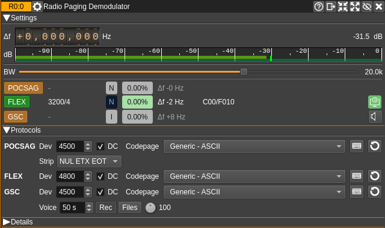
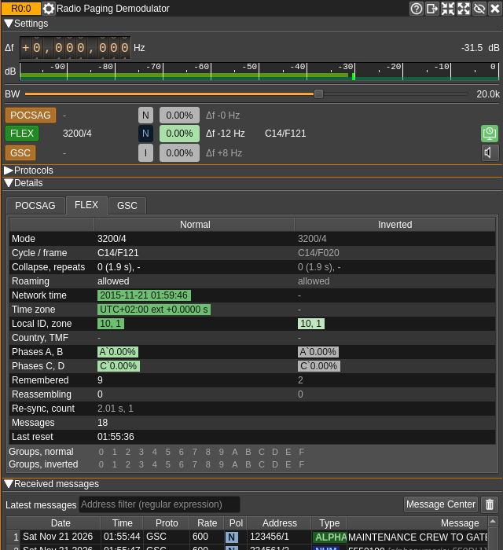
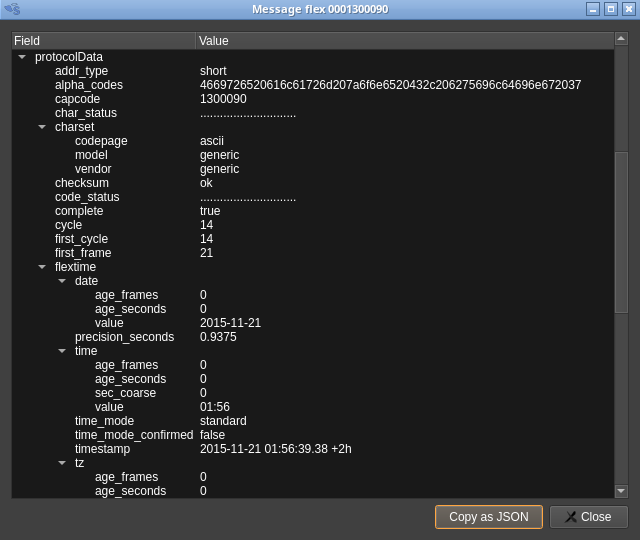

<h1>Radio paging demodulator plugin</h1>

<h2>Introduction</h2>

This plugin receives the three radio paging protocols at the same time, on one channel:

* POCSAG at 512, 1200 and 2400 bit/s ([ITU-R M.584-2](https://www.itu.int/rec/R-REC-M.584/en))
* FLEX in its four modes 1600/2, 3200/2, 3200/4 and 6400/4 (ARIB RCR STD-43A)
* GSC (Golay Sequential Code), with 300 bit/s address words and 600 bit/s data blocks (ITU-R Rep. 900-2 Annex I)

Each protocol can be switched off. A protocol that is on is decoded at every speed (or mode) and polarity: there is nothing else to select. Each decoder hunts for its own synchronisation, and every message received is output with its protocol, speed (or mode) and polarity. Selecting one network or another is done downstream, on the records.

Decoded messages are shown in the channel window and published as message records on the "messages" pipe, for features such as the Message Center that keep the history.

<h2>Networks and polarity</h2>

A paging network is defined by its frequency and its polarity, and for POCSAG and GSC also by its speed:

* Polarity doubles the address range: the same address on the other polarity is another network, and a pager receives only its own polarity. Normal polarity: POCSAG binary 1 is a negative frequency deviation, GSC binary 1 is a positive frequency deviation, FLEX symbol 3 is the highest frequency.
* POCSAG pagers are single speed: each speed is a network of its own.
* GSC has a single speed.
* In FLEX the mode is a property of each frame, chosen by the system frame by frame (FLEX pagers follow it). A FLEX network is one polarity and spans all modes. The mode, cycle, frame and phase of a FLEX message are given in its record.

The decoders keep the state of each network apart: POCSAG and GSC have one decoder per speed and polarity, FLEX keeps fragments, temporary groups, retransmissions, collapse and network time per polarity. Duplicate detection is per network too.

<h2>Signal processing</h2>

The channel is resampled to 38400 S/s and filtered by the channel filter (BW). It then feeds one leg per protocol, each with its own low pass filter and its own FM discriminator scaled to the protocol's deviation. The receiving bandwidth of a leg is the Carson bandwidth of the protocol, 2 x (deviation + highest modulation rate):

* POCSAG: 2 x (deviation + 2400), 13.8 kHz with the default deviation of 4.5 kHz. All three speeds share this leg.
* FLEX: 2 x (deviation + 3200), 16 kHz with the default deviation of 4.8 kHz.
* GSC: 2 x (deviation + 600), 10.2 kHz with the default deviation of 4.5 kHz.

With DC correction (the default), a leg hunts at the width of the channel. The carrier frequency offset is measured as the DC offset of the discriminator on the known patterns of the protocol (POCSAG sync codewords, FLEX sync 1, GSC preamble and start code); the leg is moved onto the carrier and narrowed to the receiving bandwidth. When the reception ends the leg goes back to hunting, centred on the last correction confirmed, which decays to 0 over about 30 s. GSC keeps 2 kHz of room on each side while it receives.

Without DC correction, a leg stays on the channel centre at its receiving bandwidth with 2 kHz of room on each side, and the decoder follows the DC offset of its levels only.

A leg filter that is not narrower than the channel filter is not applied.

<h2>Protocols</h2>

<h3>POCSAG</h3>

The preamble trains the bit clock of the demodulator. Synchronisation uses the codewords only, so a transmission is also acquired when the preamble was missed: a sync codeword with up to 2 bit errors starts a candidate batch, which is decoded when it is confirmed by another sync codeword one batch away, or when all 16 codewords of the batch decode by themselves. A sync codeword missed in a transmission (a fade) does not end it: reception goes on at the expected position and the next batch is decoded when the sync codeword after it confirms it. Two batches in a row without their sync codeword are a sync loss: the transmission ends and the decoder hunts again, as pager decoders do.

A message ends with an idle or address codeword, or after two successive codewords that cannot be decoded (ITU-R M.584-2 2.5.1). A single undecodable codeword is kept in the message and counted as uncorrectable.

The address is the 7 digit RIC followed by the function (the two function bits of the address codeword) as a letter A to D, for example 0300013D.

The message type is not signalled: the message is decoded both as numeric and as alphanumeric (7-bit) and the type whose content scores best is given, the other one is kept as the alternative (alt_type, alt_text). A numeric alternative longer than 18 characters is not given (POCSAG and GSC). A tie is alphanumeric. A message without message codewords is tone only.

The fill at the end of an alphanumeric message (the last character, and the one before when it is the same code) is dropped by the rule selected: NUL; NUL, ETX or EOT; a code without a glyph in the codepage; or a list of codes. The default strips NUL, ETX and EOT.

<h3>FLEX</h3>

A demodulator at 1600 baud, 2 levels, hunts for sync 1 all the time, in both polarities. Sync 1 is accepted with at most 8 bit errors over its 80 bits, or when its two copies of the mode code agree (up to 2 bit errors in one and 3 in the other). A sync 1 with bit errors must also follow the reversals of bit sync 1 (at most 4 bit errors over their last 16 bits). The frame is then received at the rate and number of levels of its mode, its blocks are deinterleaved and its phases (A to D) decoded. Blocks received with a carrier much weaker than during sync 1 are marked erased. The emergency re-synchronization is detected and its length measured.

Each data symbol is decided twice: on the mean of the whole symbol (the matched filter, the best in noise) and on the mean of its centre half (without the transitions, the best when the band of the signal is narrow for its rate, as after the audio filter of a receiver at 3200 baud). Each phase is decoded from the decision that loses fewer codewords; a codeword the other decision corrects fills in one that cannot be corrected, except in the address field, where a codeword corrected wrong would be a message to another pager.

The address is the capcode in 10 digits. Short, long and temporary addresses, and the message types alphanumeric, secure, numeric, special numeric, numbered numeric, binary, short message and short instruction are decoded. A short message with the tone only payload (every digit a space) is a tone only page; a short message of type 1 or 2 (a source, a source with a message number) reads "(type:source source:0)" or "(type:numbered source:3 number:17 retrieval)". An address without a vector at the end of the address field (a tone only address, allowed by the standard) is not decoded: noise and damaged frames end their address field the same way. A vector word whose checksum fails (STD-43A 3.5.1) is not read: the code may correct a word wrong, and an all zero word passes it. A message vector of no words is a message of no words: nothing is read after the vector, its raw data is the vector, it reads "(type:secure, no message words)". Secure messages of type 00 are characters, of the other types their data bits as hex. Priority, maildrop and retrieval are flags of the message.

* Long messages are sent in fragments over several frames. Each fragment is output as it is received, then the reassembled message; a message with lost fragments is output as incomplete.
* Message numbers: the messages with R = 1 of an address are checked for skipped numbers, up to the largest message number of the network, 63 (the WebAPI setting flexMaxMessageNumber sets another).
* Retransmissions of a message are recognised by their message number. A retransmission is output again, tagged duplicate; when its words replaced lost words of an earlier copy it is tagged DUP+.
* Group messages: a short instruction assigns a member capcode to a temporary address (group slot) and the frame of the group message. The instruction is output to the member capcode, the group message once to the temporary address, with its group slot and members (when the assignments were received). In the table the instruction reads "(added to group slot 2, temporary address 2029570, group message in frame 111)" with the chip G2>F111, the group message has the chip G2[n], n members, its tooltip gives the first 20; right click, Group members..., opens all of them (search, copy, the messages of a member), and the details window has them at the top.
* Other short instructions: type 1, a system event, reads "(system event, flags 0x...)"; types 2 to 7 are reserved by STD-43A (Table 3.9.1-1) and read "(short instruction type 5, reserved, data 0x2a5)" with the 11 data bits. The chip SI:n says in its tooltip what the type is, with the data bits in binary and hex.
* The network information of the block information words is kept: date, time and time zone, roaming system ID (local id, coverage zone, country code, traffic management flags), collapse.

<h3>GSC</h3>

The decoders lock on three preamble words, then find the start code (on either of its two words) on the preamble word grid. Address words are decided on pairs of 600 baud symbols (300 bit/s); data blocks are 8 BCH(15,7) codewords at 600 bit/s, with a checksum.

* Batch transmissions (complemented preamble) of 16 slots after each start code, extended by a repeated start code (extended batch) or by a new preamble, are both received.
* The address is the 6 digit cap code followed by the function: the address number 1 to 4 given by which of the two address words are complemented, for example 1978922. What a function means is set by the pager, not by the standard. Tone only, voice and data (numeric or alphanumeric) pages are decoded; the page type is the message type.
* The data type is not signalled: as for POCSAG, the content decides between numeric and alphanumeric. Letters are given in upper case, as GSC pagers display them. Spare codes are given as &lt;0xNN&gt;.
* A voice page has an alert time and a voice message after its activation code. Tone only addresses sent in the alert time are decoded (marked interleaved). The voice message ends with the turn off code, a new transmission, the longest voice message (voice timeout) or the loss of the signal; the record of the voice page is then updated with how and after how long it ended. The voice can be played and recorded (see below).
* Non battery saver transmissions (NBS) have no preamble and no start code, and are always detected. The index digit of the cap code comes from the preamble, so it is N in non battery saver, for example N197892. Their polarity is not given by the signal: it is decided once for the whole transmission, by a data block whose check is right or by the activation code of a voice page, otherwise normal. The messages are held until it is decided.

<h3>Codepages</h3>

The alphanumeric messages of each protocol are shown with the glyphs of a pager codepage (vendor, model and codepage), selected per protocol. The codes without a glyph are given as &lt;0xNN&gt;. CR and LF are shown as the symbols for carriage return and line feed (U+240D, U+240A), GSC CR/LF as the symbol for carriage return, so a message is one line. FLEX Kanji messages are HEX/binary messages in Shift JIS.

Each protocol has a custom codepage too, Custom in the codepages: the default table of the protocol (ASCII, GSC its Table VII) with the codes the pager shows differently mapped to other characters, one character for each code, and the direction of the text (right-to-left: the text is shown in the reverse order of the codes). Custom... opens its editor: every code with its character and Unicode code point, ASCII to start again from the default table, Export and Import of the codepage as a JSON file. OK saves it and chooses it. The custom codes are kept with each record decoded with it (custom_codes), so that the Message Center decodes it again the same way.

<h3>Duplicates</h3>

Nothing is dropped. A POCSAG or GSC page received again within 60 s on the same network (speed and polarity) with the same address, function, type and content is output again, tagged duplicate. FLEX retransmissions are tagged as above. Duplicates are flagged DUP (DUP+ when they repaired an earlier copy) in the info column and have duplicate set in their record.

<h3>Bit error rate</h3>

The bit error rate (BER) is the bits the code corrected over the bits received, over a window that decays by half every 64 codewords. A codeword that could not be corrected counts as 3 bit errors. FLEX gives it also for each phase.

<h2>Interface</h2>

The top and bottom bars of the channel window are described [here](../../../sdrgui/channel/readme.md)

The window has the sections Settings, with a status row for each protocol, Protocols (the settings of each protocol, rolled up at first), Details (the state of the networks received, rolled up at first), the received messages, their output and the waveforms. Each section can be rolled up. Every value has a tooltip that says what it is.

The name of the demodulator in the messages it outputs (their channel) and in the names of its voice files is the title of the channel, set in the channel settings dialog (right click on the window title).

<h3>1: Frequency shift from center frequency of reception</h3>

Use the wheels to adjust the frequency shift in Hz from the center frequency of reception. Left click on a digit sets the cursor position at this digit. Right click on a digit sets all digits on the right to zero.

<h3>2: Channel power</h3>

Average total power in dB relative to a +/- 1.0 amplitude signal received in the pass band.

<h3>3: Level meter in dB</h3>

  - top bar (green): average value
  - bottom bar (blue green): instantaneous peak value
  - tip vertical bar (bright green): peak hold value

<h3>4: BW - Channel bandwidth</h3>

Bandwidth of the channel filter, from 10 to 25 kHz in 100 Hz steps (default 20 kHz: the 16 kHz of FLEX and room for the frequency offset of the transmitter and receiver oscillators). Each protocol filters further to its own bandwidth.

<h3>5: Protocol status rows</h3>

A row for each protocol, always shown, about the network being received (the polarity in sync, else the one received last). The values are grey once the reception ended (the last ones are kept). A protocol is in sync on a real signal only: POCSAG once a sync codeword is confirmed by the next one or a batch is decoded, GSC once the start code or an address follows the preamble, FLEX on the frame sync. A sync codeword or a preamble found by chance in noise or in another protocol changes nothing.

* Protocol button - decode the protocol. Its colour is the state of the reception: grey off, the colour of a switch on while it looks for a signal, green in sync, amber during a FLEX emergency re-synchronization or a GSC voice page. A protocol switched off is reset.
* What is received - POCSAG the speeds in sync, FLEX the mode of the frame (or ERS with its length during an emergency re-synchronization), GSC VOICE during a voice page. Between the frames of a FLEX transmission the reception stays shown until the sync of the next frame is due (1.875 s after the start of the last one).
* Polarity - N normal or I inverted, in the colours of the Pol column of the messages.
* Bit error rate - a box with the rate in it: green without bit errors, yellow when errors were corrected, red when there were errors the code could not correct. The tooltip says how it is measured and gives the counts.
* &Delta;f - the carrier frequency offset.
* FLEX: the cycle and frame of the last frame, and the network time indicator (a clock), in the colours of the indicators of the other channels (NFM, BFM): green when the time was received in this cycle (4 minutes), the icon alone in this hour, grey and dimmed when older or never, grey with a green hue and dimmed while the kind of the time is assumed (see Details; often from noise, so it does not stand out). Its tooltip gives the date, time and zone, the kind of the time, when the time word was last received and until when it stays green and is kept: as cycle and frame of the network and as its time (about), so that it reads right on a recording played back too.
* GSC: the voice audio button (see Protocols).

<h3>Protocols</h3>

The settings of each protocol, in aligned columns:

* Dev - frequency deviation in Hz: POCSAG 4500, FLEX 4800 (outer symbol), GSC 4500 by default. It sets the filter of the protocol and the scale of its discriminator.
* DC - DC offset correction of the protocol (see Signal processing), on by default.
* Codepage - the codepage of the alphanumeric messages, Custom for the custom codepage of the protocol. The keyboard button opens the editor of the custom codepage (see Codepages).
* Reset (recycle button) - makes the receivers of the protocol forget what they remember: the messages for duplicate detection, and for FLEX the fragments, groups, message numbers and network time. The receivers are reset when the device starts too, so that a file played again is not taken as duplicates. Switching a protocol off resets it as well.
* POCSAG: Strip - the rule that strips the fill at the end of alphanumeric messages (default NUL, ETX and EOT). Right click edits the list of the custom codes.
* GSC: Voice - voice timeout, recording, voice files and volume (see below).

<h3>Details</h3>

A tab for each protocol, with a table of the values of each network: the normal polarity in a column, the inverted one in the other. A value of the protocol (the messages, the last reset) is across both. The tooltip of each row says what the value is.

* POCSAG: the speeds in sync, the batches of the transmission, the messages in the deduplication memory (kept 60 s), the messages received and the last reset.
* FLEX, the last frame of each network:
  * Mode, cycle and frame.
  * Collapse, repeats - the system collapse with, in brackets, the longest a page waits for the frame of its pager; xN and the TD collapse for a frame sent N times, - when sent once.
  * Roaming - the roaming bit of the frame.
  * Network time, time zone (with the extended second), local ID and coverage zone, country code and traffic management flags (T3 T2 T1 T0). By the age of the word: a green chip received in this cycle, plain in this hour, grey older. The network time goes on with the frames since its time word, for the whole hour a network may go without sending it. Its kind (standard: the time of frame 0 of the cycle, the offset of the frame added; direct: the time of the frame) is assumed standard, a grey-green chip, until the time words of a cycle tell it.
  * Phases A, B and Phases C, D - the bit error rate of each phase of the frame in a box of the colour of its quality (A at 1600, A and C at 3200, A to D at 6400), A&#96; when the low traffic flag of the phase is set (its addresses end in block 0). The tooltip has the block information of each phase: collapse, carry-on, priority address words and block information words.
  * The messages in the deduplication memory (kept 30 minutes), the messages being reassembled, the last emergency re-synchronization and how many were received, the messages received and the last reset.
  * Group slots - the 16 group slots of each network (temporary addresses 2029568 to 2029583). The colour of a slot is its state: blue members being assigned, amber waiting for the group message, teal the group message being received, green delivered, red missed (its frame went by without it), violet discarded (assigned again to another frame before it), orange timeout (the group message did not end), grey free. An outcome stays shown for 16 frames. The tooltip of a slot gives its state, the number of its members and the first of them, the frame of the group message, the cycle and frame of the assignment and how many frames on the group message is.
* GSC: the state (SYNC, HUNT or VOICE), the preamble, batch and slot of the last page, the messages in the deduplication memory (kept 60 s), the messages received and the last reset.

GSC has in addition, in Protocols:

* Voice timeout - longest voice message in seconds (default 50 s). The voice message ends after this time if no turn off code is received.
* Voice audio button (in the status row) - left click plays the voice message of voice pages: the audio opens when the alert time is over, as a pager opens its audio after the alert, and closes at the end of the page (turn off code, new transmission, signal lost or the voice timeout). It is green while the voice is played. Right click selects the audio output device.
* Rec - left click records the voice message of voice pages to a WAV file; its path is in the message record (voice_file). Right click selects the directory of the files (default: radiopaging/voice/rx in the application data directory).
* Files - the voice files: how many are kept, the space they take, and deleting the old ones. Files older than the number of days set are deleted a few at a time when a new voice file is written (default 3 days); the newest files set are always kept.
* Volume - voice audio volume.

The voice is the GSC discriminator output, with the DC removed, low pass filtered at 3 kHz and resampled to the audio output rate. It is processed only while a voice page is open.

<h3>6: Output of the messages</h3>

What the Pager demodulator has, for the messages of all three protocols. A message is output once, when it is received. The end of a GSC voice message, which only completes the record of its voice page, is not output again.

* UDP - sends each message to the address and port set. Format Pager: the fields of the Pager demodulator, each ended by a NUL: date, time, address, function bits, alphanumeric, numeric, protocol and type. The address has 7 digits for POCSAG and 9 for FLEX, the function bits are only for POCSAG; a numeric message is in the numeric field and its alphanumeric interpretation is in the alphanumeric field, and the other way round. Format JSON: the message record as one line of JSON.
* Log (record button) - writes each message to a .csv file, with the columns of the message record (header first, appended to an existing file). The folder button selects the file.
* Load (arrow button) - reads the messages of a log written by this demodulator into the table. They are not notified again.
* Notifications - a regular expression matched on a field of the message (address, message, protocol, type, channel or any of them), and what is done to a message that matches: its row is highlighted, the text of Speech is spoken (when the build has text to speech), the Command is run, and a position (latitude and longitude) in the message is plotted on the Map named by the address. Speech and Command replace ${address}, ${message}, ${protocol}, ${type}, ${channel} and ${0}, ${1}... (the captures of the expression). A duplicate is not notified again.
* Address filter - only the messages whose whole address matches the regular expression are shown, as in the Pager demodulator (e.g. 12345.., 001001/.). It applies as it is typed. A FLEX group message is shown for the address of a member of its group too; the notifications on the address match the members as well.

<h3>7: Waveforms</h3>

The scope shows two of the signals of the receiver, at the channel sample rate of 38400 Hz: I, Q and the power of the channel, the discriminator of each protocol (1 is the deviation set), the carrier offset correction of each protocol in kHz, and 1 while a receiver of the protocol is synchronised.

<h3>8: Clear messages from table</h3>

Clears the table.

The Message Center button next to it opens the Message Center (and adds it when there is none).

<h3>9: Messages table</h3>

The latest messages, newest at the bottom. The table follows new messages while it is scrolled to the bottom. While a row is selected or the table is scrolled up the rows stay where they are: the new messages wait, a button in the corner of the table counts them, and they come when it is clicked or when the table is at the bottom again with no row selected. The end of a GSC voice message updates the row of its voice page. Duplicates are flagged DUP or DUP+ in the info column. Right click on the header selects the columns. A click on the icon of a voice message plays its file. Double click on a message opens a window with all the fields of its record: its quality and why first, then the common fields, protocolData and the raw payload (also as bits). Right click on a message: details, copy, voice and decode again. Decode as, All codepages... shows the message decoded with every codepage of its protocol; Create rule... (on a message, or on a row of that window) opens the rule dialog of the Message Center filled from the message.

* Time - time the message was received (hover for the date)
* Proto - POCSAG, FLEX or GSC
* Rate - POCSAG and GSC: the speed in bit/s. FLEX: the mode of the frame (bit/s and levels)
* Pol - N normal or I inverted polarity
* Address - POCSAG: RIC and function letter. FLEX: capcode. GSC: cap code and function digit
* Type - ALPHA, NUM, TONE, VOICE, or the FLEX message type (SEC, SPEC, NNUM, NSPEC, BIN, SMSG, SI)
* Message - the text, (tone only) without content. Control characters are given as &lt;0xNN&gt;. The characters are coloured by how they were received: in the colour of the text when received without errors, amber when their codeword was corrected, red on a red tint when it could not be corrected. A lost character is shown as ? (POCSAG: the characters of a codeword that could not be corrected; FLEX: those of a lost word) and a lost FLEX fragment of unknown length as &lt;...&gt;. The alternative decode of POCSAG and GSC is shown after the text, in grey
* Fragment - FLEX: the number of a fragment as it was received, REASM n for a message reassembled from n fragments, INCOMPLETE n for a message with fragments missing
* Info - protocol fields:
  * POCSAG: B batch; END:cut when the signal was lost in the middle of a batch or two codewords in a row could not be decoded (M.584-2 2.5.1: the rest of the message may be missing, it is damaged); END:batch when the message filled the last batch and the transmission ended with it, without the idle codeword M.584-2 1.2 says should end a transmission (the message is whole: the network does not send it). A message ended by an idle or the next address codeword has no END chip
  * FLEX: PH phase, C cycle / F frame, # message number, R retrieval, MD maildrop, PRI priority, LONG long address (or the special address type), Gs[members] group message (hover for the members), K checksum and S signature (ok, bad or ? incomplete)
  * GSC: BATCH or NBS, S slot, CK checksum, INTL interleaved in an alert time, END:cut when the transmission ended before the message did (damaged)
  * DUP duplicate, DUP+ retransmission that recovered lost words
* Quality - how well the message came through: ok (green, clean: no bit errors, every check passed), ~n bits corrected (yellow, corrected: nothing lost), or damaged (red): Xn codewords that could not be corrected, or damaged when the bits were all corrected but a check failed, so the corrections were wrong (a codeword with too many errors can be corrected to another valid codeword), or the message is incomplete. The checks are the FLEX checksum K of the words of each fragment, ok or failed (words lost: failed; a reassembled message has the worst of its fragments), the FLEX signature S of the characters of the whole message (incomplete when characters are lost; in a fragment that is no damage: the rest is to come), and the checksum of each GSC block. A message of fragments one of which is missing is incomplete: damaged. POCSAG has no check over the message: its corrected codewords are trusted. The tooltip gives why; the window of the record has it first. The Message Center filters on it

<h2>Message records</h2>

Each message is published on the "messages" pipe as a message record with the protocol, mode, speed, address, polarity, type, text, raw payload (rawData, rawBits), error counts, duplicate, the absolute frequency and the channel (title, device set and channel index, tuning). The protocol specific fields are in protocolData:

* POCSAG: function, batch, end (idle, address, batch or cut), word_status (one character for each message codeword: . received, c corrected, X uncorrectable), char_status (the same for each character of the text), and the type decision: score, alt_type, alt_text, alt_score
* FLEX: capcode, long_address, addr_type, priority, maildrop, retrieval, cycle, frame, phase, message_number, fragmented, fragment_count, complete, is_fragment, fragment_gap, checksum, signature, kanji, word_map, words_corrected, quality; for alphanumeric and secure messages char_status (one character for each character of the text: . received, c corrected, X lost) and alpha_codes and code_status (the 7-bit characters and their status, to decode them again); for group messages group_slot, group_tracked and group_capcodes; for short instructions instruction_type, instruction_data (the 14 bits of the vector), instruction_slot and instruction_frame, and event_flags for a system event; for short messages short_type, short_source; for secure messages secure_type and payload_unknown; no_words for a message vector of no words; flextime when the network sends the time, the network time as of the frame of the message, in the form of multimon-ng FLEX_NEXT: timestamp (date, time and zone) and precision_seconds (7.5, or 0.9375 with the extended second of the zone word), date, time and tz (with offset_min, dst, zone_code, sec_ext, sec_combined) each with age_frames and age_seconds, time_mode (standard: the time of frame 0 of the cycle, the offset of the frame added; direct: the time of the frame) and time_mode_confirmed (false while it is assumed)
* GSC: function, address_number, preamble, batch, slot, non_battery_saver, end (complete or cut); for data pages checksum_errors, checksum_passed and the type decision; for voice pages voice_end (turn_off, new_transmission, timeout, signal_lost), voice_seconds and voice_file when recorded; for tone only pages interleaved

All records have interpretedBy = decoder.

<h2>REST API</h2>

Settings (RadioPagingDemodSettings): inputFrequencyOffset, rfBandwidth, pocsagEnabled, pocsagDeviation, pocsagDcCorrection, pocsagFill, pocsagFillCodes, pocsagCharset, flexEnabled, flexDeviation, flexDcCorrection, flexMaxMessageNumber, flexCharset, gscEnabled, gscDeviation, gscDcCorrection, gscCharset, gscVoiceTimeout, gscAudio, gscVoiceRecord, gscVoiceDirectory, gscVoiceKeepDays, gscVoiceKeepMin, volume, audioDeviceName and the usual channel settings (rgbColor, title, streamIndex, reverse API, channelMarker, rollupState).

Report (RadioPagingDemodReport): channelPowerDB, channelSampleRate, the state of each decoder (pocsag512Sync, pocsag1200Sync, pocsag2400Sync, flexSync, gscSync: 0 not synchronised, 1 synchronised, 2 synchronised on inverted polarity), flexMode and flexQuality of the last frame, flexErs, flexErsSeconds and flexErsCount, gscVoice, and the number of messages received per protocol (pocsagMessages, flexMessages, gscMessages).
