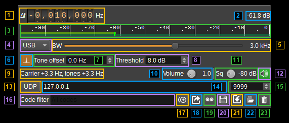
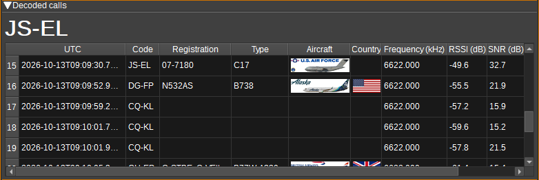
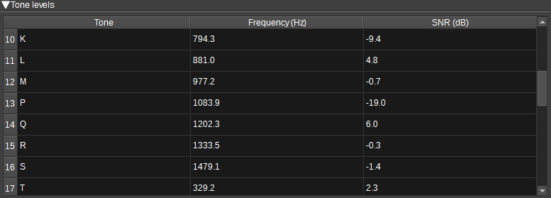
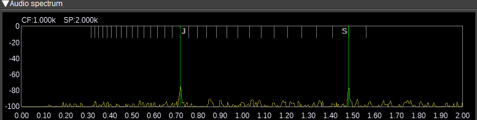

<h1>SELCAL Demodulator Plugin</h1>

<h2>Introduction</h2>

This plugin decodes aviation SELCAL (selective calling) transmissions from HF USB
and VHF AM signals. It supports the original 12/16-tone system and all 32 tones
listed in the [ASRI SELCAL Users Guide, revision E](https://asri.aero/wp-content/uploads/2021/11/20240910-ASRI-SELCAL-Users-Guide.pdf).

A call consists of two simultaneous tone pairs, displayed as `AC-BD`. The four
tones must be distinct. The order of the pairs is retained; symbols within each
pair are displayed in tone designation order. Aircraft that have been assigned
a code can be displayed using a downloadable database. SELCAL codes do not
uniquely identify aircraft, so several aircraft may be listed for a code.

<h2>Interface</h2>

The top and bottom bars of the channel window are described [here](../../../sdrgui/channel/readme.md).



<h3>1: Frequency shift from center frequency of reception</h3>

Use the frequency wheels to set the channel offset in Hz from the device center
frequency. Left click a digit to select it, then use the mouse wheel or keyboard
arrows to adjust it. Shift changes the selected digit by five steps and Control
by two steps. Right click a digit to set the digits to its right to zero.

For USB, tune to the carrier frequency. The channel marker shows the upper
sideband. AM uses a symmetric marker around the carrier.

<h3>2: Channel power</h3>

Displays average received channel power in dB relative to a signal with an
amplitude of 1.0.

<h3>3: Level meter in dB</h3>

- Top bar (green): average power.
- Bottom bar (blue green): instantaneous peak power.
- Bright green vertical marker: peak hold value.

<h3>4: Modulation</h3>

Select **USB** for HF upper-sideband signals or **AM** for VHF amplitude-modulated
signals. Changing modulation selects an initial bandwidth of 3000 Hz for USB or
6000 Hz for AM.

<h3>5: Bandwidth (BW)</h3>

Use the slider to set the bandwidth in 100 Hz steps. For USB, this sets the audio
upper cutoff from 2.0 to 3.6 kHz; the lower cutoff is 100 Hz. For AM, it sets the
full RF bandwidth from 2.0 to 6.0 kHz. The value is displayed beside the slider.

Keep enough bandwidth for both tones in each pair. The highest SELCAL-32 tone is
1557.8 Hz. An AM bandwidth of 6000 Hz covers the complete tone set. The bandwidth
does not change the decoder's sensitivity, as tone levels are measured relative
to the noise in the SELCAL band.

<h3>6: Automatic carrier detection</h3>

Use the carrier button to enable or disable automatic tone offset correction.
It is enabled by default for USB. A stable residual carrier within &plusmn;100 Hz
of the channel tuning supplies the correction automatically. Each tone pair keeps
the offset with which it was acquired. Retuning clears carrier acquisition.

If the carrier is fully suppressed or cannot be detected reliably, the decoder
searches around the manual tone offset. When a carrier fades or is keyed off,
the search is centred on its last measured offset for a further 10 seconds. This button is inactive in AM, which
always tracks the carrier, within &plusmn;1000 Hz, for coherent detection. When
the AM carrier cannot be tracked, envelope detection is used.

<h3>7: Tone offset</h3>

Sets the expected common frequency offset of the received audio tones, from
-100 to +100 Hz. For example, if the tones arrive 20 Hz above their nominal
frequencies, set this to `+20 Hz`.

When automatic carrier detection has a reliable lock, the measured carrier
offset is used instead. Otherwise, the decoder searches for the tones within
&plusmn;6 Hz of this setting, so small USB tuning errors need no correction. The
search is limited to &plusmn;6 Hz because pairs of adjacent tones resemble their
neighbours shifted by about 17.5 Hz: a wider search could decode the wrong code.
For larger errors, tune more accurately, set this offset, or rely on the carrier.

<h3>8: Threshold</h3>

Sets the minimum level of each tone of a pair above the noise, from 6 to 20 dB.
The default is 8 dB. The noise is measured across the SELCAL band, in the
bandwidth of a single tone (about 15 Hz). Lower values detect weaker calls, but
increase the chance of false detections. The tones must also be within 15 dB of
each other, and no third tone or other signal in the SELCAL band may be
comparable with them.

<h3>9: Carrier status</h3>

The status text shows the measured carrier offset and the
tone offset measured by the decoder, for example `Carrier +6.7 Hz, tones +6.7 Hz`.
In AM, it shows whether coherent detection is in use.

<h3>10: Volume</h3>

Use the dial to set the monitoring audio volume from 0.0 (silent) to 10.0 in steps
of 0.1. The default is 1.0, and the value is displayed beside the dial. This does
not change decoder input or detection thresholds.

<h3>11: Squelch threshold (Sq)</h3>

Sets the received RF power threshold for monitoring audio, from -100 to 0 dBFS
in 1 dB steps. The default is -80 dBFS. Audio opens above the threshold, with a
short hold to avoid chatter. The value is displayed beside the dial.

Squelch only controls monitoring audio. SELCAL decoding continues while the
squelch is closed.

<h3>12: Audio mute and audio output selection</h3>

Left click the speaker button to mute or unmute monitoring audio. The button
turns green while the audio squelch is open, including when audio is muted.
Muting audio does not interrupt decoding.

Right click the button to select the audio output device. The current device is
shown in the button's tooltip. See the
[audio management documentation](../../../sdrgui/audio.md) for details.

<h3>13: UDP output</h3>

Check **UDP** to enable or disable forwarding decoded
calls to the UDP address and port. Output is disabled by default. Each received
call produces one UTF-8 JSON datagram, independently of the table filter:

```json
{"code":"AC-BD","utc":"2026-10-02T12:34:56.789Z","frequencyHz":11330000,"rssi":-42.1,"snr":25.0,"toneOffsetHz":6.7}
```

UDP output also works in server mode.

<h3>14: UDP address</h3>

Sets the destination IP address or host name for UDP output. The default is
`127.0.0.1`. A host name is looked up when it is set.

<h3>15: UDP port</h3>

Sets the destination UDP port from 1 to 65535. The default is 9999.

<h3>16: Code filter</h3>

Filters the calls table using a case-insensitive substring match. Hyphens are
ignored, so `acbd` matches `AC-BD`. Leave the field empty to display all calls.
Filtering changes table visibility; logging and UDP output still include every
received call.

<h3>17: Copy calls</h3>

The copy button copies selected rows to the clipboard as tab-separated text,
with the columns shown in the order shown. If no rows are selected, it copies
the code shown in the last-call display.

To copy a single value, right click on its cell in the table and select
**Copy**. For an aircraft image or flag, this copies the registration or
country it represents.

<h3>18: Export calls to CSV</h3>

The export button saves the visible table rows to a selected CSV file. Rows
hidden by the code filter are excluded. The format is the same as the CSV log.

<h3>19: Start/stop logging calls to CSV</h3>

Use the record button to start or stop appending received calls to the selected
CSV log file. Logging is disabled by default. It includes every received call,
independently of the table filter, and also works in server mode.

The CSV columns and an example row are:

```text
UTC,Code,FrequencyHz,RSSI,SNR
2026-10-02T12:34:56.789Z,AC-BD,11330000,-42.1,25
```

<h3>20: CSV log filename</h3>

Click the save button to select the log filename. The current filename is shown
in its tooltip. The default is `selcal_log.csv`.

<h3>21: Download SELCAL database</h3>

Click the download button to download the database of SELCAL codes assigned to
aircraft. It is used to display
the registrations, types and images of aircraft assigned a received code. If the
aircraft database used by the ADS-B demodulator has not been downloaded, you are
asked whether to download it too (45MB): it provides aircraft types and images.
The databases are stored in SDRangel's application data directory.

The [Aircraft feature](../../feature/aircraft/readme.md) uses the same database. When
one is running, every received call is passed to it, and it works out which aircraft
the call was for from the aircraft it is tracking - see its SELCAL section.

<h3>22: Read calls from a CSV log</h3>

Click the load button to select an existing CSV log and add its calls to the
table. The file must contain the `UTC`, `Code`, `FrequencyHz`, `RSSI` and `SNR`
columns. Imported calls do not produce logging or UDP output, or increment the
receiver's call count.

<h3>23: Clear calls</h3>

Click the bin button to clear the calls table, including rows hidden by the
filter. This does not erase the log file or reset the receiver's call count.

<h3>Received calls table</h3>



The table contains:

- **UTC:** approximate start time of the call, using the reception clock and
  sample duration. Recording playback uses reception time rather than the
  recording's original timestamp.
- **Code:** the two received tone pairs, such as `AC-BD`.
- **Registration:** registrations of aircraft assigned the code, from the SELCAL
  database. Codes are not unique, so several aircraft may be listed. The tooltip
  gives the manufacturer, model and operator of each from the aircraft database.
- **Type:** ICAO type designators of the listed aircraft, from the aircraft
  database. `?` is shown for an aircraft that is not in the aircraft database.
- **Aircraft:** image of the first listed aircraft that is in the aircraft
  database.
- **Country:** flag of the country of registration of that aircraft, or of the
  first listed aircraft.
- **Frequency (kHz):** the tuned channel frequency when the call was decoded.
- **RSSI (dB):** average channel power during the two tone bursts, in dB
  relative to a signal amplitude of 1.0.
- **SNR (dB):** level of the weaker tone above the noise in the bandwidth of a
  tone, as for the threshold. Subtract about 22 dB for that tone's SNR in a
  2.5 kHz bandwidth.

Drag column headers to reorder them and resize their edges to change column
widths. Right click on the table header to select which columns are shown.
Column positions, widths and visibility are saved with the channel settings.
There is no automatic history row limit.

<h3>Tone levels table</h3>



Open or close this panel using its rollup header. It displays the designation,
nominal frequency and level of each of the 32 SELCAL tones, in dB above the
noise in the bandwidth of a tone, measured at the current tone offset. A tone is
detectable when its level exceeds the threshold.

<h3>Audio spectrum</h3>



Displays the spectrum and waterfall of the audio analysed by the decoder, from
0 to 2 kHz. The 32 tone frequencies, adjusted by the tone offset, are marked at
the top of the spectrum. The tones of a detected pair are marked across the
full height of the spectrum and labelled. The display controls below the
spectrum are described [here](../../../sdrgui/gui/spectrum.md).
