<h1>DSE (Digital Speech Encoder) Modulator plugin</h1>

<h2>Introduction</h2>

This plugin is the transmit counterpart of the [DSD Demodulator](../../../plugins/channelrx/demoddsd/readme.md). It encodes speech with a vocoder and transmits it using one of the following digital voice protocols:

  - D-STAR: GMSK, 4800 bit/s, AMBE 3600x2400. Supports slow data: the header, a text message and the station's position (D-PRS).
  - DMR: 4FSK (C4FM, root raised cosine alpha 0.2), 4800 symbols/s, AMBE+2 3600x2450. Either continuous as a base station (BS): both time slots with CACH, the selected slot carrying a group or private voice call and the other slot carrying idle bursts; or as a mobile station (MS, direct mode): single slot bursts with the carrier off in between.
  - YSF (Yaesu System Fusion): C4FM, 4800 symbols/s. V/D mode type 2 (DN, AMBE+2 2450 parameter bits with triple redundancy), V/D mode type 1 (AMBE+2 3600x2450) or voice full rate (VW, IMBE 7200x4400).
  - NXDN: 4FSK, 2400 symbols/s (4800 bit/s, 6.25 kHz) or, as NXDN96, 4800 symbols/s (9600 bit/s, 12.5 kHz, +/- 2100 Hz) with the same 192 symbol frames, AMBE+2 3600x2450 (EHR). Conventional voice call on an RDCH.
  - dPMR (ETSI TS 102 490): 4FSK, 2400 symbols/s, AMBE+2 3600x2450.
  - P25 Phase 1: C4FM, 4800 symbols/s, IMBE 7200x4400.
  - P25 Phase 2: 4FSK at 6000 symbols/s, AMBE+2 3600x2450.
  - [M17](https://spec.m17project.org): 4FSK at 4800 symbols/s in 12.5 kHz with Codec2 3200. A text message with no voice input is sent as an SMS packet transmission.
  - Angel61: SDRangel's own amateur digital voice protocol in four profiles:
    - on VHF/UHF Angel61 NB, 6.25 kHz (4800 symbols/s QPSK or 16-QAM), and Angel61 WB, 12.5 kHz (9600 symbols/s QPSK or 16-QAM), 
    - on HF Angel61 HF-NB, 2.7 kHz (50-carrier OFDM), and HF-WB, 6 kHz (110-carrier OFDM) 
    - with 24 kHz V1 speech (vocoscodec) at four tiers (from 1.5kpbs to 12kbps) and WB's top tier using Opus audio at 18.4 kbit/s, LDPC coding, callsign routing, text messages, positions, file transfers and IP tunneling.

The AMBE and IMBE speech encoder of the D-STAR, DMR, YSF, NXDN, dPMR and P25 modes can be either:

  - **mbevocoder**: the [mbevocoder](https://github.com/srcejon/mbevocoder) software encoder, the default.
  - **AMBE**: a DVSI AMBE-3000 device (ThumbDV, DV3000 or an AMBE server) handled by the [AMBE feature](../../../plugins/feature/ambe/readme.md). Add an AMBE feature, open the device in it, then select the feature in the vocoder list (11).

M17 encodes with Codec2 and Angel61 with V1 or Opus.

<h2>Interface</h2>

The top and bottom bars of the channel window are described in the [Channel window](../../../sdrgui/channel/readme.md) documentation.

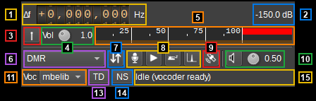

<h3>1: Frequency shift from center frequency of transmission</h3>

Use the wheels to adjust the frequency shift in Hz from the center frequency of transmission. Left click on a digit sets the cursor position at this digit. Right click on a digit sets all digits on the right to zero. This effectively floors value at the digit position. Wheels are moved with the mousewheel while pointing at the wheel or by selecting the wheel with the left mouse click and using the keyboard arrows. Pressing shift simultaneously moves digit by 5 and pressing control moves it by 2.

<h3>2: Channel power</h3>

Average total power in dB relative to a +/- 1.0 amplitude signal generated in the pass band.

<h3>3: Transmit (PTT)</h3>

Starts and stops a transmission. When started the header is sent followed by the speech frames. When stopped the protocol's end of transmission is sent (the D-STAR end sequence, the DMR terminator, the NXDN release, the P25 terminator...) right after the last speech frame, then the carrier is switched off. A DMR base station follows its terminator with about one second of idle bursts.

<h3>4: Audio input gain</h3>

Adjusts the level of the speech input from 0.0 to 3.0.

<h3>5: Level meter</h3>

Shows the speech input level fed to the vocoder.

<h3>6: Protocol</h3>

Select the digital voice protocol: D-STAR, DMR, YSF, NXDN, NXDN96, dPMR, P25, P25P2, M17, Angel61 NB, Angel61 WB, Angel61 HF-NB or Angel61 HF-WB. The protocol's parameters are in the first tab of the tab bar (16 to 23), which is named after it.

<h3>7: Invert</h3>

Inverts the polarity of the transmitted symbols. Use it if the receiving radio only decodes the signal with the opposite polarity. Not shown for Angel61, whose linear modulation has no polarity to invert.

<h3>8: Speech input</h3>

Select the speech input. Click to select one of:

  - Microphone: the audio input device. Right click on the button to select the audio input device. The button turns red if the audio device cannot be opened. The audio input sample rate has to be an integer multiple of 8 kHz.
  - File: the audio file of the Audio file tab (24), played into the vocoder.
  - Morse keyer: a keyed tone using the CW keyer (30). Frames with the key down go out as tone frames under the same conditions as the tone below.
  - Tone: a sine wave at the frequency set by the dial next to it, which is there only while Tone is selected. With the mbevocoder back end and tone detection (13) on, an AMBE protocol carries it as AMBE tone frames rather than voice coded audio: the receiving radio regenerates a clean tone at the level set by the audio input gain (4). Frequencies outside the AMBE tone set (218.75 Hz to 3812.5 Hz in 31.25 Hz steps, plus 156.25 and 187.5 Hz) are rounded to the nearest one.

Clicking one takes the selection from whichever was selected and clicking the selected one off leaves none selected, which sends silence frames.

<h3>9: Position</h3>

When on, sends this station's position (from Preferences > My position, or the GPS feature), refreshed every 5 s during a transmission:

  - D-STAR as a D-PRS sentence in the slow data (16),
  - DMR as a GPS Info embedded LC (17),
  - Angel61 in its position slot (22).

The button is hidden for protocols that do not support it (YSF, NXDN, dPMR, P25 and M17).

<h3>10: Audio feedback</h3>

Left click to hear the local audio before it is encoded (the microphone, file, keyer or tone as it goes into the vocoder), or, while relaying, the decoded Angel61, DMR and D-STAR gateway audio. Right click to select the audio output device. The dial next to it sets the feedback volume.

<h3>11: Vocoder</h3>

Selects the speech encoder back end as described in the introduction. The list holds the software encoder when it is built in and then every AMBE feature the instance has (`AMBE F:0` and so on). It is hidden for M17 and Angel61, which encode with Codec2 and V1 or Opus.

<h3>12: Gain</h3>

Vocoder input gain in dB of an AMBE device. Shown when an AMBE feature is selected (11).

<h3>13: TD - Tone detection</h3>

When on, a single tone, DTMF digit or call progress tone in the input is sent as a tone frame rather than coded as voice, which is what makes DTMF over the air reliable. Shown for the mbevocoder encoder, and for Angel61, where it sends DTMF heard in the speech input as DTMF data (29).

<h3>14: NS - Noise suppression</h3>

Noise suppression on the speech input, for a noisy microphone. Adds 20 ms of delay. Shown for the mbevocoder encoder.

<h3>15: Status</h3>

"Idle" with the vocoder availability (ready, or unavailable when the mbevocoder encoder is not built in or no AMBE feature is connected), or while transmitting `TX n frames, n enc, n under, n over, n trim` and, with the microphone input, `mic -n +n`:

  - frames: protocol frames (bursts) sent.
  - enc: vocoder frames received from the encoder.
  - under: vocoder frames replaced by silence because none had arrived in time. A few at the start of a transmission with an AMBE device are normal; a steady count means the encoder cannot keep up.
  - over: vocoder frames dropped because the queue reached its bound of 50 frames, which only happens if the audio source runs far ahead of the transmitter. Should stay at 0.
  - trim: vocoder frames dropped by the delay control (see Timing and latency). It drops at most one frame a second. One or two early in a transmission are normal, while the queue settles, and each is that frame's length of speech missing. After that, a count rising slowly means the audio clock runs faster than the SDR clock and the control is keeping the delay constant: 100 ppm takes a 20 ms frame every 200 s.
  - mic -n: 20 ms frames that were short of microphone samples and were zero filled (the audio device is behind the SDR clock, or dropped out).
  - mic +n: microphone blocks discarded because the input buffer was full (the audio device is ahead of the SDR clock). Both should stay at 0 with working audio; a steady count indicates a clock rate mismatch between the audio device and the SDR.

<h3>16: D-STAR</h3>

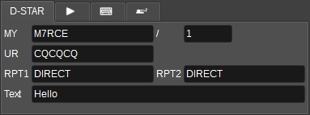

  - MY: own callsign (8 characters) and, after the `/`, its suffix (4 characters).
  - UR: destination callsign, CQCQCQ for a general call.
  - RPT1, RPT2: repeater callsigns, DIRECT for simplex.
  - Text: 20 character text message sent in the slow data, alternating with the header retransmission.

The position button (9) sends this station's position as a D-PRS (GPS-A) sentence in the slow data, about every 10 s and first right after the header. The sentence is an APRS position report with timestamp, altitude and the D-STAR CRC (`$$CRChhhh,MYCALL>APZSDR,DSTAR*:/hhmmssh ddmm.mmN/dddmm.mmW-000/000/A=ffffff SDRangel`), which D-STAR gateways forward to APRS-IS, so the station appears on aprs.fi with its real position: leave it off unless the preferences hold the right one. The DSD Demodulator shows the position as a locator with bearing and distance.

<h3>17: DMR</h3>

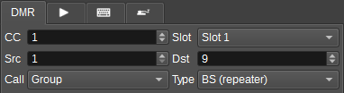

  - CC: colour code (0 to 15).
  - Slot: the time slot carrying the voice call. In BS type the other slot carries idle bursts.
  - Src: own DMR ID.
  - Dst: destination talk group (group call) or DMR ID (private call).
  - Call: group call or private (unit to unit) call.
  - Type: BS (repeater) transmits continuously as a base station: both slots with CACH, the voice call in the selected slot and idle bursts in the other, as a repeater output. MS (direct) transmits as a mobile station: one 27.5 ms burst per 60 ms frame with the MS sync patterns and no CACH, and the carrier off (ramped over 0.5 ms) in the guard time and the other slot. This is what radios send to each other in direct mode / talkaround and what a simplex hotspot expects. Talking to a real repeater as an MS is not covered: that needs the bursts aligned to the repeater's slot timing, which requires receiving it.

The position button (9) sends this station's position as a **GPS Info** full link control
(ETSI TS 102 361-2 7.1.1.4, FLCO 8) in the embedded signalling of a voice superframe, which is
where the voice link control itself rides, so it costs no extra bursts. One superframe in five
carries the position and the rest keep the voice LC, which is what lets a receiver join a call
late: a position therefore goes out about every 1.8 s. The longitude and latitude are the
standard's two's complement fractions of the full range, about 1.1e-5 degrees a step, and the
accuracy class is sent as "within 20 m" for a GPS fix and "unknown" for a position typed into
the preferences. The [DSD Demodulator](../../../plugins/channelrx/demoddsd/readme.md) decodes it
as an `EVT:GPS` event and puts the station on the map.

<h3>18: YSF</h3>

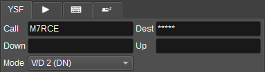

  - Call: own callsign (10 characters).
  - Dest: destination callsign, ***** for all stations.
  - Down, Up: downlink and uplink repeater callsigns, blank for simplex.
  - Mode: the voice mode, sent in the FICH's data type: V/D 2 (DN, the default and what radios send), V/D 1, or Voice FR (VW, IMBE, the vocoder at P25 Phase 1's rate). Some radios and repeaters take V/D type 2 alone. Web API: `ysfMode` (0 V/D 2, 1 V/D 1, 2 voice full rate).

<h3>19: NXDN</h3>

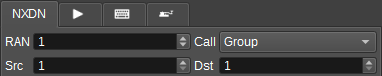

The same parameters serve NXDN and NXDN96.

  - RAN: radio access number (0 to 63).
  - Call: group or individual call.
  - Src: own unit ID (1 to 65535).
  - Dst: destination group or unit ID.

<h3>20: dPMR</h3>

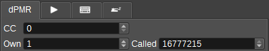

  - CC: colour code (0 to 63).
  - Own: own ID (24 bit).
  - Called: called ID (24 bit), 16777215 for an all call.

<h3>21: P25</h3>

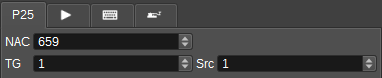

  - NAC: network access code (12 bit, entered in decimal: 659 is the usual 0x293).
  - TG: talk group (16 bit).
  - Src: source ID (24 bit).

The same parameters serve P25 Phase 2. Its scrambling also depends on the WACN and system ID, which are the `p25p2Wacn` and `p25p2Sysid` settings of the Web API (0xBEE00 and 0x001 by default, the DSD demodulator's defaults as well).

<h3>22: M17</h3>

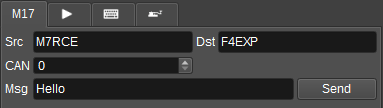

  - Src: source callsign (up to 9 characters of `A-Z 0-9 - / .`).
  - Dst: destination callsign, empty or `ALL` for everyone.
  - CAN: channel access number (0 to 15), M17's equivalent of a colour code.
  - Msg and Send: a text message. With no speech input it is sent as an SMS packet transmission of its own; Send keys up, sends it and keys down again.

<h3>23: Angel61</h3>

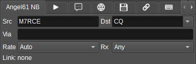

The same parameters serve the four Angel61 profiles.

  - Src, Dst: source and destination callsigns - with an SSID of 0 to 15 after a dash where the station has one (`G4ABC-7`) - `CQ` for everyone, or `TG n` for a call to talkgroup n (the list offers the talkgroups of the server of any [DSGateway](../../feature/dsgateway/readme.md) transmitting through this modulator, as `TG 9 - Local`). A callsign is up to 9 characters of `A-Z 0-9 - / .`, or up to 17 of `A-Z 0-9 /` with an SSID (`EA8/G4ABC/QRP-7`). Dst is editable and also lists the callsigns reported as heard by Rx, or the union from all DSD Demodulators when Rx is `Any`. A station is matched by its base callsign and SSID, so a request from `G4ABC/P` counts for `G4ABC`. A new channel takes its source from the station name of the preferences when that is a valid callsign.
  - Via: an optional path of up to two callsigns separated by a comma: repeaters, or a talkgroup gateway's callsign (with its SSID, `M7RCE-10`) to make a call to a callsign in Dst a private call through the network.
  - Rate: the tier / bitrate for transmission. Each profile has four, V1 voice: NB `2.25k QPSK`, `3.0k QPSK`, `4.5k QPSK`, `9.0k 16-QAM`; WB `4.5k QPSK`, `9.0k QPSK`, `12k 16-QAM`, `Opus 16-QAM` (Opus audio at 18.4 kbit/s: music and wideband sound as well as speech, with no data under it); HF-NB `1.5k QPSK`, `2.25k 16-QAM`, `3.0k 16-QAM`, `4.5k 16-QAM`; HF-WB `2.25k QPSK`, `4.5k QPSK`, `6.0k 16-QAM`, `9.0k 16-QAM`. `Auto` follows the rate request of a receiver, which is determined by measuring the SNR of the signal it receives. It is tier 0 to CQ, a talkgroup or before a reply is heard.
  - Rx: the DSD Demodulator the rate request and the heard callsigns are taken from. `Any` (the default) uses whichever of them hears the destination.
  - Link: what was heard: the tier the destination asked of this station with its constellation in this profile (`asked tier 3 (16-QAM)`) and the tier this station asks of it in its own headers (`asking 0` to `asking 3`, the demodulator's judgement of the destination's transmissions). `Link: none` means no usable record, so `Auto` is at tier 0.

<h3>24: Audio file</h3>

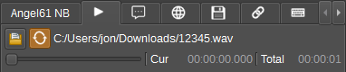

The first row opens a file, sets the loop and shows the file's name; the second has the time navigator, the elapsed time and the total time.

  - Open an audio file: a `.wav` file (16 bit signed PCM, mono or stereo, any sample rate: it is resampled to the vocoder's 8 kHz, or 24 kHz for V1 (Angel61) and 48 kHz for Opus (Angel61 WB's tier 3), and a stereo file's channels are averaged) or a headerless `.raw` file (8 kHz, 16 bit signed integer, mono, little endian). A raw file can be produced with `sox speech.wav --encoding signed-integer --bits 16 --rate 8k --channels 1 speech.raw`.
  - The file name is kept with the channel settings (presets, configurations, the `audioFileName` Web API setting) and the file is reopened when they are restored.
  - Loop: play the file in a loop.
  - The play button of the speech inputs (8) selects the file as the speech input and plays or pauses it.
  - The navigator sets the position in the file while the file is not the selected input (it is disabled while the file plays).

<h3>25: Text message</h3>

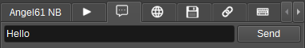

Angel61 only. A text message and Send. With a speech input it rides in the data slots of the transmission (up to 180 7-bit characters); with no speech input selected, Send keys up a data only transmission that carries the message (UTF-8, repeated) and keys down again by itself. A message present at key up is sent with the transmission.

<h3>26: APRS</h3>

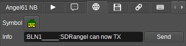

Angel61 only.

  - Symbol: the APRS symbol this station sends in its parameters slot. The button shows it and opens the two symbol tables as grids of their icons to pick it from, with an overlay character for the alternate table. The icons are the [APRS feature](../../../plugins/feature/aprs/readme.md)'s, read as a resource; a build without that feature shows the two characters that name the symbol instead. A receiver draws the station with it when it puts the position on the APRS network (`sdrbase/dsp/dv/ANGEL61.md` 3.3); unset means unspecified and the receiver chooses from the position itself.
  - Info and Send: an APRS information field sent as data (see below).

**Sending APRS.** A text message is already APRS: the receiver turns one addressed to a callsign
into a message (`:ADDRESSEE:text`) and one to `CQ` into a status, and it turns the position slot
into a compressed position report with the symbol, course and speed (`sdrbase/dsp/dv/ANGEL61.md`
3.3). So the Text message tab (25) is how an APRS message is sent, and nothing else is needed for it.
The **Info** field of the APRS tab is for what those native fields cannot say - an object, a
weather report, a bulletin, telemetry, a message acknowledgement - which the format carries
verbatim as content type 2: everything after the colon of a TNC2 line, with the receiver putting
this station's callsign in front of it. Send keys up a data transmission of its own and keys down
again by itself. To relay a packet another station originated, use APRS's own third party format
(`}SOURCE>PATH,TCPIP*,CALL*:payload`) here, so that nothing is attributed to this station.

<h3>27: File transfer</h3>

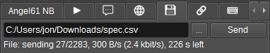

Angel61 only. A file to offer (`ANGEL61.md` 3.4), picked with the `...` button. Send starts it: the transmission is keyed up, the offer and the blocks go out in data frames, and the station receiving it answers with the blocks it missed - the modulator keys up again for each of those rounds, up to five, and the label under the file name shows the state, the blocks and the round. A file sent to `CQ` or a talkgroup (`TG n`) goes once through: nobody answers a group, so the transfer is done when its last block has gone, and a station that missed blocks needs the file sent again. On VHF, at NB's 30 bytes a frame (QPSK) and 70 (16-QAM), a 100 kB file is about four and a half minutes on the air, or two.

The file transfer's progress and its rate are reported twice a second while a transfer runs. The
rate is averaged over the transfer rather than taken between two reports, which is what it has to
be: a report is a snapshot, and two of them close together read as megabits a second.

<h3>28: IP tunnel</h3>

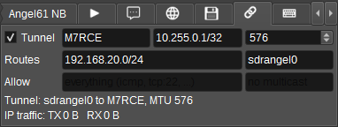

Angel61 only. The Angel61 modes can carry **IP datagrams** for one other station, so that two
sites with no other path exchange ordinary network traffic over the radio.
Know what it is before turning it on: the link carries
**333 bytes/s** at the low rate and 900 at the high one. Interactive SSH is
comfortable, a web page is not.

The fields of the tab (the unlabelled ones show what they are for when empty):

| Field | What it is |
|---|---|
| **Tunnel** | Turns it on. The host interface is created when Angel61 first needs it, which needs administrator or root. On Windows, accept the UAC prompt for the bundled tunnel helper; SDRangel itself does not restart or become elevated, and the signed `wintun.dll` must be beside the executables. The helper stays open while Tunnel remains ticked, so changing away from and back to Angel61 does not prompt again |
| **Peer** | The callsign at the other end. A datagram is only sent to that station and only accepted from it |
| **Address** | This end's address on the tunnel with its prefix length, `10.255.0.1/32`. The other station uses a different one |
| **MTU** | 576 suits the low rate (29 fragments, 1.7 s a datagram). IPv6 needs 1280, which is 65 fragments and, at 1% block error rate, about half of them lost |
| **Routes** | The prefixes routed into the tunnel and advertised to the peer, comma separated: `192.168.20.0/24, 2001:db8::/64`. Nothing outside them is sent |
| **Interface** | The name of the host interface to create (`sdrangel0`) |
| **Allow** | What may be sent, comma separated: a protocol (`icmp`, `tcp`, `udp`, `gre`, `esp`, `ah`, `sctp` or a number) with a port or a port range for TCP, UDP and SCTP, which either port of a datagram may be in, so that a session's replies pass too: `icmp, tcp:22, udp:53`. Empty: everything. A list that cannot be read sends nothing, and says which term it could not read. Web API `angel61TunnelAllow` |
| **Groups** | Multicast groups sent all the same, comma separated (`224.0.0.251, ff02::fb`), still subject to Allow; every other multicast and broadcast destination is refused. Web API `angel61TunnelGroups` |

The receiving side is a **DSD Demodulator** in the same instance, with Angel61
in its protocol list; it passes what it hears to this modulator over the
`angel61` pipe, the same one the rate requests and file transfer answers use.
Pick which demodulator with the **Rx** selector (22) if there is more than one.
The demodulator's IP tunnel tab shows what it heard beside what this modulator did with it.

To join two LANs, give each station a different address, enable IP forwarding
on both hosts, permit it in their firewalls, and add a route on each LAN's own
router through its local tunnel host - `../../../sdrbase/tun/README.md` has further information.

Broadcast and multicast are not supported, as the link is too slow for most protocols.
There is no encryption, in keeping with amateur radio regulations.

<h3>29: DTMF</h3>

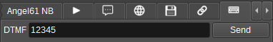

Enter up to 32 DTMF digits (0-9, A-D, * and #) and press Send. The digits are sent as AMBE dual tone frames, 100 ms per digit with 100 ms gaps, with the mbevocoder back end (with the other back ends the digits are synthesised as audio and voice coded). If a transmission is in progress the digits replace the speech input while they are sent. If not, a transmission is started for the sequence and stopped after it, so a repeater or an EchoLink node can be controlled with a single click. Releasing the PTT (3) drops the remaining digits.

On the Angel61 modes the digits are data, never voice (`sdrbase/dsp/dv/ANGEL61.md` 3.8): they go in the DTMF slot, each at least twice, and the receiver plays them again as tones of the same length and shows them as text. While they play the frames are idle, the speech input not coded, and the transmission lasts until they have played; a Send with no transmission in progress makes a transmission of its own for them. A relay (the `angel61` network input) sends the DTMF of the call it relays in its own slots.

<h3>30: CW keyer</h3>

Controls of the Morse keyer used by the Morse keyer speech input (8). See the [CW keyer](../../../sdrgui/gui/cwkeyergui/readme.md) documentation.

<h3>31: Spectrum</h3>

Spectrum of the modulated signal at 48 kS/s, or, with the AF button above it on, of the speech input as passed to the encoder (after the input gain, at the encoder's sample rate: 8 kHz for the AMBE and IMBE vocoders, more for Angel61 wideband codecs). See the [spectrum](../../../sdrgui/gui/spectrum/readme.md) documentation.

<h2>Attribution</h2>

This code was mostly written by AI, so thanks to everyone whose code it was trained on.
