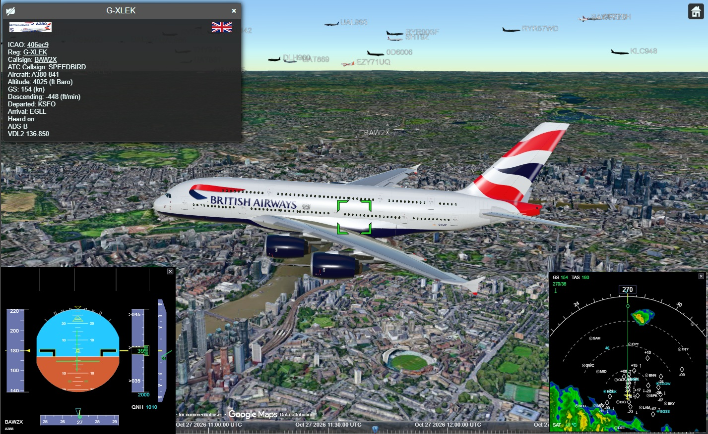
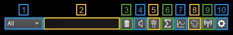
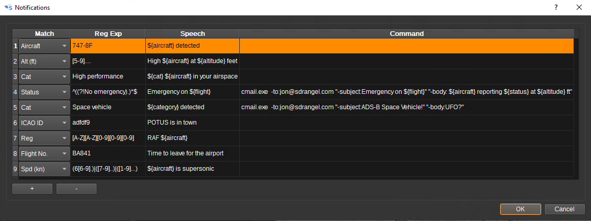
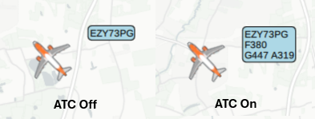
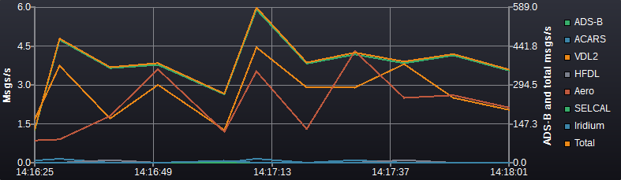
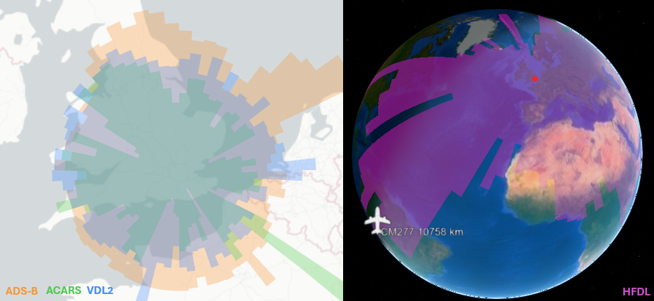
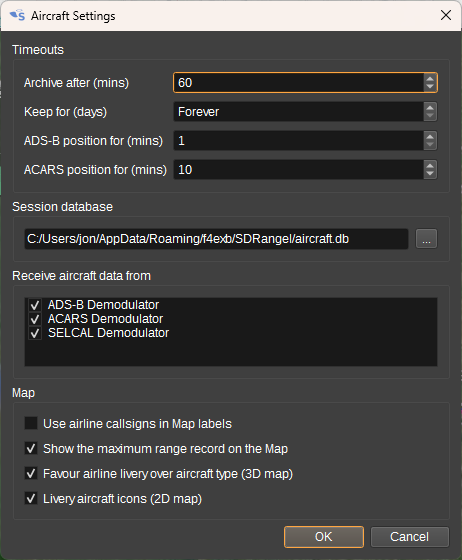
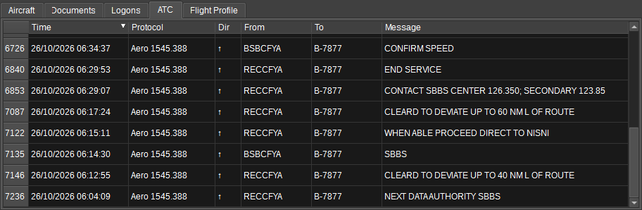

<h1>Aircraft Feature Plugin</h1>

<h2>Introduction</h2>

The Aircraft feature collates aircraft data from multiple demodulators into a single
aircraft list, and sends the combined aircraft to the [Map feature](../map/readme.md).

Reports are received from the [ADS-B demodulator](../../channelrx/demodadsb/readme.md),
the [ACARS demodulator](../../channelrx/demodacars/readme.md) (VHF ACARS, VDL Mode 2
HFDL, Aero and Iridium modes) and the [SELCAL demodulator](../../channelrx/demodselcal/readme.md),
from any number of channels in any device set.

Combining protocols matters because each sees a different slice of a flight: ADS-B gives
continuous positions in VHF range, VDL-2 sees logons and CPDLC near airports, and HFDL/Aero
can report an aircraft's position from thousands of kilometres away, hours after it left
ADS-B range. The feature merges these into one aircraft with one track.

<h3>Aircraft identity</h3>

Reports may identify an aircraft by any of:

* 24-bit ICAO address (ADS-B/HFDL/VDL-2 logons),
* registration (VHF ACARS header, or looked up from the ICAO address via the aircraft database),
* flight number / callsign.

The feature merges reports under whichever identities it has seen, cross referencing
registration and ICAO address through the aircraft database. A flight number is
remembered as the aircraft's most recent flight.

<h3>Session persistence</h3>

The collated aircraft, flights, documents and ATC log are saved to a SQLite database
(aircraft.db in the application data directory) every minute and on exit, and restored
when the feature is next opened.

<h3>Map</h3>

Aircraft with a position are sent to the [Map feature](../map/readme.md), named by registration when known.

The map item carries:

* An icon matching the aircraft type & livery.
* The full track accumulated across all protocols - so a flight tracked on ADS-B and
  picked up again hours later on HFDL shows one continuous track.
* A popup headed by a side view of the type in the operator's livery and the country
  flag, followed by registration and flight number, that are **links** to select that aircraft or flight in this feature,
  aircraft type, departure/arrival airports, route if available, and the
  protocols and frequencies the current flight has been heard on.
* PFD and ND data from ADS-B (speed, altitude, heading etc) and ACARS data (waypoints).



The routes an aircraft has been given are [drawn](#documents) for the aircraft or flight
selected in the tables.

Routes are drawn in the Map's **Aircraft Routes** item group rather than the **Aircraft** group,
so that their colour, labels and above all their minimum zoom can be set independently of
the aircraft icons.

Selecting one of an aircraft's past flights draws that flight's track instead of the one
it is on now.

Aircraft are removed from the table and the Map after a configurable number of minutes
without a report.

<h2>Interface</h2>



<h3>1: Find column</h3>

Which field the Find box (2) looks in - All, ICAO, Reg, Type, Callsign or SELCAL.

<h3>2: Find</h3>

The Find box highlights the next row matching what is typed, stepping through the matches
on each press of Enter. It searches the ICAO address, registration, type, flight number,
airline and departure and arrival airports at once, or a single one of them when the
column selector (1) is set to something other than All. The text turns red when
nothing matches.

<h3>3: Delete aircraft</h3>

Deletes every aircraft from the database: current and past, with all of their flights,
tracks, and associated data. They are also removed from the Map. This cannot be undone.

The statistics and coverage are kept. Each has its own reset, on its button's context menu.

<h3>4: Notifications</h3>

Opens the notifications dialog.

The notifications dialog holds rules matched against each aircraft's ICAO address,
registration, flight or type with a regular expression. When an aircraft first matches
a rule, the rule's speech text is read aloud and/or its command is executed, with
${icao} ${reg} ${flight} ${type} ${protocol} substituted. Each rule fires at most once
per aircraft.



<h3>5: ATC</h3>

When checked, aircraft labels on the Map show callsign, flight level, speed and type in
an ATC style; when unchecked just the callsign or registration is shown.



<h3>6: Statistics</h3>

The statistics table can be shown and hidden with the statistic button.
Right click the button to reset the records.

Every figure is given twice, side by side: for this session and for all time, each with
who set it and when.

* **Maximum range**, one row per protocol - the furthest aircraft heard on ADS-B, ACARS,
  VDL-2, HFDL and Aero. Per protocol rather than as one figure because the protocols are
  not comparable: line of sight VHF, HF skywave and an L band satellite downlink have
  nothing to do with one another, and a single "maximum range" would only ever show the
  satellite
* **Fastest ground speed** and **Highest altitude**, with the aircraft that set each
* **Most aircraft at once** - the largest number heard within any 15 minute window
* **Aircraft heard** - how many different airframes
* **Total messages**, then one row per protocol giving that protocol's count and its
  share of the total. The share is of that scope's own total, so a protocol that has been
  quiet today shows its reduced share against its long run one rather than against nothing
* **Listening time** and **Messages per minute**


<h3>7: Chart</h3>

Shows and hides the message rate chart. Right click the button to clear the data.

The chart plots the message rate per protocol (and in total) over time. ADS-B and the
total, which runs hundreds of times faster than the other protocols, are plotted against
the right hand axis; every other protocol against the left. Click a legend entry to show
or hide a series.

The mouse wheel zooms the time axis in and out about
the cursor, and with shift held, the rate axes. Double click the plot to go back to
showing all the data, with the rate axes fitted to it.



<h3>8: Coverage</h3>

Check to display per protocol receiver coverage on the map: the furthest an aircraft has been
heard on each bearing, drawn in a different colour for each protocol. The coverage is kept in
the database, so it builds up across sessions.

Right click to choose which protocols' coverage is displayed, or to reset the coverage data.



<h3>9: Feed</h3>

The Feed button forwards every ACARS message the ACARS demodulators decode on to
community aggregators, as acarsdec-style JSON - one object per UDP datagram, or a
newline-delimited stream over TCP. Right click it for the settings: a station identifier
sent with every message, and per-service enables with host, port and protocol.

It lives here rather than in the ACARS demodulator because a receiver runs one of those
per band - VHF, VDL-2, HFDL - and the feed had to be filled in identically in each,
opening three sets of connections to the same aggregator under the same station identity.
The station is a property of the receiver, so it is set up once and every demodulator
feeds through it.

Note that airframes.io assigns the protocol **per station type**: their VDL2 (vdlm2dec)
wizard says TCP 5555, while the ACARS (acarsdec) station type ingests **UDP on 5550** and
shows no protocol box at all. SDRangel emits acarsdec-format JSON, so create an
ACARS/acarsdec station for this feed. A TCP connection to 5550 is refused, which shows up
as a "feed not connected ... reconnecting, message dropped" loop in the log.

Unlike the aircraft tables, the feed is not filtered by the per-demodulator enables in the
settings dialog: those say which demodulators contribute to what is tracked, and a
receiver may reasonably want to feed a band it does not track.

<h3>10: Settings</h3>

Click to open the settings dialog.



**Timeouts**

* Archive after (mins) - how long without a report before an aircraft moves to the Old
  Aircraft table and comes off the Map. It is also where one flight ends: an aircraft
  heard again after a longer gap is on a new flight, and its last position, altitude,
  heading, speed and distance are cleared rather than shown as current.
* Keep aircraft for (days) - how long archived aircraft are kept in the database
  before being discarded, with all of their flights. Zero keeps them forever, at the cost
  of a database that grows without limit
* Keep flights for (days) - how long a flight is kept after it was last heard.
  This allows aircraft to be kept forever, but only their
  recent flights - which hold the tracks, profiles and ACARS documents, so are most of the
  database. An aircraft's most recent flight is always kept. Zero keeps flights for as long
  as their aircraft.
* ADS-B position for (mins) - how long an aircraft stays on the Map after its last ADS-B
  position
* ACARS position for (mins) - the same for a position from ACARS, VDL-2, HFDL, Aero or Iridium.
  Two figures rather than one because the protocols report at wildly different rates:
  ADS-B about once a second, where an oceanic position report can be the only one for
  many minutes.

**Session database** - the file the aircraft, flights and messages are saved in.

**Receive aircraft data from** - which demodulators this feature accepts reports from.
Unticked ones are ignored.

**Use airline callsigns in Map labels** - writes the flight on the Map the way it is
spoken on the radio rather than the way it is transmitted: SPEEDBIRD 123 instead of
BAW123, using the airline's radio callsign from the airline database.

**Show the maximum range record on the Map** - keeps the aircraft that set the all time
maximum range record permanently on the Map, drawn at the position it was in when it set
it rather than wherever it is now. The
bubble names the aircraft, the distance, the protocol it was heard on and when. It is the
best record across all protocols, and it stays until the record is beaten, the records are
reset, or this is turned off.

**Favour airline livery over aircraft type (3D map)** - when no 3D model exists of the
right type in the right livery, prefer a similar aircraft in the correct livery over an
exact type in the wrong one.

**Livery aircraft icons (2D map)** - display aircraft on the 2D map using icons showing
their airline's livery, instead of black icons.

<h3>11: Download aircraft database</h3>

Downloads the latest aircraft database (45MB). It maps ICAO addresses to registrations and
gives each airframe's type, model, operator and owner, which fill in the Aircraft table.
Without it, an aircraft heard by
its ICAO address on one protocol and by its registration on another is only recognised as
the same airframe where something else links them, such as a flight number (see Aircraft
identity above).

It is the same database the ADS-B and ACARS demodulators download, so it only
needs downloading from one of them.

<h3>12: Find datalink aircraft</h3>

When checked, each time a datalink ATC message (CPDLC, pre-departure clearance or oceanic
clearance) arrives for an aircraft that is on the Map, the aircraft is found on the Map, as
if Find had been chosen for it. The 3D map follows the aircraft, and its DCDU pops up with
the message. This is a way of watching datalink traffic as it happens, but with a lot of
traffic the view will jump from aircraft to aircraft.

Right click to choose messages that are sent to the Map without finding their aircraft:
WILCO, ROGER, LOGICAL ACKNOWLEDGEMENT and CURRENT DATA AUTHORITY. All but ROGER are checked
by default. A
message made up only of checked messages still appears on the DCDU of an aircraft that is
already selected or followed, but doesn't turn the view to its own aircraft.

<h3>Aircraft</h3>

* **Aircraft** - every airframe currently being heard, one row each.
* **Old Aircraft** - airframes that have gone quiet for longer than the archive timeout.
  They are not forgotten, only no longer current, and they come off the Map


* ICAO - 24-bit ICAO address, when known
* Reg - Aircraft registration
* Type - Aircraft type (ICAO type designator) from the aircraft database
* Callsign, Flight No - The flight the airframe is on now, under its ICAO and IATA
  names, as in the Flights table below. The two names belong to the FLIGHT, so an
  airframe not currently on one shows the name it was last heard under as its callsign
  and nothing as its number
* Airline - Airline logo, or operator name when no logo is available
* Sideview - Aircraft silhouette, coloured per airline where available
* Country - Flag of the country of registration
* Lat, Lon - Latest position from the current flight in degrees. If the aircraft has been
  removed from the map, this position will be shown in grey, and its tooltip says
  how old it is. Alt, Hdg and Spd are greyed too when they are as old as that
* Dist (km) - Great circle distance from the receiver to the aircraft. Measured from
  the position of the device the report arrived on when that device knows where it
  is - a remote SDR reports the position of the server, not of you - and from
  Preferences > My Position otherwise. So the figure always means "from the antenna
  that heard it"
* Alt (ft) - Altitude in feet
* Hdg - Heading or track in degrees
* Spd (kn) - Speed in knots
* Protocols - Every protocol and frequency the **airframe** has been received on
  (e.g. "ACARS 131.725; HFDL 5.720"), over every flight it has made and for as long as
  it is kept. The Flights table has a column of the same name holding the same thing for
  a single flight, and that is the one the Map shows
* Msgs - Number of messages received
* Last seen - Time of the last report
* SELCAL - The aircraft's SELCAL code: the one it was heard called on, otherwise what the
  SELCAL database assigns it, which can be more than one. The database is downloaded
  from the SELCAL demodulator

<h3>Flights</h3>

* **Flights** - the flights seen this session, current and past: flight number, aircraft,
  departure and arrival, the four OOOI times, when it was first and last heard, which
  documents it has produced, and which protocols heard it
* **Old Flights** - flights that have finished, and those restored from the last session


* Callsign - The ICAO form, as the transponder broadcasts it (e.g. TOM7BD). Where the
  flight has only ever been heard under its IATA number, that is shown here instead, so
  the column always says what the aircraft is being called
* Flight No - The IATA form, as ACARS carries it (e.g. BY07BD). The two are the same
  flight: an airline has a three letter ICAO designator and a two character IATA one, so
  TUI Airways is TOM and BY, and 7BD is 07BD without the leading zero
* Reg - Registration of the airframe that flew it
* From, To - Departure and arrival airports
* Out, Off, On, In - The four OOOI times: off the gate, airborne, landed, on the gate
* First seen, Last seen - When the flight was first and last heard
* LS, OC, FP - A tick where the flight has produced a loadsheet, an oceanic clearance or
  a flight plan
* Docs - Number of documents collected
* Protocols - Protocols and frequencies this flight has been heard on. The Aircraft
  table's column of the same name is the airframe's, over every flight it has made

Columns in either table can be reordered by dragging, hidden via the right-click header
menu, and either table sorted by clicking a header. Widths and order are saved with the
preset.

<h3>Weather</h3>

The Weather table shows METARs, TAFs, D-ATIS, TWIPs, NOTAMs, PIREPs and SIGMETs carried by ACARS.
Selecting a row shows the full report below.

<h3 id="aircraft">Aircraft</h3>

Shows a photograph of the selected
aircraft from [planespotters.net](https://www.planespotters.net/) headed by its
registration and the country flag, with the airline's logo beneath it and a table of what
the aircraft database knows about the airframe beside it. Clicking the photograph opens it
on planespotters.net


<h3 id="documents">Documents</h3>

Flight plans, oceanic clearances, loadsheets, logons and OOOI events,
collected against the flight number. Selecting one displays its full text
below the table. Plain ACARS messages are not collected.


<h3>ATC</h3>

CPDLC (controller-pilot data link) messages across all channels, with the
protocol, direction (uplink from ATC, downlink from the aircraft), source and
recipient where known, and the concise message text (e.g. "WILCO"). SELCAL calls are
listed here too, with the frequency they were heard on as the source - see
[SELCAL](#selcal) below. With nothing selected, the table shows the SELCAL calls that
could not be attributed to an aircraft



<h3>Past Aircraft</h3>

Every airframe that has operated the selected **flight number**.
Shown only while a flight is selected.

<h3>Past Flights</h3>

Every flight the selected **aircraft** has operated.
Shown only while an aircraft is selected.
Selecting one of its rows charts that flight's profile and draws its track.

<h3>Flight profile</h3>

The Flight Profile tab charts the selected flight's altitude (left axis) and speed
(right axis) against time, showing the flight profile - climb, cruise and descent - built
from all protocols.


<h3 id="selcal">SELCAL</h3>

A SELCAL call is a ground station calling an aircraft on an HF or VHF voice channel. It
carries only a code, and a code can be shared by several aircraft.

An attributed call counts as a message from the aircraft: it adds "SELCAL" and the
frequency to the aircraft's protocols and updates when it was last seen. It carries no
position, so nothing moves on the Map. Every call, attributed or not, is listed in the ATC
tab.

<h3>Context menus</h3>

Right clicking a cell in any of the tables offers, as they apply to that cell:

* **Copy** the cell's contents to the clipboard
* **Find on map** - centre the Map on that aircraft
* **Display flight** - jump to that flight in the Flights table, from the aircraft flying it
* **Display aircraft** - jump the other way, to the airframe operating a flight

<h2>Web API</h2>

The feature's settings can be read and written at
`/sdrangel/featureset/{featureSetIndex}/feature/{featureIndex}/settings`, and
`.../report` gives the number of aircraft held, how many of them are currently being
heard, the number of flights, and the messages received this session both in total and
per protocol.

`.../actions` takes `selectIcao`, `selectRegistration` or `selectFlight`, each naming
one aircraft or flight to select in the tables - the same thing clicking a row does.
For example:

```
POST /sdrangel/featureset/0/feature/0/actions
{"featureType":"Aircraft","AircraftActions":{"selectFlight":"BAW123"}}
```

Where several flights have carried that number, the most recently heard is chosen.

<h2>Attribution</h2>

Aircraft and route data from the [OpenSky Network](https://opensky-network.org/).

Aircraft photographs from [PlaneSpotters](https://www.planespotters.net/).

Airline logos, sideviews and flags are by Steve Hibberd from
[RadarSpotting](https://radarspotting.com).

Airports from [OurAirports](https://ourairports.com/), and navaids and waypoints from
[OpenAIP](https://www.openaip.net/) - used to place the waypoints of a filed route.

Some code written by AI.
