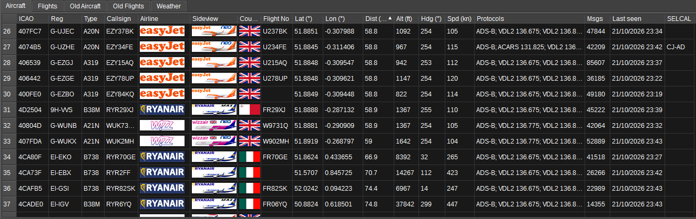
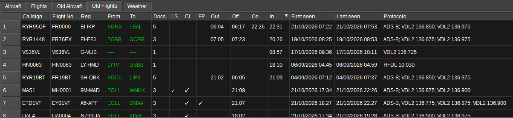
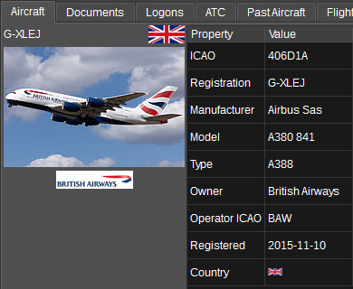
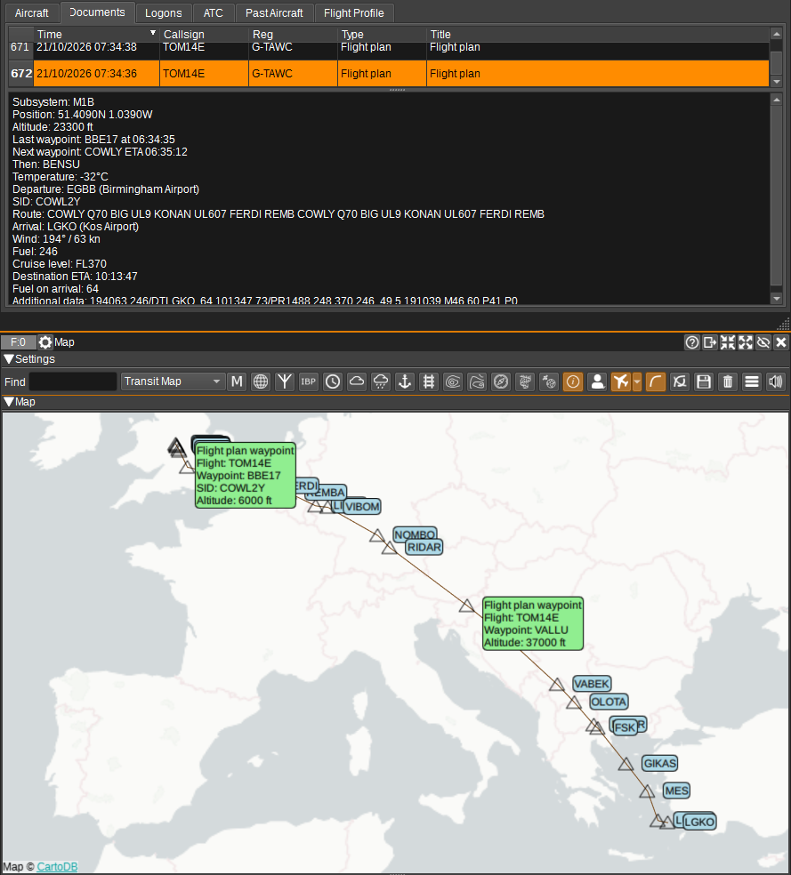
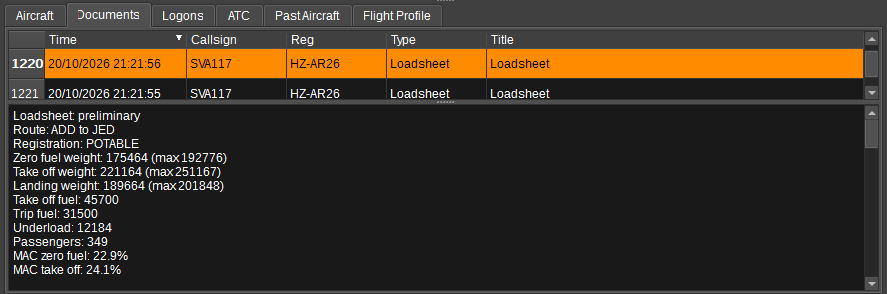
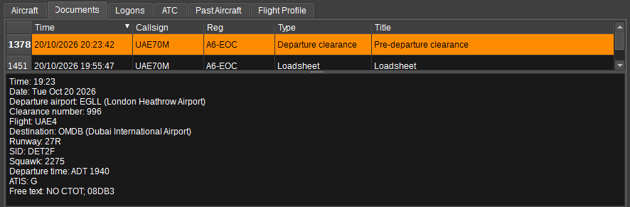
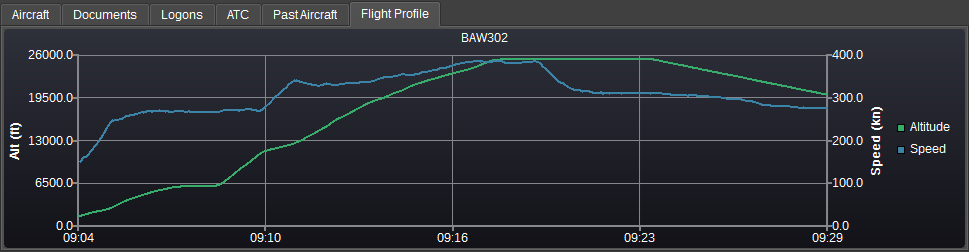
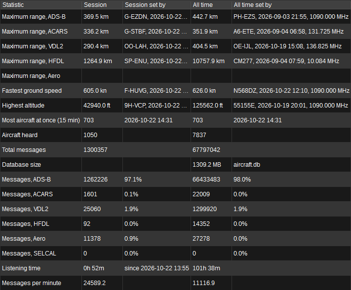

<h1>Aircraft Feature Plugin</h1>

<h2>Introduction</h2>

The Aircraft feature collates aircraft data from multiple demodulators into a single
aircraft list, and sends the combined aircraft to the [Map feature](../map/readme.md).

Sightings are received from the [ADS-B demodulator](../../channelrx/demodadsb/readme.md),
the [ACARS demodulator](../../channelrx/demodacars/readme.md) (VHF ACARS, VDL Mode 2
HFDL and Aero modes) and the [SELCAL demodulator](../../channelrx/demodselcal/readme.md),
from any number of channels in any device set.

Combining protocols matters because each sees a different slice of a flight: ADS-B gives
continuous positions in VHF range, VDL-2 sees logons and CPDLC near airports, and HFDL/Aero
can report an aircraft's position from thousands of kilometres away, hours after it left
ADS-B range. The feature merges these into one aircraft with one track.

<h2>Aircraft identity</h2>

Reports may identify an aircraft by any of:

* 24-bit ICAO address (ADS-B/HFDL/VDL-2 logons),
* registration (VHF ACARS header, or looked up from the ICAO address via the aircraft database),
* flight number / callsign.

The feature merges reports under whichever identities it has seen, cross referencing
registration and ICAO address through the aircraft database. A flight number is
remembered as the aircraft's most recent flight (flights change; the airframe does not).

<h2>Tables and tabs</h2>

The upper half of the window holds the traffic:

* **Aircraft** - every airframe currently being heard, one row each. See the column list
  under Interface below
* **Old Aircraft** - airframes that have gone quiet for longer than the archive timeout.
  They are not forgotten, only no longer current, and they come off the Map



* **Flights** - the flights seen this session, current and past: flight number, aircraft,
  departure and arrival, the four OOOI times, when it was first and last heard, which
  documents it has produced, and which protocols heard it
* **Old Flights** - flights that have finished, and those restored from the last session



* **Weather** - METARs, TAFs, D-ATIS, TWIPs, NOTAMs, PIREPs and SIGMETs carried by ACARS.
  They arrive through whichever aircraft asked for them but describe an **airport**, not
  that aircraft, so they are kept for the session rather than against a flight. Selecting
  a row shows the full report.

  The aircraft's half of the exchange is not listed. A request names the airports it
  wants and the report type - `EGKK LFPO LFBD LFBO-SA` - and says nothing about the
  weather, so only uplinks are kept where a message is recognised by its label alone.
  A body that actually contains a METAR, TAF, SIGMET or PIREP is kept whichever way it
  was going, since a PIREP is a downlink by definition

The lower half describes whatever is selected above:

<h3 id="aircraft">Aircraft</h3>

Shows a photograph of the selected
aircraft from [planespotters.net](https://www.planespotters.net/) headed by its
registration and the country flag, with the airline's logo beneath it and a table of what
the aircraft database knows about the airframe beside it. Clicking the photograph opens it
on planespotters.net



<h3>Documents</h3>

Flight plans, oceanic clearances, loadsheets, logons and OOOI events,
collected against the flight number. Selecting one displays its full text
below the table. Plain ACARS messages are not collected.







<h3>ATC</h3>

CPDLC (controller-pilot data link) messages across all channels, with the
protocol, direction (uplink from ATC, downlink from the aircraft), source and
recipient where known, and the concise message text (e.g. "WILCO"). SELCAL calls are
listed here too, with the frequency they were heard on as the source - see
[SELCAL](#selcal) below. With nothing selected, the table shows the SELCAL calls that
could not be attributed to an aircraft

<h3>Past Aircraft</h3>

Every airframe that has operated the selected **flight number**.
Shown only while a flight is selected.

<h3>Past Flights</h3>

Every flight the selected **aircraft** has operated.
Shown only while an aircraft is selected.
Selecting one of its rows charts that flight's profile and draws its track.

<h3>Flight profile</h3>

The Flight Profile tab charts the selected flight's altitude (left axis) and speed
(right axis) against time, showing the flight profile - climb, cruise and descent - built
from all protocols.



<h3 id="selcal">SELCAL</h3>

A SELCAL call is a ground station calling an aircraft on an HF or VHF voice channel. It
carries only a code, and a code can be shared by several aircraft.

An attributed call counts as a message from the aircraft: it adds "SELCAL" and the
frequency to the aircraft's protocols and updates when it was last seen. It carries no
position, so nothing moves on the Map. Every call, attributed or not, is listed in the ATC
tab. A call never creates an aircraft, and calls the feature cannot attribute are listed
against no aircraft.

<h2>Chart</h2>

The chart plots the message rate per protocol (and in total) over time. Click a legend
entry to show or hide a series. It is shown and hidden with the chart button, and
appears at the bottom of the splitter beneath the tables rather than in a tab, so the
rate can be watched at the same time as the traffic producing it. Right click the
button to clear the data.

<h2>Statistics</h2>

The statistics table can be shown and hidden with the statistic button. 
Right click the button to reset the records.

Every figure is given twice, side by side: for this session and for all time, each with
who set it and when. 

* **Maximum range**, one row per protocol - the furthest aircraft heard on ADS-B, ACARS,
  VDL-2, HFDL and Aero. Per protocol rather than as one figure because the protocols are
  not comparable: line of sight VHF, HF skywave and an L band satellite downlink have
  nothing to do with one another, and a single "maximum range" would only ever show the
  satellite
* **Fastest ground speed** and **Highest altitude**, with the aircraft that set each
* **Most aircraft at once** - the largest number heard within any 15 minute window
* **Aircraft heard** - how many different airframes
* **Total messages**, then one row per protocol giving that protocol's count and its
  share of the total. The share is of that scope's own total, so a protocol that has been
  quiet today shows its reduced share against its long run one rather than against nothing
* **Listening time** and **Messages per minute**



<h2>Settings</h2>

The gear button opens the settings dialog.

**Timeouts**

* Archive after (mins) - how long without a report before an aircraft moves to the Old
  Aircraft table and comes off the Map.
* Keep for (days) - how long archived aircraft and their flights are kept in the session
  database before being discarded. Zero keeps them forever, at the cost of a database
  that grows without limit
* ADS-B position for (mins) - how long an aircraft stays on the Map after its last ADS-B
  position
* ACARS position for (mins) - the same for a position from ACARS, VDL-2, HFDL or Aero.
  Two figures rather than one because the protocols report at wildly different rates:
  ADS-B about once a second, where an oceanic position report can be the only one for
  many minutes.

**Session database** - the file the aircraft, flights and messages are saved in.

**Receive aircraft data from** - which demodulators this feature accepts reports from.
Unticked ones are ignored.

**Use airline callsigns in Map labels** - writes the flight on the Map the way it is
spoken on the radio rather than the way it is transmitted: SPEEDBIRD 123 instead of
BAW123, using the airline's radio callsign from the airline database. 

**Show the maximum range record on the Map** - keeps the aircraft that set the all time
maximum range record permanently on the Map, drawn at the position it was in when it set
it rather than wherever it is now. The
bubble names the aircraft, the distance, the protocol it was heard on and when. It is the
best record across all protocols, and it stays until the record is beaten, the records are
reset, or this is turned off.

A record set before positions were kept alongside them has nowhere to be drawn, and in
that case nothing is drawn until the record is beaten. Not the furthest record that
*could* be placed: that would put a marker on the Map giving one distance while the
statistics table gave another. The log says so when it happens.

**Favour airline livery over aircraft type (3D map)** - when no 3D model exists of the
right type in the right livery, prefer a similar aircraft in the correct livery over an
exact type in the wrong one. 

**Livery aircraft icons (2D map)** - display aircraft on the 2D map using icons showing
their airline's livery, instead of black icons. The icon follows the aircraft's matched
3D model, so this requires the 3D models to have been downloaded via the Map feature.
Aircraft without a matching model are displayed with a white version of the plain icon.

<h2>Notifications</h2>

The notifications dialog holds rules matched against each aircraft's ICAO address,
registration, flight or type with a regular expression. When an aircraft first matches
a rule, the rule's speech text is read aloud and/or its command is executed, with
${icao} ${reg} ${flight} ${type} ${protocol} substituted. Each rule fires at most once
per aircraft.

<h2>Session persistence</h2>

The collated aircraft, flights, documents and ATC log are saved to a SQLite database
(aircraft.db in the application data directory) every minute and on exit, and restored
when the feature is next opened.

Tracks and flight profiles are **not** read at startup - only how many points each flight
has, which is what lets the save go on appending to them. The points themselves are
fetched a flight at a time, when something wants to draw or chart one. On a season's
worth of history that is nine million rows not read, and about nine seconds off the time
the feature takes to open. The first time an existing database is opened after this
change it builds two indexes, which takes a couple of seconds and grows the file by about
a fifth; after that it is a no-op. On restore, aircraft that have not been heard within
the removal timeout are pruned, while the document and ATC logs are restored in full;
restored aircraft with positions reappear on the Map with their full tracks. 

The all time figures are kept in that database too, and belong to it: a range is measured
from a particular antenna, so keeping a database per site gives that site its own records.
Like the aircraft count below they are never touched by clearing the aircraft or by the
retention period - they outlive the traffic they were measured from.

They used to be kept in the preset instead, on the grounds that they describe the
receiving setup rather than the traffic. That was the wrong home: the database *is* the
per setup file, a preset gets copied to other machines where the ranges no longer mean
anything, and it left the records in one place and the airframe count that belongs beside
them in the other - so switching databases gave one database's count with another's
records. A preset written before the move still carries them, and they are imported into
the database once, the first time one is opened that has none of its own.

The all time aircraft count is kept differently from the rest, because it cannot be a
running total: the
same airframe heard on two days has to count once, so it needs the set of which
airframes have been heard rather than a number. That set is a table in the database, and
it is the only thing there that is never pruned - so the count keeps growing after the
aircraft themselves have aged out. 

Right clicking the statistics button offers to reset either half. Resetting the session
starts it again from that moment without touching the all time figures. Resetting all
time also clears the record of which airframes have been heard.

<h2>Finding things</h2>

The Find box highlights the next row matching what is typed, stepping through the matches
on each press of Enter. It searches the ICAO address, registration, type, flight number,
airline and departure and arrival airports at once, or a single one of them when the
column selector beside it is set to something other than All. The text turns red when
nothing matches.

<h2>Context menus</h2>

Right clicking a cell in any of the tables offers, as they apply to that cell:

* **Copy** the cell's contents to the clipboard
* **Find on map** - centre the Map on that aircraft
* **Display flight** - jump to that flight in the Flights table, from the aircraft flying it
* **Display aircraft** - jump the other way, to the airframe operating a flight

<h2>Map</h2>

Aircraft with a position are sent to the Map feature, named by registration when known.

When an Aircraft feature is present, the ADS-B demodulator stops sending
aircraft to the Map themselves. ADS-B sightings
pass through the demodulator's fully-built map item, so the 3D model, animations and
the complete aircraft state driving the Map's PFD display are preserved, with the
combined track and route information added. Without an Aircraft feature, the
ADS-B demodulator sends to the Map directly.

The map item carries:

* An icon matching the aircraft type, rotated to point along the track,
* The full track accumulated across all protocols - the whole history survives coverage
  gaps, so a flight tracked on ADS-B and picked up again hours later on HFDL shows one
  continuous track,
* A popup whose ICAO address, registration and flight number are **links**: clicking one
  selects that aircraft or flight in this feature, which is usually the next question
  someone looking at the Map has. They work on both the 2D and the 3D map, and appear
  only where they can lead somewhere - an aircraft drawn by the ADS-B demodulator with no
  Aircraft feature open gets plain text instead of a link that would do nothing,
* A popup headed by a side view of the type in the operator's livery and the country
  flag, followed by registration, flight, aircraft type,
  departure/arrival airports and the route where messages have revealed them, and the
  protocols and frequencies the **current flight** has been heard on. 

The routes an aircraft has been given are drawn too, but only for the aircraft or flight
**selected** in the tables - a filed flight plan and an oceanic clearance alike - as a
line through the waypoints with a marker at each one. Every oceanic flight in earshot
files a clearance, so drawing them all covered the Map in lines that had nothing to do
with what you were looking at. Selecting an aircraft draws the flight it is on now. A
flight
plan comes from an FPN message or a position report's route insert; a clearance from an
oceanic clearance or its readback. Both are bookended with the departure and arrival
airports so the line starts and finishes somewhere recognisable, and the route's popup
carries the message that filed it, which is where the clearance number, entry time,
flight level and Mach are.

Routes are drawn in the Map's **Aircraft Routes** item group rather than the Aircraft one,
so that their colour, labels and above all their minimum zoom can be set independently of
the aircraft icons. An icon has to be decluttered away when the map is zoomed out, where a
route drawn across an ocean is exactly what you want to see at that zoom - one setting
could not do both. The group defaults to a minimum zoom of 0, so routes stay visible
however far out the map is zoomed.

**A flight plan is assembled from the inserts that carry it.** An aircraft files the
departure end - runway, SID and the en route path - in one message and the arrival end -
STAR and approach - in another, so each part is taken from whichever message carried it
and the popup shows the whole plan in the order it is flown. The path is only replaced by
a message that has one, and only when it names at least as many waypoints that can be
placed - otherwise the insert carrying nothing but "ILS 19L" would erase the line drawn
from the one before it. An insert naming a different departure or arrival is a re-file
rather than another part, and replaces the plan outright.

**A named SID or STAR is expanded into the fixes it flies through.** A plan names its
departure and arrival procedures rather than listing them - "runway 26L, LAM1Z departure" -
so the line used to leave the airport straight for the first en route fix, which is not
where the aircraft goes: a SID out of Gatwick turns through half a dozen fixes before it
joins the airway. Where the SID/STAR database holds the procedure, its fixes are drawn
between the aerodrome and the route, in the order they are flown. The procedure is looked
up against the plan's own departure or arrival airport, by ICAO code, and its type is
given as well as its name - the same name can be a departure at one airport and an
arrival at another, as LAM1Z is a SID at Gatwick and a STAR at Heathrow. A runway
qualifier is ignored, so LAM1Z and LAM1Z/26L both find it.

A procedure fix names its procedure on the Map, and is drawn at the altitude the
procedure requires. A fix is named for the procedure it belongs to - KKE02, KKN43 - so on
its own it is an unexplained marker in the middle of nowhere; its popup now gives the SID
or STAR it came from. Where the procedure constrains the altitude, that is shown as the
plate reads it - "5000 ft" for a crossing altitude, "2000 ft or above" for a floor,
"5000 to 7000 ft" for a window - and the fix is drawn at that altitude rather than on the
ground, so a departure climbs on the 3D map instead of lying flat.

The database gives every procedure fix a position, so they are never looked up by name -
which matters, because a procedure fix is named for its procedure (KKE02, KKN43) and is in
no en route waypoint database. A procedure usually ends on a fix the plan then names as
its first waypoint, and the two are collapsed into one. Coverage is partial: where the
procedure is not held, or the database has not been downloaded, the route is drawn exactly
as it was before.

**A plan files a shorter name than the database holds, and both are matched.** An ARINC
424 procedure identifier is the significant fix, a validity digit and a route letter, and
it is limited to six characters - so a five letter fix is truncated to four and a plan
files ROXO1H where the procedure is really ROXOG1H. Both forms find it. The shortened
names are indexed only where they are unambiguous, which is checked rather than assumed:
an alias that shadowed a real procedure would draw the wrong route rather than none, which
is a worse failure than the one it fixes. On the current database all 1475 are
unambiguous.

**A plan is assembled from any insert that carries part of it, not only one that carries
a path.** The arrival end of a plan names no waypoints at all - just the STAR and the
approach - so an insert carrying the STAR was being dropped whole, and the STAR never
reached the plan being assembled. That is the usual way a STAR arrives, so without this
most of them were never captured at all. A plan that has no path of its own is still
drawn when a procedure can be expanded into one.

Plans stored before the runway, SID, STAR, approach and alternate were kept have those
parts recovered from the message that filed it, which is held with the plan. The text is
this application's own rendering, one "Label: value" a line, so it reads back reliably;
only a part that is empty is filled, so nothing a message actually filed is overwritten.
Once the flight is saved again the parts are stored properly.

The database is downloaded from the **Map** feature's settings dialog, alongside the
airport, airspace, NAVAID and waypoint databases, and is picked up on the next route drawn
without needing a restart. It is a snapshot of one AIRAC cycle, and a procedure's name
carries its revision - a plan filing FRAN1M does not match a database holding FRANE1Z,
which is a different revision of the same departure, and nothing is drawn rather than a
route the aircraft is not flying.

Each name is resolved against the airport, waypoint and navaid databases - four
characters is an airport, five a waypoint, three a VOR or NDB ident, and anything of the
form 58N030W an oceanic position, with the minutes optional on either half so that
5730N020W and 5730N02030W are read too - and any that cannot be resolved is dropped.
Where the message gave a waypoint's position itself, that is used in preference, which is
what places the fixes no database holds. Selecting another
aircraft or flight moves the lines to it; they are kept for an archived flight, so
selecting one still shows where the aircraft was going.

Selecting one of an aircraft's past flights draws that flight's track instead of the one
it is on now. Where the aircraft is still being heard the track is part of its own map
item; where it has been archived the aircraft is no longer on the Map at all, so the track
is drawn on its own, as a line named after the flight. Its popup gives the route, when the
flight was heard and how many points it has. The aircraft itself is deliberately not put
back: an icon at a position from hours ago would say it is still there, which a track of
where it went does not.

Stale positions from stored performance log dumps (seen with HFDL) are ignored: a
position timestamped well before the newest known position for that aircraft does not
move it.

Aircraft are removed from the table and the Map after a configurable number of minutes
without a report.

<h2>Interface</h2>


<h3>1: Find column</h3>

Which field the Find box looks in - All, ICAO, Reg, Type or Flight.

<h3>2: Find</h3>

Highlights the next row matching the text. See Finding things above.

<h3>3: Delete aircraft</h3>

Deletes all aircraft from the tables and removes them from the Map.

<h3>4: Notifications</h3>

Opens the notifications dialog. See Notifications above.

<h3>5: ATC</h3>

When checked, aircraft labels on the Map show route, flight level, speed and type in
an ATC style, like the ADS-B demodulator's ATC button; when unchecked just the flight
number or registration is shown.

<h3>6: Statistics</h3>

Shows and hides the statistics table, which appears in the splitter beside the aircraft
and flight tables. Right click to reset the session figures or the all time ones.

<h3>7: Chart</h3>

Shows and hides the message rate chart, at the bottom of the splitter. Right click to
clear the data.

<h3>8: Settings</h3>

Opens the settings dialog - timeouts, the session database, which demodulators to accept
reports from, and the Map options. See Settings above.

<h3>Aircraft table</h3>

The table shows one row per aircraft:

* ICAO - 24-bit ICAO address, when known
* Reg - Aircraft registration
* Type - Aircraft type (ICAO type designator) from the aircraft database
* Callsign, Flight No - The flight the airframe is on now, under its ICAO and IATA
  names, as in the Flights table below. The two names belong to the FLIGHT, so an
  airframe not currently on one shows the name it was last heard under as its callsign
  and nothing as its number
* Airline - Airline logo, or operator name when no logo is available
* Sideview - Aircraft silhouette, coloured per airline where available
* Country - Flag of the country of registration
* Lat, Lon - Latest position in degrees
* Dist (km) - Great circle distance from the receiver to the aircraft. Measured from
  the position of the **device the report arrived on** when that device knows where it
  is - a remote SDR reports the position of the server, not of you - and from
  Preferences > My Position otherwise. So the figure always means "from the antenna
  that heard it", which matters when receiving from somewhere other than where you are
* Alt (ft) - Altitude in feet
* Hdg - Heading or track in degrees
* Spd (kn) - Speed in knots
* Protocols - Every protocol and frequency the **airframe** has been received on
  (e.g. "ACARS 131.725; HFDL 5.720"), over every flight it has made and for as long as
  it is kept. The Flights table has a column of the same name holding the same thing for
  a single flight, and that is the one the Map shows - an airframe heard on HFDL over
  the Atlantic last month is not being heard on HFDL now, so naming it beside the
  aircraft on the Map would be wrong.
* Msgs - Number of messages received
* Last seen - Time of the last report
* SELCAL - The aircraft's SELCAL code: the one it was heard called on, otherwise what the
  SELCAL database assigns it, which can be more than one. The database is downloaded
  from the SELCAL demodulator

<h3>Flights table</h3>

The table shows one row per flight, and the Old Flights table the same columns for
flights that have finished:

* Callsign - The ICAO form, as the transponder broadcasts it (e.g. TOM7BD). Where the
  flight has only ever been heard under its IATA number, that is shown here instead, so
  the column always says what the aircraft is being called
* Flight No - The IATA form, as ACARS carries it (e.g. BY07BD). The two are the same
  flight: an airline has a three letter ICAO designator and a two character IATA one, so
  TUI Airways is TOM and BY, and 7BD is 07BD without the leading zero. They are matched
  on the flight number alone - safe, because a match is only ever looked for within one
  airframe - and either cell's tooltip lists every name the flight is known by
* Reg - Registration of the airframe that flew it
* From, To - Departure and arrival airports
* Out, Off, On, In - The four OOOI times: off the gate, airborne, landed, on the gate
* First seen, Last seen - When the flight was first and last heard
* LS, OC, FP - A tick where the flight has produced a loadsheet, an oceanic clearance or
  a flight plan. Blank where it has not, rather than a cross: a column of crosses is as
  loud as a column of ticks, which makes the ticks harder to pick out
* Docs - Number of documents collected
* Protocols - Protocols and frequencies **this flight** has been heard on. The Aircraft
  table's column of the same name is the airframe's, over every flight it has made

Columns in either table can be reordered by dragging, hidden via the right-click header
menu, and either table sorted by clicking a header. Widths and order are saved with the
preset.

<h2>Web API</h2>

The feature's settings can be read and written at
`/sdrangel/featureset/{featureSetIndex}/feature/{featureIndex}/settings`, and
`.../report` gives the number of aircraft held, how many of them are currently being
heard, the number of flights, and the messages received this session both in total and
per protocol.

`.../actions` takes `selectIcao`, `selectRegistration` or `selectFlight`, each naming
one aircraft or flight to select in the tables - the same thing clicking a row does.
For example:

```
POST /sdrangel/featureset/0/feature/0/actions
{"featureType":"Aircraft","AircraftActions":{"selectFlight":"BAW123"}}
```

Where several flights have carried that number, the most recently heard is chosen.

<h2>Attribution</h2>

## Feeding aggregators

The **Feed** button forwards every ACARS message the ACARS demodulators decode on to
community aggregators, as acarsdec-style JSON - one object per UDP datagram, or a
newline-delimited stream over TCP. Right click it for the settings: a station identifier
sent with every message, and per-service enables with host, port and protocol.

It lives here rather than in the ACARS demodulator because a receiver runs one of those
per band - VHF, VDL-2, HFDL - and the feed had to be filled in identically in each,
opening three sets of connections to the same aggregator under the same station identity.
The station is a property of the receiver, so it is set up once and every demodulator
feeds through it.

Note that airframes.io assigns the protocol **per station type**: their VDL2 (vdlm2dec)
wizard says TCP 5555, while the ACARS (acarsdec) station type ingests **UDP on 5550** and
shows no protocol box at all. SDRangel emits acarsdec-format JSON, so create an
ACARS/acarsdec station for this feed. A TCP connection to 5550 is refused, which shows up
as a "feed not connected ... reconnecting, message dropped" loop in the log.

Unlike the aircraft tables, the feed is not filtered by the per-demodulator enables in the
settings dialog: those say which demodulators contribute to what is tracked, and a
receiver may reasonably want to feed a band it does not track.

Aircraft and route data from the [OpenSky Network](https://opensky-network.org/).

Aircraft photographs from [PlaneSpotters](https://www.planespotters.net/).

Airline logos, sideviews and flags are by Steve Hibberd from
[RadarSpotting](https://radarspotting.com).

Airports from [OurAirports](https://ourairports.com/), and navaids and waypoints from
[OpenAIP](https://www.openaip.net/) - used to place the waypoints of a filed route.

Some code written by AI.
