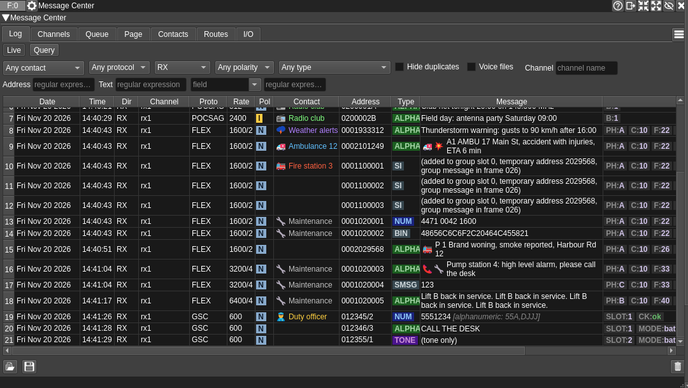
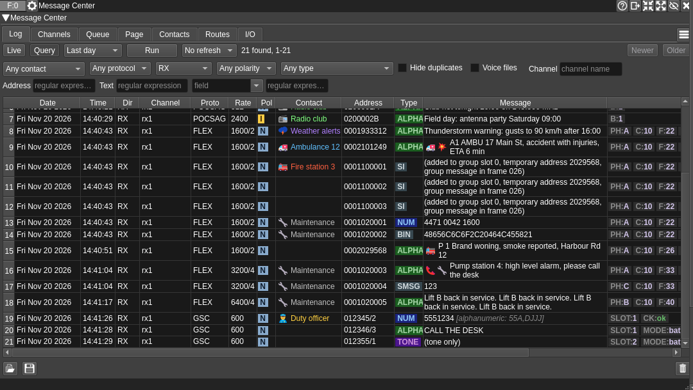
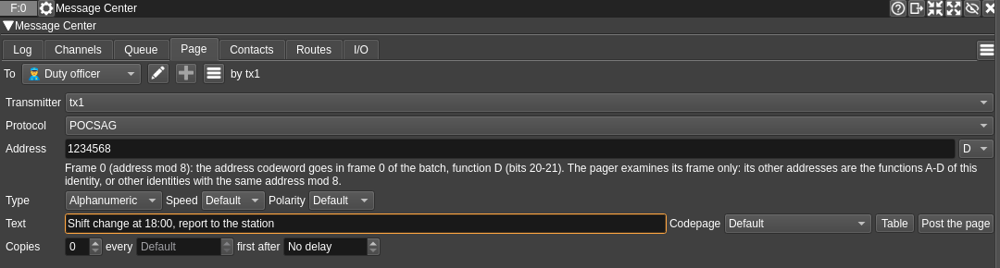
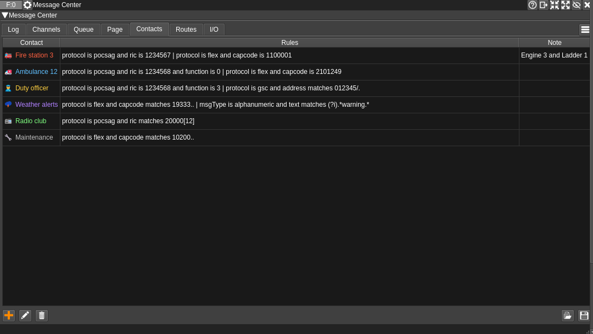
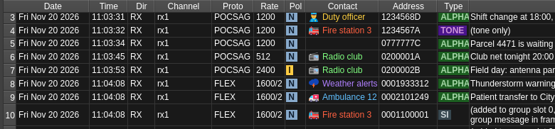
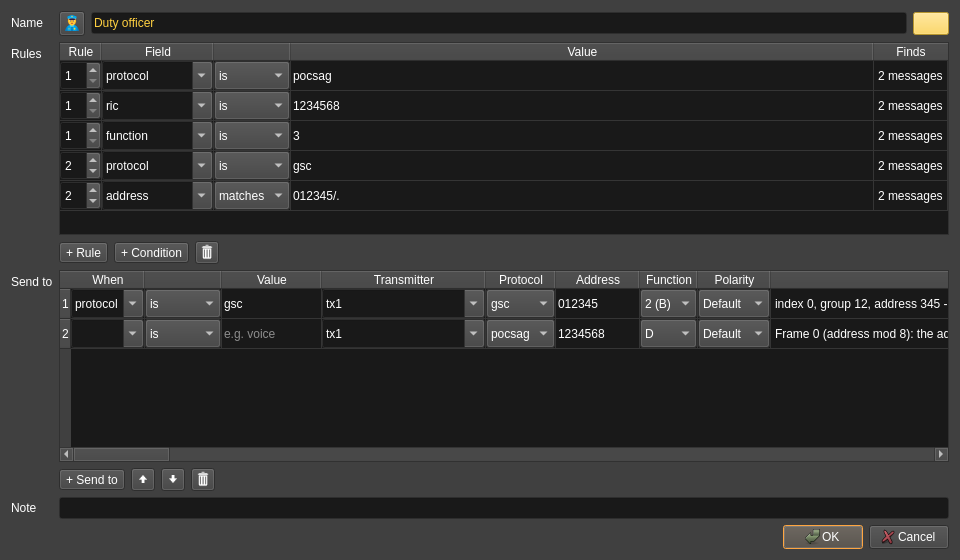
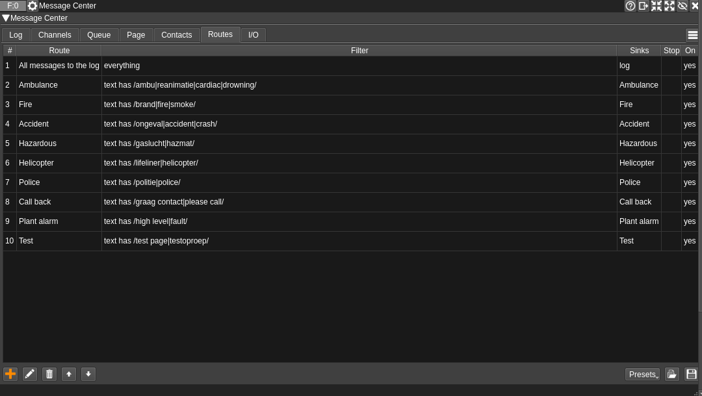
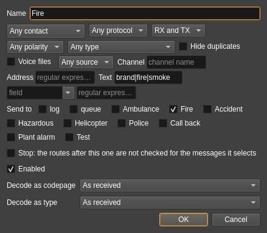
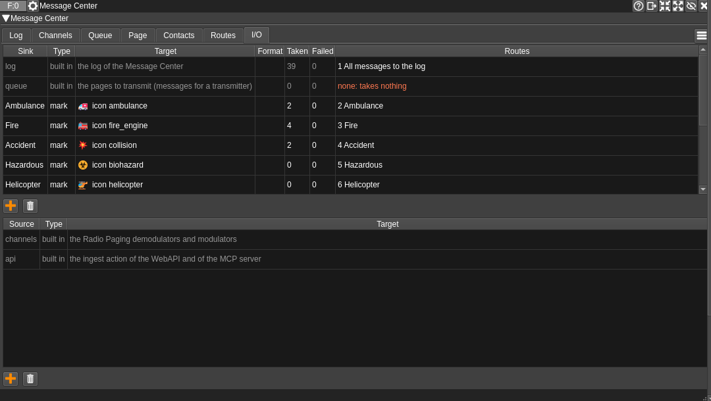
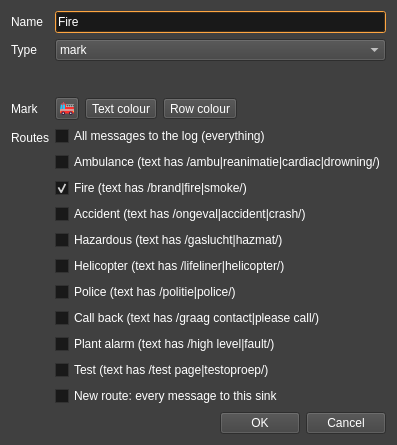

<h1>Message Center feature plugin</h1>

<h2>Introduction</h2>

The Message Center collects the messages of the radio paging channels (Radio Paging demodulator and modulator) in one log, routes them to files, and queues pages to the transmitters. It is the place where messages, events and voice messages are exchanged between the decoders and the encoders.

The channels publish their messages as message records on the "messages" pipe, and announce themselves with event records: the Message Center knows the receivers and transmitters without configuration. It is added like any feature, or with the Message Center button of the Radio Paging demodulator and modulator, which opens it (and adds it when there is none).

```
  source ---> routes 1, 2, 3... (filter) ---> sink(s)
  sources: the channels, the API, a JSON lines file, a CSV log, UDP datagrams
  sinks:   the log, the transmit queue, a JSON lines file, a CSV file, UDP datagrams,
           a command, speech, a mark in the log, a position on the Map
```

<h2>Interface</h2>



The window has a tab for each section: Log, Channels, Queue, Page, Contacts, Routes and I/O. The button at the right of the tabs opens the options.

<h3>Log</h3>

The messages received and sent, newest at the bottom.

* Live: the newest 100 messages the filters select, as they come. While a row is selected or the table is scrolled up, the rows stay where they are: the new messages wait, and a button in the corner of the table counts them; they come when it is clicked, or when the table is at the bottom again with no row selected.
* Query: the messages of a time range the filters select, over the history (the log when the history is not kept): the last 5 minutes, hour, day, 7 days, all, or from a time to a time. The range is fixed when the query is run (Run, a filter changed), so the pages keep it: how many messages it selects, and a page of 100 of them, newest first (Newer, Older). It stays as it is until it is run again; the auto-refresh runs it again every 5 to 60 s (none by default; not while a row is selected).



* Filters: contact, protocol, direction (RX, TX or both), polarity, message type (the types of the protocol chosen), channel name, address, text, one more field, hide duplicates, voice pages with a file only. All the filters set must match.
  * Address: a regular expression the whole address must match, as the filters of the other plugins of SDRangel: 12345.. for the addresses 1234500 to 1234599.
  * Text: a regular expression found anywhere in the text, not case sensitive: fire, or fire|smoke (^ and $ for its start and end).
  * One more field: a field of the message or of its protocol (the details of a message show them all: capcode, ric, function, mode, group_capcodes...), chosen in the list or typed, and a regular expression its whole value must match: capcode 4071410.. for a range of capcodes. A list (the members of a group message): one of its values.

  An expression that is not valid is shown in red and selects nothing. Only the messages the filters select are shown. An address selects the FLEX group messages of which it is a member too (the members received with the assignments).
* The table has the columns of the message tables of the channels: date, time, direction, channel, protocol, rate, polarity, contact, address, type, message, fragment, info, errors and state. Right click on the header selects the columns. The direction is RX (received) or TX (sent by its channel); a page posted to the Message Center that is not sent yet is QU while it is in the queue and NS (not sent) when it failed, was cancelled or is no longer queued (the queue is not kept when SDRangel is restarted). The tooltip of QU and NS gives the state and the reason, e.g. "waiting: tx1 sends pocsag now, not flex".
* A click on the icon of a voice message plays its file. Double click on a message opens a window with all the fields of its record: the common fields, protocolData (the flags and parameters of the protocol) and the raw payload, also as bits.
* Right click on a message: details, copy the cell, the row or the record as JSON, play the voice, select the audio output, and decode a received message again as the other type or with another codepage of its protocol.
* Decode as, All codepages...: a window with the message decoded with every codepage of its protocol (and as numeric, POCSAG and GSC), a row each; the reading shown is in bold. Right click on a row: Create route..., the route dialog filled to decode the messages of the address so.
* Create route... (right click on a message): the route dialog filled from the message: its protocol, polarity, type and address, to the log, with Stop. The tables of the Radio Paging channels have both too, for the Message Center there is (none: they are greyed out).
* The filters are on a line that wraps at the width of the window.
* Import (open icon): reads the messages of a file into the log: a JSON lines file, or a CSV log of a message center or of the Pager demodulator. They are logged, not routed, so no action is taken on them again.
* Export (save icon): saves the messages the filters select to a CSV file, which Import reads again.
* Clear (bin icon): removes all the messages of the log (in memory) after a confirmation; the history stays, unless "Also delete the history" is checked there. The items the map sinks put on the Map are removed too.
* A message a mark sink took has the icon of the mark before its text, its text and its row in the colours of the mark (those it sets). A message several routes mark has their icons side by side.

<h3>Channels</h3>

The channels that announced themselves: name (the title of the channel), role (receiver or transmitter), status (online, or offline when it has not announced itself for the silent time), protocols, speeds, polarity, the pages queued to it, and the time it was last seen.

* A channel renamed (its title changed) keeps one entry, of its new name.
* Remove: removes the channel selected; it comes back when it announces itself again. Remove offline: removes the channels offline. The pages of a transmitter removed go back to the queue.

<h3>Queue</h3>

The pages to transmit, with the transmitter (its name), protocol, address, text, state, tries, retries and the reason of a failure or of the wait of a pending page (for example "waiting: tx1 sends pocsag now, not flex": the page goes out once the modulator is switched to FLEX). A page goes through pending, queued, claimed, transmitted and sent: the transmitter claims it and reports its state back. A page given to a transmitter that does not claim it within the claim timeout goes back to the queue; a page that can not be sent is dead.

* Requeue: a dead page goes back to pending with its attempts reset.
* Cancel: withdraws a page nobody has claimed, or a dead page.
* Clear sent: removes the pages sent.

<h3>Page</h3>



The composer of a page, the same as in the Radio Paging modulator: transmitter (its name), protocol, address, type, text and the fields of the protocol. Table opens the codepage table of the text. Post the page queues the page for the transmitter.

* To: the transmitter and the address of the composer, or a contact (one with a send to): its send to for the page (its type, protocol...) fills in the transmitter, the address, the function and the polarity. They can be changed: the page then goes where they say, and To shows the contact whose destination they are, if one has it.
* Edit: the contact chosen (a new one if none). + : the transmitter and the address of the composer to the contacts, as a new contact or added to one: a rule for the messages of the address (and its polarity, if one is set: the same address in the other polarity is another pager) and a send to; there only when the address is one that no contact has as its destination. The list button opens the Contacts tab.

<h3>Contacts</h3>



The address book: a name, an icon and a colour for the messages of a pager or a station. The log shows them in the Contact column, and the filters (of the log and of the routes) choose the messages of a contact (Any contact).



A contact has rules; a message is the contact's when it meets all the conditions of one of them. A condition is on a field of the message: protocol, address, msgType, channel, frequency, mode, or a field of its protocol (ric, function, capcode, group_capcodes...; the details of a message in the log show them all). It is the value (numbers are compared as numbers: the capcode 0001234567 is 1234567) or matches a regular expression of the whole value; a list field (the members of a FLEX group message) when one of its values does. A pager has several addresses (POCSAG functions, FLEX capcodes): one contact with a rule for each. The first contact a message is of names it.



* Icon: a built-in one (Microsoft Fluent Emoji, flat style, MIT License: emergency, radio, messages, weather, places, transport, people, things, signs and colours) or an image file of your own. The colour colours the name; right click on it for none.
* Rules: a row for each condition, its rule number groups them. + Rule adds a rule, + Condition a condition to the rule selected. The field list has the fields of the messages of the log; another one can be typed. Finds: the messages of the log the rule finds; a regular expression that is not valid is shown in red.
* The contacts are saved to and added from a JSON file (a contact of the same name is replaced).

A message of a contact has its name, icon and colour in its data (contact, contact_icon, contact_color): the sinks have them too. A change of the contacts names the messages that come after it.

A page can go to a contact instead of a transmitter and an address (`contact` in a post of the WebAPI or of the MCP tool message_center_post_page). The contact's send to list says how: in order, conditions on the page (protocol, type, text, priority... as a post has them; none for always) and the fields it sets (transmitter, protocol, address, function...). The first one whose conditions the page meets is taken, e.g. voice pages by GSC, binary ones by FLEX, the others by POCSAG. A page no send to takes is refused with the reason.

<h3>Routes</h3>

Every message is checked against all the routes in their number order (#), not only the first. Each route whose filter selects the message sends it to the sinks of the route: the log, the transmit queue or the sinks of I/O. A route with Stop ends the check for the messages it selects, so the routes after it do not see them. The log is a sink as the others: a message no route sends to it is not logged. A new Message Center has one route, 1 "All messages to the log", without a filter. A sink takes only what a route sends to it.





A filter on several contacts (set through the WebAPI) is one item of the contact list. Editing a route keeps what its dialog does not show of its filter.

The tool tip of the table of the routes recalls how they work.

* Add (plus icon), Edit (pencil icon, or double click) and Remove (bin icon) manage the routes; a route can be switched off. Up and Down (arrows) change the order.
* Insert: where a new route goes, before route 1 by default, or before or after another.
* Decode as codepage and type: the messages the route selects are decoded again with the codepage and as the type before they go to its sinks; the routes after it get them as they were received. A message that cannot be decoded so (a codepage of another protocol, a transmitted message) is sent as it is.
* Presets: replace the routes and the sinks (after a confirmation; the sources and the contacts stay) with those of a preset. Empty: every message to the log, as a new Message Center. Emergency, an example to adapt: the log, and a route with a mark (an icon) for each kind of message, by a few words of its text, in English and in Dutch (the P2000 network): ambulance (ambu, reanimatie, cardiac, drowning), fire (brand, fire, smoke), accident (ongeval, accident, crash), hazardous (gaslucht, hazmat), helicopter (lifeliner, helicopter), police (politie, police), call back (graag contact, please call), plant alarm (high level, fault), test (test page, testoproep). A message of several kinds has their icons side by side.
* Export (save icon) saves the routes, the sinks and the sources to a JSON file; Import (open icon) replaces them with those of a file, after a check and a confirmation.

The filter of a route has the fields of the filter of the log, and the source of the message: the channels, the API (ingest) or a source of I/O. The captures of its text expression are ${1}, ${2}... in the texts of the sinks the route sends to: text Fire at (.*) gives the place as ${1}. Decode as type is for POCSAG and GSC: a FLEX message is sent with its type, it keeps it.

<h3>I/O</h3>



The sources and sinks: where messages come from besides the channels (files read as they grow, UDP), and where the routes send them besides the log and the queue (files, UDP, commands, speech, marks in the log, the Map). Each has a name and a type. The built in ones come first: the sinks log and queue, the sources channels and api. Double click to edit; a sink renamed is renamed in the routes too. The editor of a sink also chooses the routes that send to it, and can add a route that sends every message to it. The table of the sinks gives the records each took and refused and the routes that send to it (none: it takes nothing). Plus adds a sink or a source, bin removes the one selected. The errors of the sinks and sources are shown below them from the first one.

Sinks:

* file: records written to a file, in JSON lines (one record a line, lossless), CSV (the columns of the record, header first), or Pager CSV: the log the Pager demodulator writes, its columns (date, time, address, function bits, alphanumeric, numeric, even parity errors, BCH parity errors, baud, protocol, type, frame) and its messages only, for the tools that read that log. As the Pager demodulator counts them, BCH parity errors are the uncorrectable errors of the message, and even parity errors are 0. Read back, both columns are uncorrectable errors.
* udp: a datagram for each message to an address and port. Pager format: the fields of the Pager demodulator, each ended by a NUL (date, time, address, function bits, alphanumeric, numeric, protocol, type); the address has 7 digits for POCSAG and 9 for FLEX, the function bits are POCSAG only, and the other reading of a message (numeric or alphanumeric) is in the other field. JSON format: the record as one line.
* command: a command run for each message. The command is split into the program and its arguments first, then ${address}, ${message}, ${protocol}, ${type}, ${channel}, ${mode}, ${id}, ${frequency}, ${time} (UTC) and ${0}, ${1}... (the captures of the route) are replaced in the arguments, so a message cannot add arguments or change the program. At most 5 are run in a second; the others are refused and reported.
* speech: the text, with the same replacements, is said (when SDRangel is built with text to speech).
* mark: an icon (the icons of the contacts, or an image file), a colour of the text and a colour of the row, each optional (right click on its button: none). The mark is written into the record (protocolData marks) before it is logged: the history, the exports and the WebAPI have it, and it is there again after a restart.

  
* map: the position (latitude and longitude) in the text of the message is put on the Map, named by the address.

The actions (command, speech, mark, map) are taken on messages only: not on events, nor on the end of a GSC voice message, which completes its page.

Sources:

* file: a JSON lines file; the lines added to it are read as they are written.
* csv: a CSV log of a message center (the columns of the record) or of the Pager demodulator (Date, Time, Address, Function Bits, Alpha, Numeric...); the rows added are read as they are written. New rows only: the rows already in the file are skipped.
* udp: datagrams received on an address (default 127.0.0.1, this computer only) and port: message records as JSON lines, or the Pager demodulator format. What is received is a message received: it never becomes a page to transmit.

<h3>Options</h3>

In the dialog opened by the button at the right of the tabs:

* Log size: messages kept in the log (default 10000).
* History: keep every message stored in the history (messagecenter/history in the application data directory): a file for each day, up to 4 MB each (YYYYMMDD-NNN.jsonl, a line of JSON for each version of a message), for the days kept (default 30) and the size kept (default 500 MB): the oldest files go. The log is the newest of it when the Message Center starts, and the queries go over all of it, reading only the files of their time range. One Message Center keeps the history.
* Claim timeout: a page given to a transmitter that does not claim it in this time goes back to the queue (default 10 s).
* Silent time: a channel that does not announce itself for this time is offline (default 20 s).

<h2>REST API</h2>

Settings (`MessageCenterSettings`, feature type `MessageCenter`): title, rgbColor, logSize, historyEnabled, historyMaxMB, historyDays, claimTimeoutSec, silentSec, routes, contacts, sinks, sources and the reverse API settings. Routes, contacts, sinks and sources are JSON arrays (as text); a setting with a sink, source, route or contact that is not valid is refused with the reason. A contact: `{"name": "Fire station 3", "icon": ":fire_engine", "color": 4294926400, "rules": [[{"field": "protocol", "is": "pocsag"}, {"field": "ric", "is": "1234567"}], [{"field": "protocol", "is": "flex"}, {"field": "capcode", "matches": "11000.."}]]}`.

Report (`MessageCenterReport`): the number of messages logged and routed, the endpoints, the pages, the log, the records each sink took and refused (sinks), the errors, and the result of the last query (query).

Actions (`MessageCenterActions`):

* `post`: a page to transmit (`MessageCenterPost`): transmitter (its name), protocol, address, type, text and the fields of the protocol. The FLEX address takes the capcode forms of STD-43A Appendix A.
* `requeue`, `cancel`: the id of a page.
* `clearSent`: 1 to remove the pages sent.
* `redecode`: a record of the log decoded again (`MessageCenterRedecode`: id, charset, type).
* `ingest`: message records as JSON lines, routed as messages received. A record needs its protocol; one without a timestamp gets the time it is given, one without an id gets an id of its own.
* `importFile`: the path of a JSON lines or CSV file read into the log, not routed.
* `query`: a query of the messages as JSON, over the history (the log without one): `from` and `to` (ms since the epoch) or `last` (seconds back from now), `filter` (as the filter of a route), `offset` and `limit` (default 100, at most 1000). Its result is in the report (query): the query (from and to resolved, to ask for the next page with them), total (the messages it selects) and records (the page, newest first). E.g. `{"last": 86400, "filter": {"protocols": ["flex"], "text": "fire"}, "limit": 50}`.

<h2>MCP</h2>

The MCP server feature has tools for the Message Center: `get_message_center` (routes, sinks, sources, channels, queue, sink counts, errors and the newest messages of the log), `set_message_center_routing` (routes, sinks and sources), `message_center_post_page`, `message_center_page_action` (requeue, cancel, clear sent), `message_center_ingest`, `message_center_import_file` and `message_center_query` (the query action: the total and a page of the messages of a time range and a filter, over the history). `get_paging_messages` gives the last 1000 messages of the paging channels whether or not a Message Center is there.
