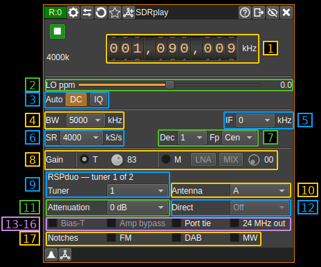

<h1>SDRplay RSP plugin (libmirisdr-6)</h1>

<h2>Introduction</h2>

This plugin supports the SDRplay RSP1, RSP1A, RSP1B, RSP2, RSPduo, RSPdx, RSPdx-R2 and nRSP-ST through [libmirisdr-6](https://github.com/BertoldVdb/libmirisdr-6). Device detection, tuning ranges and front-end capabilities come from the library, so controls that a particular receiver or tuner does not support are disabled automatically.

Either RSPduo tuner can be selected. One tuner is streamed by an SDRangel device set at a time.

<h2>Build and runtime requirements</h2>

The plugin depends on libmirisdr-6 v1.2.0 or later. When it is installed in a non-standard folder, specify the include and library paths on the CMake command line. For an installation in `/opt/install/libmirisdr`, add `-DMIRISDR_DIR=/opt/install/libmirisdr`.

libmirisdr-6 accesses the receiver directly through libusb. Install its `mirisdr.rules` udev file to use the receiver without root, then reload the udev rules or reconnect the receiver.

Only one process can own the receiver. Close other SDR applications before starting the SDRplay source. The SDRplay API service also conflicts with direct libusb access and, when installed, can be stopped with:

```
sudo systemctl stop sdrplay
```

<h2>Interface</h2>

The top and bottom bars of the device window are described in the [device interface documentation](../../../sdrgui/device/readme.md). The remaining SDRplay controls are described below.



<h3>1: Center frequency</h3>

The center-frequency dial is in kHz. Its range follows the tuning capabilities reported for the connected receiver and selected tuner. libmirisdr-6 automatically selects the tuner band, filters and RF path for the requested frequency; there is no manual band selector.

SDRangel also validates frequency changes in the backend, including changes made through the Web API or reverse API. The device LO calculation includes decimation placement, PPM correction and the selected IF. An out-of-range center frequency is moved to the nearest usable value and the corrected value is returned to the GUI.

When a Hi-Z input is selected, the tuner LO must remain below 30 MHz. The GUI applies the Hi-Z dial limit and the backend clamps the center frequency to a valid value while accounting for IF, PPM and decimation placement.

<h3>2: Local oscillator frequency correction</h3>

The LO correction is set in tenths of a ppm.

<h3>3: DC and IQ imbalance correction</h3>

These controls are common to many source plugins. SDRplay receivers can have a DC offset when used at zero IF. DC correction must be enabled for IQ imbalance correction to be effective.

<h3>4: IF bandwidth</h3>

The following MSi001 IF filter bandwidths are available:

  - 200 kHz
  - 300 kHz
  - 600 kHz
  - 1536 kHz
  - 5000 kHz
  - 6000 kHz
  - 7000 kHz
  - 8000 kHz

<h3>5: IF frequency</h3>

The following IF frequencies are available:

  - 0 Hz for zero IF
  - 450 kHz
  - 1620 kHz
  - 2048 kHz

For a low IF, the libmirisdr-6 baseband engine shifts the selected frequency to 0 Hz in the output stream. A matching sample-rate and decimation combination is not required.

<h3>6: Sample rate</h3>

The selection includes complex baseband rates from 48 kS/s to 15 MS/s. libmirisdr-6 selects the converter format, converter rate, filtering and resampling plan needed for the requested output rate.

<h3>7: Decimation and frequency position</h3>

SDRangel can decimate the libmirisdr-6 output by powers of two from 1 (no decimation) to 64. The position control selects where the requested center frequency lies in the decimated passband:

  - **Cen**: centered in the passband
  - **Inf**: below the device center frequency
  - **Sup**: above the device center frequency

With `SR` as the sample rate before SDRangel decimation and `n` as the decimation factor, there is no shift for `n = 1`. For **Inf** or **Sup**, the magnitude of the frequency shift `Fc` is:

  - For `n` of 2 or 4: `Fc = SR / (2n)`. The RF filter bandwidth should be at least twice the decimated baseband bandwidth.
  - For `n` of 8 or higher: `Fc = SR / n`. The RF filter bandwidth should be at least three times the decimated baseband bandwidth.

<h3>8: Gain controls</h3>

In **T** (total-gain) mode, the gain dial requests a total receive gain in dB and libmirisdr-6 distributes it across the available gain stages. The maximum is 102 dB plus any board-level front-end amplifier reported by the receiver. The exact gain varies with frequency.

In **M** (manual-gain) mode, the gain stages are controlled independently:

  - **LNA** enables the nominal 24 dB LNA above 50 MHz or the mixer buffer below 50 MHz.
  - **MIX** enables the mixer amplifier, with a nominal gain of 19 dB.
  - The baseband gain dial selects 0 to 59 dB.

<h2>Device-specific controls</h2>

The controls below the common SDRplay controls are created dynamically from the capabilities reported by libmirisdr-6. Unsupported controls are disabled, and lists contain only the choices available for the selected tuner.

<h3>9: Device and tuner</h3>

The status line shows the detected receiver model, selected tuner and tuner count. The tuner selector is enabled for the RSPduo. Changing tuner also refreshes the antenna, attenuation and other front-end capabilities.

<h3>10: Antenna</h3>

Selects an available antenna input. Depending on the receiver and tuner, the list can include inputs A, B or C, a Hi-Z input, and an internal test input. The RSPduo and RSP2 Hi-Z inputs are restricted to tuner LOs below 30 MHz.

<h3>11: Attenuation</h3>

Selects a front-end attenuation step in dB. The available steps depend on the receiver, frequency and antenna input. Hi-Z inputs do not have front-end attenuation pads.

<h3>12: Direct sampling</h3>

Direct sampling is available on supported RSPdx-family receivers:

  - **Off** always uses the tuner.
  - **On** uses direct sampling at or below 2 MHz.
  - **Auto** uses direct sampling when the complete requested baseband fits below 2 MHz.

<h3>13: Bias-T</h3>

Enables DC power on the supported antenna connector. Enable it only when the connected antenna or accessory accepts Bias-T power.

<h3>14: Amplifier bypass</h3>

Bypasses the board-level front-end amplifier on supported receivers. This control is available in manual-gain mode.

<h3>15: Port tie</h3>

On the RSPduo, ties the two 50-ohm antenna ports so either tuner can receive from either port. This can reduce signal level and increase noise.

<h3>16: 24 MHz reference output</h3>

Enables the receiver's 24 MHz reference output on supported RSPduo and RSP2 receivers for clocking another compatible device.

<h3>17: Notch filters</h3>

The available hardware rejection filters are:

  - **FM**: approximately 85 to 100 MHz
  - **DAB**: approximately 165 to 230 MHz
  - **MW**: approximately 0.4 to 1.6 MHz

Filter availability depends on the receiver and selected input.
