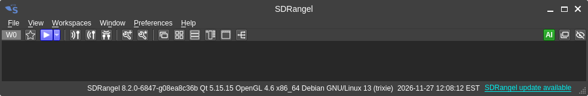

# Release Update Check

This directory contains the optional release update-checking support for SDRangel.

Release checking is designed to support multiple providers. The initial implementation uses GitHub Releases, but additional providers can be added.

The feature checks whether a newer SDRangel release is available and provides an update destination. It does not download or install updates, obtaining and installing updates remains the user's responsibility.



When release checking is enabled and a newer release is available, SDRangel displays an update notification in the status bar. Select the notification to access the action provided by the configured update service.

## Build Configuration

Release checking is disabled by default.

To enable the GitHub release provider, configure SDRangel with:

```bash
-DENABLE_RELEASE_CHECK=GITHUB
```

Currently supported providers:

- `GITHUB`: Checks the latest release published in the `f4exb/sdrangel` GitHub repository.

An empty or missing `ENABLE_RELEASE_CHECK` value disables the feature, as do the standard CMake false constants (`OFF`, `NO`, `FALSE`, `0`). Any other unsupported value causes a CMake configuration error.

Distribution maintainers should leave ENABLE_RELEASE_CHECK unset (disabled) unless they provide their own release update service. Distribution packages should direct users to the distribution's normal update mechanism rather than notifying them about upstream GitHub releases that may not correspond to the version or package they have installed. When a distribution-specific provider is available, it can be integrated through the release update service infrastructure.

When enabled, CMake defines two compile-time macros for `sdrgui`:

- `ENABLE_RELEASE_CHECK`: Release checking is enabled.
- `ENABLE_RELEASE_CHECK_<PROVIDER>` (for example `ENABLE_RELEASE_CHECK_GITHUB`): The selected provider. `createReleaseUpdateService()` uses this macro to choose the provider implementation.

When disabled, the checker and provider implementation sources are not compiled. The `ReleaseUpdateWidget` remains part of the build so that `MainWindow` does not need conditional compilation. In this configuration, the widget is inactive and remains hidden.

The GitHub configuration also links the Qt Network module.

## Architecture

The implementation separates presentation, release-checking policy, and the source of release information.

- `ReleaseUpdateWidget`: Status-bar presentation, notification display, blinking, and user interaction.
- `ReleaseUpdateChecker`: Compares the running version with the latest available version and determines when another check is due.
- `ReleaseUpdateService`: Abstract interface for checking releases and opening an update URL.
- `ReleaseUpdateServiceGitHub`: GitHub implementation using the GitHub Releases API.
- `createReleaseUpdateService()`: Factory, selected at compile time by the provider macro, that creates the configured `ReleaseUpdateService`. It returns `nullptr` when no provider is selected, so the widget stays hidden.

`MainWindow` only creates the `ReleaseUpdateWidget` and adds it to the status bar. It does not manage release-checking logic or communicate directly with the provider.

The GitHub implementation uses `QNetworkAccessManager` for asynchronous HTTP requests. It uses the GitHub [ETag](https://docs.github.com/en/rest/using-the-rest-api/best-practices-for-using-the-rest-api?apiVersion=2026-03-10#use-conditional-requests) response header to avoid downloading release information unnecessarily.

The checker is independent of the release provider. Additional providers can implement `ReleaseUpdateService` without changing the version-comparison and scheduling logic.

## Version Comparison

Versions are compared using `QVersionNumber`.

The running version may include build metadata or a suffix, for example:

```text
8.2.0-6847-g08ea8c36b
```

The checker extracts the three-component version (`8.2.0`) and compares that. If the running version does not match this form, no update is ever reported, and a warning is logged.

Release tags from GitHub must be exactly a three-component version, optionally prefixed with `v` (for example, `8.2.0` or `v8.2.0`). Tags with any other form are rejected as invalid release information.

## Check Scheduling

The checker stores one timestamp, `LastCheckTime`: the time of the last successful release check.

The normal check interval is 24 hours, and the checker evaluates whether a check is due once an hour. Repeated evaluations do not cause additional network requests while a check is already in progress.

A failed attempt does not update `LastCheckTime`. The provider may supply a retry delay with the failure (for example, derived from GitHub rate-limit headers). Otherwise the checker retries after 6 hours. Provider-supplied delays are clamped to between 1 minute and 24 hours, because they come from untrusted network data.

If the running version is newer than the cached release version, the checker requests an immediate validation check, subject to the retry delay following a previous failure and a 10 second startup delay (as not interfer with loading plugins). This is expected right after the user upgrades, or when running a development build, because the cache still holds the previous release until the next check completes. It is also a convenient way to test the check path.

## Settings and Cache

Settings are stored using `QSettings`.

Common scheduling state:

```text
General/ReleaseCheck/
    LastCheckTime
```

GitHub-specific cached release information:

```text
General/ReleaseCheck/GitHub/
    LatestVersion
    UpdateUrl
    ETag
```

The GitHub cache is used to display the latest known release without waiting for a network request. Conditional requests use the cached ETag. A successful HTTP 304 response confirms that the cached release information is still current.

## Design Responsibilities

Responsibilities should remain separated:

- `ReleaseUpdateServiceGitHub` owns provider-specific release information, including the version, URL, ETag, and cached metadata. It emits `releaseAvailable()` when release information is available.
- `ReleaseUpdateChecker` owns policy: comparing the running version with the reported release, deciding when to check, and determining whether an update is available.
- `ReleaseUpdateWidget` owns presentation: displaying the update notification, handling its visual state, and forwarding user interaction to the checker.
- `MainWindow` owns application-level integration by adding the widget to the status bar.

The provider should not implement UI behavior or directly interact with `MainWindow`.

## Adding Another Release Provider

To add a release provider:

1. Add a branch for the provider name in `sdrgui/CMakeLists.txt`: add its sources and headers, define `ENABLE_RELEASE_CHECK_<NAME>`, and link any extra libraries it needs.
2. Implement a subclass of `ReleaseUpdateService`.
3. Implement `checkForUpdate()` to retrieve release information.
4. Implement `openUpdate()` to open the release page.
5. Implement `updateNotificationText()` to provide the provider's translated notification text.
6. Emit `checkCompleted()` when a check succeeds, then `releaseAvailable()`. The order matters: the checker records the successful check on `checkCompleted()` and evaluates the release on `releaseAvailable()`.
7. Emit `checkFailed()` when a check cannot be completed. Optionally pass a retry delay in seconds.
8. Add the provider to `createReleaseUpdateService()` under its `ENABLE_RELEASE_CHECK_<NAME>` macro.

The provider is responsible for retrieving and validating release information. It owns any provider-specific cache, authentication, request headers, response handling, and network details.

The common `ReleaseUpdateChecker` is responsible for comparing versions, determining update availability, and scheduling subsequent checks. Provider implementations should not duplicate this logic.

## Provider Signals

| Signal | Meaning |
|---|---|
| `releaseAvailable(ReleaseInfo)` | Valid release information is available, either from cache or a successful retrieval. |
| `checkCompleted()` | The requested check completed successfully. Emit before `releaseAvailable()` when the check provides new information. |
| `checkFailed(error, retryDelaySeconds, level)` | The requested check failed. `retryDelaySeconds` is optional; the default (-1) lets the checker choose. `level` is also optional, and controls QtDebugMsg or QtWarningMsg|

One important distinction: `releaseAvailable()` does not necessarily mean an update is available. It means the provider has release information. The checker determines whether that release is newer than the running version.

Each requested check must eventually emit exactly one of `checkCompleted()` or `checkFailed()`.

`checkCompleted()` should not be emitted just because a network request returned HTTP 200. The response must contain usable release information. A valid HTTP 304 is also a successful check when the cached release information is usable.

## Network and Security

The GitHub provider accesses:

[https://api.github.com/repos/f4exb/sdrangel/releases/latest](https://api.github.com/repos/f4exb/sdrangel/releases/latest)

Following GitHub's API guidance, redirects are followed, but never downgraded from HTTPS. The version and URL used by the application come from the validated JSON body of the response, not from where it was fetched.

Network failures and invalid release responses do not replace the existing cached release information. A failed check does not update `LastCheckTime`.

Each release provider is responsible for validating all data received from its network source before using or storing it. This includes checking response formats, version strings, URLs, headers, and any other values used by the application. Network responses must be treated as untrusted input, even when they come from a well-known service. Providers must reject malformed, unexpected, or otherwise invalid data and must not assume that a response is legitimate simply because it comes from the configured endpoint.

Requests time out after 30 seconds, and responses larger than 1 MiB are discarded. HTTP 403 and 429 responses that indicate rate limiting are reported as failures with a retry delay derived from the `X-RateLimit-Reset` or `Retry-After` headers.

Release URLs must be HTTPS github.com release-tag pages. URLs with credentials, unexpected ports, queries or fragments are rejected. The owner and repository name are not pinned, so repository renames and transfers (future redirects) keep working.

## User Interaction

When an update is available, the application displays a notification in the status bar. The notification blinks to attract attention. Selecting it opens the corresponding action (for github service, opens the corresponding GitHub release page in the user's browser). The application does not automatically download or install the release.

The user remains responsible for obtaining and installing the update through the appropriate distribution or installation method.
